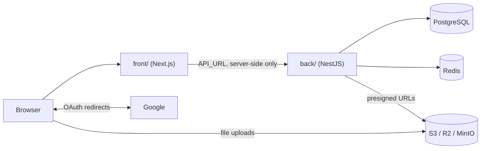

# Practice App

A small language-school app. Teachers manage their students, the students' language courses and course documents; students see their own courses. Sign-in is Google-only; a new account picks its role (teacher or student) once, during onboarding.

**Live:** https://practice-app-lime.vercel.app (API: https://practice-app-dsmb.onrender.com)

## Features

- **Sign in with Google**. The first sign-in creates your account.
- **Onboarding**: new users confirm their name and pick a role, teacher or student, once. Students can also add their birth date, job and hobbies.
- **Teachers** add students, edit them, and create a language course for each student, with levels, goals, skills and private notes.
- **Students** see their own courses and edit their profile.
- **Course documents**: upload files or add links to a course, open or delete them.

## Repository

| Folder | App | Stack |
| --- | --- | --- |
| [`front/`](front) | Web app | Next.js 16, React 19, Tailwind 4, react-hook-form + zod |
| [`back/`](back) | REST API | NestJS 11, Drizzle ORM + PostgreSQL, BullMQ + Redis, S3-compatible storage |



The browser only talks to the Next.js app (plus direct file uploads to storage); the Next server calls the backend, so session cookies stay on the frontend's domain.

## Run Locally

Requirements: Node.js, npm, Docker.

**Backend** (http://localhost:3005):

```bash
cd back
npm install
# create back/.env — every variable is described in back/docs/setup/env.md
docker compose up -d        # PostgreSQL, Redis, MinIO
npm run db:migrate
npm run start:dev
```

**Frontend** (http://localhost:3000):

```bash
cd front
npm install
cp .env.example .env        # API_URL=http://localhost:3005
npm run dev
```

Google sign-in needs `GOOGLE_OAUTH_*` values in `back/.env` and `http://localhost:3005/auth/google/callback` registered as a redirect URI in Google Cloud Console.

## Deployment

| Part | Host |
| --- | --- |
| Frontend | Vercel (root directory `front`) |
| Backend + Redis | Render |
| PostgreSQL | Neon |
| Files | Cloudflare R2 |

Pushing to `master` deploys both apps. Details: [back/docs/setup/deployment.md](back/docs/setup/deployment.md) and [front/src/docs/architecture/deployment.md](front/src/docs/architecture/deployment.md).

## Contributing

- Work on a feature branch and open a pull request. A pre-push hook blocks pushes to `main`/`master`; enable it once per clone with `git config core.hooksPath .githooks`.
- Checks before a PR — backend: `npm run build`, `npm run lint`; frontend: `npm run lint`, `npx tsc --noEmit`, `npm run build`.

## Documentation

- Backend: [`back/docs/`](back/docs) — setup and env, auth (Google OAuth, sessions), database, error handling, queues and storage, students.
- Frontend: [`front/src/docs/`](front/src/docs) — architecture (API requests, role access, structure, design system), onboarding, students.
- AI assistant rules: `CLAUDE.md` / `AGENTS.md` here and in each app.
