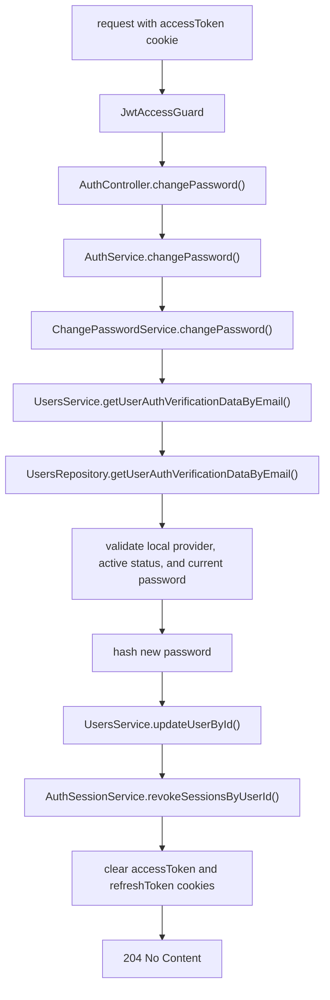

# Change Password Endpoint

The auth module lets an authenticated local user replace their password.

## Route

```txt
POST /auth/change-password
```

The endpoint returns `204 No Content`.

## Request Body

```ts
{
  currentPassword: string;
  newPassword: string;
}
```

## Flow


