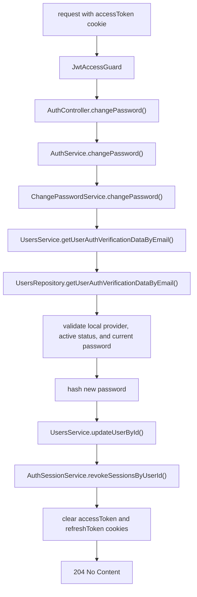

# Change Password Endpoint

The auth module lets an authenticated local user replace their password.

## Route

```txt
POST /auth/change-password
```

The endpoint returns `204 No Content`.

## Request Body

```ts
{
  currentPassword: string;
  newPassword: string;
}
```

## Flow



## Behavior

- Requires a valid `accessToken` cookie.
- Accepts only local active users with an existing password hash.
- Requires `currentPassword` and `newPassword` to have at least 8 characters.
- Rejects equal `currentPassword` and `newPassword` values.
- Rejects missing users, non-local users, inactive users, and wrong current passwords with `INVALID_CREDENTIALS`.
- Hashes the new password before storing it.
- Revokes all active refresh sessions for the user.
- Clears the current response auth cookies, so the user must sign in again.

## Implementation Files

- `src/modules/auth/controllers/auth.controller.ts`
- `src/modules/auth/dto/change-password.dto.ts`
- `src/modules/auth/services/change-password.service.ts`
- `src/modules/auth/services/auth.service.ts`
- `src/modules/auth/services/auth-session.service.ts`
- `src/modules/users/services/users.service.ts`
- `src/modules/users/repositories/users.repository.ts`
