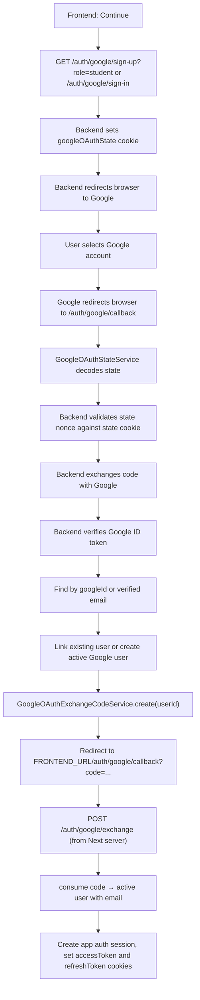

# Google OAuth Flow

```txt
Next.js button
-> browser navigates to backend /auth/google/sign-in or /auth/google/sign-up
-> backend redirects browser to Google
-> Google redirects browser to backend /auth/google/callback
-> backend creates/links user and stores a one-time exchange code (Redis, 60 s, hashed)
-> backend redirects browser to Next.js /auth/google/callback?code=...
-> Next.js calls POST /auth/google/exchange { code } server-to-server
-> backend creates the session and sets auth cookies on that response; Next.js re-sets them on its own domain

Why: in production the frontend and backend are on different sites, so cookies set on the
backend's domain would never reach the Next server. The code is single-use (GETDEL).
```

## Endpoints

```txt
GET /auth/google/sign-in
GET /auth/google/sign-up?role=teacher|student
GET /auth/google/callback
```

Use the sign-in endpoint for existing accounts and the sign-up endpoint when a new Google user may need to be created. Do not call `GET /auth/google/callback` manually; Google calls it after the user approves or rejects access.

Do not test these endpoints with Swagger `Try it out`. Swagger uses browser `fetch`, but OAuth requires full browser navigation across the backend and Google. Test by pasting the start URL into the browser address bar or by clicking the real frontend button.

## Frontend Entry Point

When the user clicks "Continue" on sign-in, redirect the browser without a role:

```ts
window.location.href = `${API_URL}/auth/google/sign-in`;
```

When the user clicks "Continue" on sign-up, redirect the browser with the selected role:

```ts
window.location.href = `${API_URL}/auth/google/sign-up?role=student`;
```

The `role` query is required only for sign-up because new users need an app role. If the Google account is linked to an existing user, the existing role stays unchanged.

Do not use `fetch()` here:

```ts
await fetch(`${API_URL}/auth/google/sign-up?role=student`);
```

That will not correctly run the OAuth flow because Google sign-in is a browser redirect flow, not a JSON API call.

## Generated Google URL

The backend uses `google-auth-library` to generate a Google authorization URL. It looks like this:

```txt
https://accounts.google.com/o/oauth2/v2/auth
  ?access_type=online
  &include_granted_scopes=true
  &prompt=select_account
  &scope=openid%20email%20profile
  &state=eyJub25jZSI6Ij...Iiwicm9sZSI6InN0dWRlbnQifQ
  &response_type=code
  &client_id=GOOGLE_OAUTH_CLIENT_ID
  &redirect_uri=http%3A%2F%2Flocalhost%3A3005%2Fauth%2Fgoogle%2Fcallback
```

Important fields:

- `client_id`: Google OAuth client id from `GOOGLE_OAUTH_CLIENT_ID`.
- `redirect_uri`: backend callback from `GOOGLE_OAUTH_REDIRECT_URI`.
- `scope`: Google identity fields requested by the backend.
- `state`: backend-created opaque value that Google preserves and returns.
- `response_type=code`: tells Google to return an authorization code.

Google later redirects back to the backend callback with a URL like:

```txt
http://localhost:3005/auth/google/callback
  ?state=...
  &iss=https://accounts.google.com
  &code=...
  &scope=email+profile+openid
  &authuser=0
  &prompt=consent
```

## Full Flow



## State And Nonce

OAuth `state` is for callback integrity. It lets the backend verify both that the callback belongs to a login flow started by the same browser, and that the state's contents (`flow`, `role`) were not altered in between.

The backend creates two related values:

```txt
stateNonce = random URL-safe string
sign-in payload = base64url(JSON.stringify({ nonce: stateNonce, flow: "sign-in" }))
sign-up payload = base64url(JSON.stringify({ nonce: stateNonce, flow: "sign-up", role }))
state          = `${payload}.${hmacSha256(payload, GOOGLE_OAUTH_STATE_SECRET)}`
```

They are used differently:

```txt
stateNonce -> saved in httpOnly googleOAuthState cookie
state      -> sent to Google in the authorization URL (payload + HMAC signature)
```

Google does not understand the contents of `state`. From Google's point of view, it is just an opaque string. Google preserves it and sends it back to the callback unchanged.

The `state` value is base64, not encryption: its contents are readable by anyone who inspects the redirect URL. The HMAC signature does not hide `flow`/`role` — it proves they were not changed after the backend issued them. A client can decode and read the payload, but cannot produce a new valid signature for an edited payload without `GOOGLE_OAUTH_STATE_SECRET`.

On callback, the backend receives:

```txt
state      -> from Google callback query string
stateNonce -> from the browser's googleOAuthState cookie
```

`GoogleOAuthStateDecoderService` first verifies the HMAC signature over the payload with `timingSafeEqual`; a missing or mismatched signature is rejected before the payload is even parsed. Only then does it decode and compare:

```txt
decodedState.nonce === googleOAuthState cookie value
```

If the signature is invalid, or the nonces do not match, the callback is rejected with `INVALID_GOOGLE_OAUTH_STATE`. The signature check and the nonce check protect different things: the signature proves `flow`/`role` were not tampered with, while the nonce-vs-cookie match proves the callback belongs to this specific, still-fresh browser flow (it expires with the 10-minute cookie).

The `role` is included in sign-up state because the user chooses the app role before leaving for Google:

```txt
/auth/google/sign-up?role=student
```

Google sign-in state does not include `role`. Google sign-up state carries it so the backend can recover the selected role when Google redirects back. Existing users keep their stored role; the state role is only used when creating a new user.

## State Encoding

`GoogleOAuthService` delegates OAuth state handling to `GoogleOAuthStateService`.
The state facade has two focused collaborators:

- `GoogleOAuthStateEncoderService`: serializes state to base64url JSON, then appends an HMAC-SHA256 signature computed with `GOOGLE_OAUTH_STATE_SECRET`.
- `GoogleOAuthStateDecoderService`: verifies the HMAC signature first, then parses and validates the decoded state from the callback.

The state object is not sent to Google as raw JSON. It is encoded and signed first:

```txt
object -> JSON text -> base64url payload -> `${payload}.${hmacSignature}`
```

Example:

```json
{"nonce":"abc123","flow":"sign-up","role":"student"}
```

becomes a signed, URL-safe string like:

```txt
eyJub25jZSI6ImFiYzEyMyIsInJvbGUiOiJzdHVkZW50In0.kY3f...9aQ
```

On callback, the backend reverses this:

```txt
split "payload.signature" -> verify HMAC signature (timingSafeEqual) -> base64url string -> UTF-8 JSON text -> object
```

`utf8` is the text encoding used after base64url decoding. `JSON.parse()` is what turns that text into an object. If the signature segment is missing or does not match, decoding stops before `JSON.parse()` runs and the state is treated as invalid.

## User Linking Rules

The backend uses these rules:

1. If a user exists with the same `googleId`, update that user's Google profile fields and sign in.
2. If no `googleId` match exists, look up by Google email.
3. Email linking is allowed only after Google confirms `email_verified`.
4. If the email user has no `googleId`, attach the Google ID, update name/avatar, activate the user, and sign in.
5. If the email user already has another `googleId`, reject with `GOOGLE_ACCOUNT_CONFLICT`.
6. If the email user is a `managed` student (created by a teacher), reject with `USER_WITH_EMAIL_ALREADY_EXISTS`. Managed students can only be claimed through a future invite flow.
7. In the sign-up flow, if no user exists, create an active user with `authProvider = google`, the requested role, Google ID, name, email, and avatar URL.
8. In the sign-in flow, if no user exists, reject the request because no role was supplied for account creation.

Linked local users keep `authProvider = local`, so password login can still work. Google login is enabled by the stored `googleId`.

Every create, link or profile update above also makes sure a teacher user has a `teachers` row, in the same transaction (`UsersRepository.ensureRoleProfile()`).
