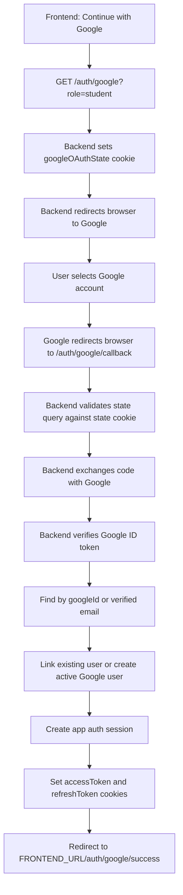

# Google OAuth Flow

The Google OAuth flow is browser-redirect based. The frontend does not exchange Google codes itself. It sends the browser to the backend start endpoint, Google redirects back to the backend callback endpoint, and the backend sets the same `accessToken` and `refreshToken` cookies used by the email auth flow.

## Endpoints

```txt
GET /auth/google?role=teacher|student
GET /auth/google/callback
```

Use `GET /auth/google` from the frontend. Do not call `GET /auth/google/callback` manually; Google calls it after the user approves or rejects access.

## Frontend Entry Point

When the user clicks "Continue with Google", redirect the browser:

```ts
window.location.href = `${API_URL}/auth/google?role=student`;
```

The `role` query is required because new users need an app role. If the Google account is linked to an existing user, the existing role stays unchanged.

## Full Flow



## What Each Endpoint Does

### `GET /auth/google?role=teacher|student`

Purpose:

- Starts Google OAuth.
- Requires `role` for possible new user creation.
- Generates an opaque OAuth `state` value.
- Stores the state nonce in an `httpOnly` cookie named `googleOAuthState`.
- Redirects the browser to Google.

Response:

- `302 Found` redirect to Google.

Validation:

- `role` must be `teacher` or `student`.

Side effects:

- Sets `googleOAuthState` cookie for 10 minutes.

### `GET /auth/google/callback`

Purpose:

- Handles Google's redirect back to the backend.
- Validates the returned `state` against the `googleOAuthState` cookie.
- Exchanges Google's `code` for tokens through `google-auth-library`.
- Verifies the Google ID token audience against `GOOGLE_OAUTH_CLIENT_ID`.
- Requires Google `email_verified` to be true.
- Finds or creates the app user.
- Creates app access and refresh tokens.
- Sets auth cookies.
- Redirects to the frontend success route.

Response on success:

- `302 Found` redirect to:

```txt
{FRONTEND_URL}/auth/google/success
```

Response on failure:

- JSON HTTP error from the backend exception filter.

Expected errors:

```txt
INVALID_GOOGLE_OAUTH_STATE
INVALID_GOOGLE_OAUTH_CODE
GOOGLE_EMAIL_NOT_VERIFIED
GOOGLE_ACCOUNT_CONFLICT
```

Side effects:

- Clears `googleOAuthState`.
- Sets `accessToken` and `refreshToken` cookies on success.

## User Linking Rules

The backend uses these rules:

1. If a user exists with the same `googleId`, update that user's Google profile fields and sign in.
2. If no `googleId` match exists, look up by Google email.
3. Email linking is allowed only after Google confirms `email_verified`.
4. If the email user has no `googleId`, attach the Google ID, update name/avatar, activate the user, and sign in.
5. If the email user already has another `googleId`, reject with `GOOGLE_ACCOUNT_CONFLICT`.
6. If no user exists, create an active user with `authProvider = google`, the requested role, Google ID, name, email, and avatar URL.

Linked local users keep `authProvider = local`, so password login can still work. Google login is enabled by the stored `googleId`.

## Cookies

The backend uses three cookies during this flow:

```txt
googleOAuthState
accessToken
refreshToken
```

`googleOAuthState` is temporary and is cleared by the callback.

`accessToken` and `refreshToken` are the same auth cookies used by:

```txt
POST /auth/verify-signup
POST /auth/verify-signin
POST /auth/refresh
POST /auth/logout
```

Cookie options:

- `httpOnly: true`
- `sameSite: lax`
- `secure: true` only when `NODE_ENV=production`

## Next.js Integration

Yes, this setup works with Next.js if the frontend starts the flow with browser navigation.

Recommended client-side button:

```tsx
'use client';

export function GoogleButton({ role }: { role: 'teacher' | 'student' }) {
  const apiUrl = process.env.NEXT_PUBLIC_API_URL;

  return (
    <button
      type="button"
      onClick={() => {
        window.location.href = `${apiUrl}/auth/google?role=${role}`;
      }}
    >
      Continue with Google
    </button>
  );
}
```

Do not use `fetch('/auth/google')` for the start endpoint. OAuth needs full browser navigation so Google can show its account/consent page and then redirect back.

Create a frontend route for the success redirect:

```txt
/auth/google/success
```

That page can call the backend current-user endpoint to load the signed-in user:

```ts
await fetch(`${process.env.NEXT_PUBLIC_API_URL}/users/me`, {
  credentials: 'include',
});
```

For local development, this works when:

- `FRONTEND_URL=http://localhost:3000`
- backend CORS allows `FRONTEND_URL`
- frontend requests use `credentials: 'include'`
- Google OAuth redirect URI points to the backend callback, for example:

```txt
http://localhost:3005/auth/google/callback
```

For production, use HTTPS for both frontend and backend. With cross-site frontend/backend domains, verify cookie behavior carefully; `sameSite: lax` works for top-level OAuth redirects, but normal cross-origin API requests may require domain and SameSite adjustments depending on deployment domains.

## Required Environment

```env
FRONTEND_URL=http://localhost:3000
GOOGLE_OAUTH_CLIENT_ID=
GOOGLE_OAUTH_CLIENT_SECRET=
GOOGLE_OAUTH_REDIRECT_URI=http://localhost:3005/auth/google/callback
```

## Implementation Files

- `src/modules/auth/controllers/auth.controller.ts`
- `src/modules/auth/services/google-oauth.service.ts`
- `src/modules/auth/configs/o-uath-configs.ts`
- `src/modules/auth/dto/google-oauth.dto.ts`
- `src/modules/auth/types/google-oauth.type.ts`
- `src/modules/users/repositories/users.repository.ts`
- `src/modules/users/schemas/schema.ts`
