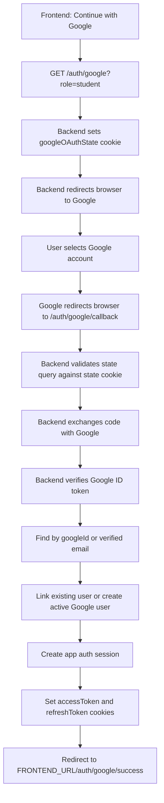

# Google OAuth Flow

The Google OAuth flow is browser-redirect based. The frontend does not exchange Google codes itself. It sends the browser to the backend start endpoint, Google redirects back to the backend callback endpoint, and the backend sets the same `accessToken` and `refreshToken` cookies used by the email auth flow.

Short version:

```txt
Next.js button
-> browser navigates to backend /auth/google
-> backend redirects browser to Google
-> Google redirects browser to backend /auth/google/callback
-> backend creates/links user and sets app auth cookies
-> backend redirects browser to Next.js success page
```

## Endpoints

```txt
GET /auth/google?role=teacher|student
GET /auth/google/callback
```

Use `GET /auth/google` from the frontend. Do not call `GET /auth/google/callback` manually; Google calls it after the user approves or rejects access.

Do not test these endpoints with Swagger `Try it out`. Swagger uses browser `fetch`, but OAuth requires full browser navigation across the backend and Google. Test by pasting the start URL into the browser address bar or by clicking the real frontend button.

## Frontend Entry Point

When the user clicks "Continue with Google", redirect the browser:

```ts
window.location.href = `${API_URL}/auth/google?role=student`;
```

The `role` query is required because new users need an app role. If the Google account is linked to an existing user, the existing role stays unchanged.

Do not use `fetch()` here:

```ts
await fetch(`${API_URL}/auth/google?role=student`);
```

That will not correctly run the OAuth flow because Google sign-in is a browser redirect flow, not a JSON API call.

## Generated Google URL

The backend uses `google-auth-library` to generate a Google authorization URL. It looks like this:

```txt
https://accounts.google.com/o/oauth2/v2/auth
  ?access_type=online
  &include_granted_scopes=true
  &prompt=select_account
  &scope=openid%20email%20profile
  &state=eyJub25jZSI6Ij...Iiwicm9sZSI6InN0dWRlbnQifQ
  &response_type=code
  &client_id=GOOGLE_OAUTH_CLIENT_ID
  &redirect_uri=http%3A%2F%2Flocalhost%3A3005%2Fauth%2Fgoogle%2Fcallback
```

Important fields:

- `client_id`: Google OAuth client id from `GOOGLE_OAUTH_CLIENT_ID`.
- `redirect_uri`: backend callback from `GOOGLE_OAUTH_REDIRECT_URI`.
- `scope`: Google identity fields requested by the backend.
- `state`: backend-created opaque value that Google preserves and returns.
- `response_type=code`: tells Google to return an authorization code.

Google later redirects back to the backend callback with a URL like:

```txt
http://localhost:3005/auth/google/callback
  ?state=...
  &iss=https://accounts.google.com
  &code=...
  &scope=email+profile+openid
  &authuser=0
  &prompt=consent
```

## Full Flow



## What Each Endpoint Does

### `GET /auth/google?role=teacher|student`

Purpose:

- Starts Google OAuth.
- Requires `role` for possible new user creation.
- Generates an opaque OAuth `state` value.
- Stores the state nonce in an `httpOnly` cookie named `googleOAuthState`.
- Redirects the browser to Google.

Response:

- `302 Found` redirect to Google.

Validation:

- `role` must be `teacher` or `student`.

Side effects:

- Sets `googleOAuthState` cookie for 10 minutes.

### `GET /auth/google/callback`

Purpose:

- Handles Google's redirect back to the backend.
- Validates the returned `state` against the `googleOAuthState` cookie.
- Exchanges Google's `code` for tokens through `google-auth-library`.
- Verifies the Google ID token audience against `GOOGLE_OAUTH_CLIENT_ID`.
- Requires Google `email_verified` to be true.
- Finds or creates the app user.
- Creates app access and refresh tokens.
- Sets auth cookies.
- Redirects to the frontend success route.

Response on success:

- `302 Found` redirect to:

```txt
{FRONTEND_URL}/auth/google/success
```

Response on failure:

- JSON HTTP error from the backend exception filter.

Expected errors:

```txt
INVALID_GOOGLE_OAUTH_STATE
INVALID_GOOGLE_OAUTH_CODE
GOOGLE_EMAIL_NOT_VERIFIED
GOOGLE_ACCOUNT_CONFLICT
```

Side effects:

- Clears `googleOAuthState`.
- Sets `accessToken` and `refreshToken` cookies on success.

## State And Nonce

OAuth `state` is for callback integrity. It lets the backend verify that the callback belongs to a login flow started by the same browser.

The backend creates two related values:

```txt
stateNonce = random URL-safe string
state = base64url(JSON.stringify({ nonce: stateNonce, role }))
```

They are used differently:

```txt
stateNonce -> saved in httpOnly googleOAuthState cookie
state      -> sent to Google in the authorization URL
```

Google does not understand the contents of `state`. From Google's point of view, it is just an opaque string. Google preserves it and sends it back to the callback unchanged.

On callback, the backend receives:

```txt
state      -> from Google callback query string
stateNonce -> from the browser's googleOAuthState cookie
```

Then it decodes and compares:

```txt
decodedState.nonce === googleOAuthState cookie value
```

If they do not match, the callback is rejected with `INVALID_GOOGLE_OAUTH_STATE`.

The `role` is included in `state` because the user chooses the app role before leaving for Google:

```txt
/auth/google?role=student
```

Google will not know or store the app role by itself. Carrying it in `state` lets the backend recover the selected role when Google redirects back. Existing users keep their stored role; the state role is only used when creating a new user.

## State Encoding

The state object is not sent to Google as raw JSON. It is encoded first:

```txt
object -> JSON text -> base64url string
```

Example:

```json
{"nonce":"abc123","role":"student"}
```

becomes a URL-safe string like:

```txt
eyJub25jZSI6ImFiYzEyMyIsInJvbGUiOiJzdHVkZW50In0
```

On callback, the backend reverses this:

```txt
base64url string -> UTF-8 JSON text -> object
```

`utf8` is the text encoding used after base64url decoding. `JSON.parse()` is what turns that text into an object.

## User Linking Rules

The backend uses these rules:

1. If a user exists with the same `googleId`, update that user's Google profile fields and sign in.
2. If no `googleId` match exists, look up by Google email.
3. Email linking is allowed only after Google confirms `email_verified`.
4. If the email user has no `googleId`, attach the Google ID, update name/avatar, activate the user, and sign in.
5. If the email user already has another `googleId`, reject with `GOOGLE_ACCOUNT_CONFLICT`.
6. If no user exists, create an active user with `authProvider = google`, the requested role, Google ID, name, email, and avatar URL.

Linked local users keep `authProvider = local`, so password login can still work. Google login is enabled by the stored `googleId`.

## Database Reads And Writes

The Google flow uses narrow user repository projections:

- Find by Google ID: selects only `id`.
- Find link data by email: selects only `id` and `googleId`.
- Create Google user: returns only `id`, `email`, and `role`.
- Update linked/Google user: returns only `id`, `email`, and `role`.

Those three returned fields are enough to create the app access and refresh tokens. Broader user fields are not loaded for the OAuth session creation step.

## Cookies

The backend uses three cookies during this flow:

```txt
googleOAuthState
accessToken
refreshToken
```

`googleOAuthState` is temporary and is cleared by the callback.

`accessToken` and `refreshToken` are the same auth cookies used by:

```txt
POST /auth/verify-signup
POST /auth/verify-signin
POST /auth/refresh
POST /auth/logout
```

Cookie options:

- `httpOnly: true`
- `sameSite: lax`
- `secure: true` only when `NODE_ENV=production`

Because cookies are `httpOnly`, Next.js cannot read token values from JavaScript. That is intentional. Next.js should call backend endpoints with `credentials: 'include'`, and the browser will attach the cookies.

## Next.js Integration

Yes, this setup works with Next.js if the frontend starts the flow with browser navigation.

Recommended client-side button:

```tsx
'use client';

export function GoogleButton({ role }: { role: 'teacher' | 'student' }) {
  const apiUrl = process.env.NEXT_PUBLIC_API_URL;

  return (
    <button
      type="button"
      onClick={() => {
        window.location.href = `${apiUrl}/auth/google?role=${role}`;
      }}
    >
      Continue with Google
    </button>
  );
}
```

Do not use `fetch('/auth/google')` for the start endpoint. OAuth needs full browser navigation so Google can show its account/consent page and then redirect back.

Create a frontend route for the success redirect:

```txt
/auth/google/success
```

That page can call the backend current-user endpoint to load the signed-in user:

```ts
await fetch(`${process.env.NEXT_PUBLIC_API_URL}/users/me`, {
  credentials: 'include',
});
```

For local development, this works when:

- `FRONTEND_URL=http://localhost:3000`
- backend CORS allows `FRONTEND_URL`
- frontend requests use `credentials: 'include'`
- Google OAuth redirect URI points to the backend callback, for example:

```txt
http://localhost:3005/auth/google/callback
```

For production, use HTTPS for both frontend and backend. With cross-site frontend/backend domains, verify cookie behavior carefully; `sameSite: lax` works for top-level OAuth redirects, but normal cross-origin API requests may require domain and SameSite adjustments depending on deployment domains.

## Swagger Testing

Swagger can document the Google OAuth endpoints, but it is not the right tool to execute the full flow.

Do not use Swagger `Try it out` for:

```txt
GET /auth/google
GET /auth/google/callback
```

Why:

- `GET /auth/google` returns a `302` redirect to Google.
- Swagger executes requests with browser `fetch`.
- Browser `fetch` cannot complete the Google OAuth redirect flow because Google does not allow that cross-origin fetch through CORS.
- `GET /auth/google/callback` needs the temporary `googleOAuthState` cookie and a real one-time Google `code`; manually pasting old callback URLs will usually fail.

Correct test method:

```txt
http://localhost:3005/auth/google?role=student
```

Open that URL in the browser address bar, or trigger it from the frontend button.

## Troubleshooting

### Swagger shows "Failed to fetch"

Expected for this flow. Use browser navigation instead of Swagger `Try it out`.

### Callback fails with "property iss should not exist"

Google may include:

```txt
iss=https://accounts.google.com
```

The callback DTO must whitelist this optional query field because the app uses `forbidNonWhitelisted: true`.

### Callback fails after database write

Check whether migrations were applied:

```bash
npm run db:migrate
```

The Google flow writes `users.avatar_url`. If the database does not have that column yet, user create/update can fail.

### Callback state is invalid

Common causes:

- The callback URL was pasted manually without the original browser cookie.
- The OAuth flow took longer than the state cookie lifetime.
- Cookies are blocked by the browser.
- The backend host used to start the flow differs from the backend host used in the callback URI.

### User is created with the wrong role

The role comes from the original start URL:

```txt
/auth/google?role=student
```

Existing users keep their current database role. The role query only affects new Google user creation.

### Next.js cannot load `/users/me` after success

Use credentials:

```ts
await fetch(`${process.env.NEXT_PUBLIC_API_URL}/users/me`, {
  credentials: 'include',
});
```

Also verify:

- `FRONTEND_URL` matches the Next.js origin.
- CORS has `credentials: true`.
- Browser devtools show `accessToken` and `refreshToken` cookies after callback.

## Required Environment

```env
FRONTEND_URL=http://localhost:3000
GOOGLE_OAUTH_CLIENT_ID=
GOOGLE_OAUTH_CLIENT_SECRET=
GOOGLE_OAUTH_REDIRECT_URI=http://localhost:3005/auth/google/callback
```

## Implementation Files

- `src/modules/auth/controllers/auth.controller.ts`
- `src/modules/auth/services/google-oauth.service.ts`
- `src/modules/auth/configs/o-uath-configs.ts`
- `src/modules/auth/dto/google-oauth.dto.ts`
- `src/modules/auth/types/google-oauth.type.ts`
- `src/modules/users/repositories/users.repository.ts`
- `src/modules/users/schemas/schema.ts`
