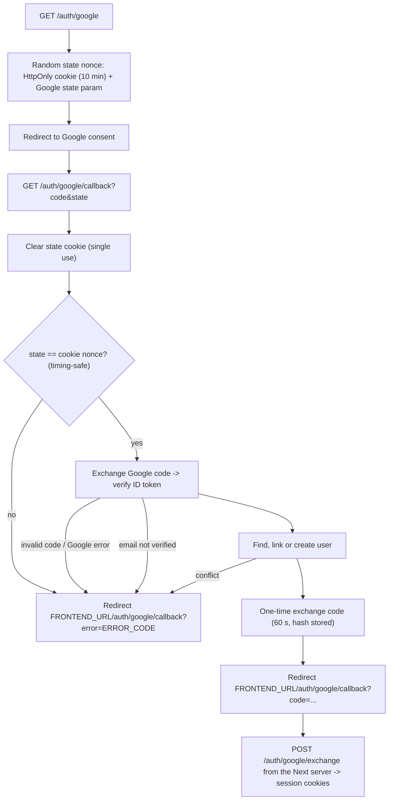

# Google OAuth Flow

Google is the only way to sign in. The first sign-in creates the account with status `onboarding` and no role; the user then completes onboarding (`POST /onboarding`, see `src/modules/onboarding/`).

```txt
browser navigates to backend GET /auth/google
-> backend sets the state cookie and redirects to Google
-> Google redirects browser to backend GET /auth/google/callback
-> backend links or creates the user
-> backend redirects browser to FRONTEND_URL/auth/google/callback?code=...   (success)
                                 or FRONTEND_URL/auth/google/callback?error=... (failure)
-> Next.js server exchanges the code: POST /auth/google/exchange -> session cookies
```

Start it with a full browser navigation (`window.location.href`), never `fetch`: OAuth is a redirect flow, not a JSON API call. Do not call the callback manually; Google calls it.

## Flow



Entry points: `AuthController.startGoogleOAuth` / `handleGoogleOAuthCallback` / `exchangeGoogleOAuthCode` (`src/modules/auth/controllers/auth.controller.ts`), `GoogleOAuthService` (`src/modules/auth/services/google-oauth.service.ts`).

## State

The state is a random nonce. It goes to Google as `state` and to the browser as an HttpOnly cookie on the backend domain. The callback accepts only when both match, which proves the callback belongs to a login started in this browser within the last 10 minutes (blocks login CSRF). The cookie is cleared before the redirect, so a state cannot be reused.

## Finding the User

1. Look up by Google ID: update the avatar and sign in.
2. Otherwise look up by Google email (lowercased with `normalizeEmail()`):
   - linked to another Google ID -> `GOOGLE_ACCOUNT_CONFLICT`;
   - a `managed` student (created by a teacher) -> `USER_WITH_EMAIL_ALREADY_EXISTS`; managed students can only be claimed through a future invite flow;
   - otherwise link the Google ID and set the user `active`.
3. No user: create one with status `onboarding`, no role, and the Google name, email and avatar.

`onboarding` users can call `/users/me`, refresh and logout (`JwtOnboardingAccessGuard`); every other endpoint answers `403 ONBOARDING_REQUIRED` until onboarding sets the role.

## Errors

The callback never answers with an error body, because the browser is mid-redirect and would be left on a backend JSON page. Failures redirect to the frontend with `?error=<ERROR_CODE>`. Only codes in `authConfig.GOOGLE_OAUTH.FORWARDED_ERROR_CODES` pass through; anything unexpected becomes `INTERNAL_SERVER_ERROR`, so internals never reach the URL. Rejections are logged as warnings with the code only; unexpected failures are logged as errors with the stack.

| Error code | Cause |
| --- | --- |
| `INVALID_GOOGLE_OAUTH_STATE` | state missing, expired or not matching the cookie |
| `INVALID_GOOGLE_OAUTH_CODE` | Google returned an error, or the code/ID token is invalid |
| `GOOGLE_EMAIL_NOT_VERIFIED` | Google email not verified |
| `GOOGLE_ACCOUNT_CONFLICT` | email user already linked to another Google account |
| `USER_WITH_EMAIL_ALREADY_EXISTS` | email belongs to a teacher-created (`managed`) student |
| `GOOGLE_ACCOUNT_NOT_FOUND` | user has no email after linking |
| `INTERNAL_SERVER_ERROR` | anything else (e.g. database down) |

`POST /auth/google/exchange` is a normal JSON endpoint: an unknown, used or expired code answers `400 INVALID_GOOGLE_OAUTH_CODE`. It is rate limited (`authConfig.RATE_LIMIT.SENSITIVE`).
