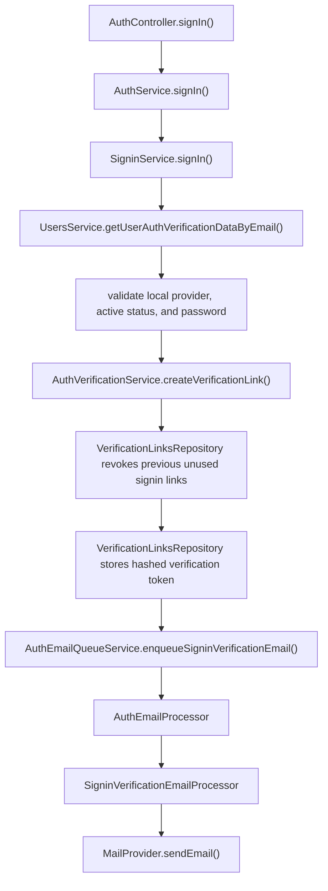
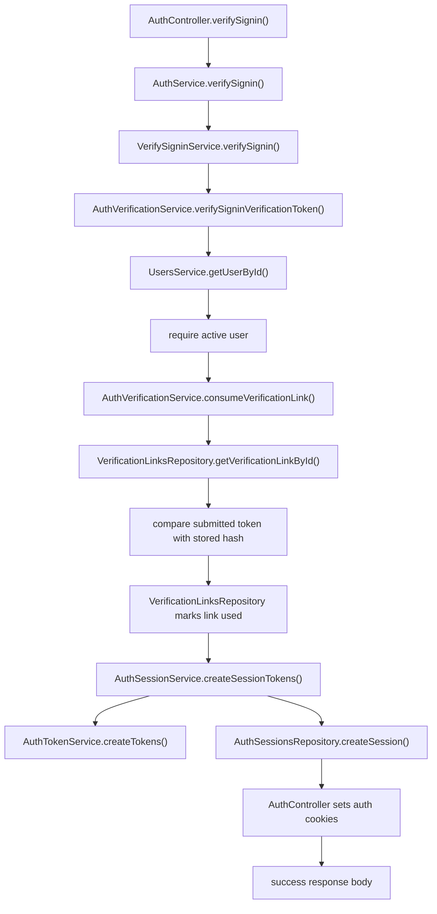
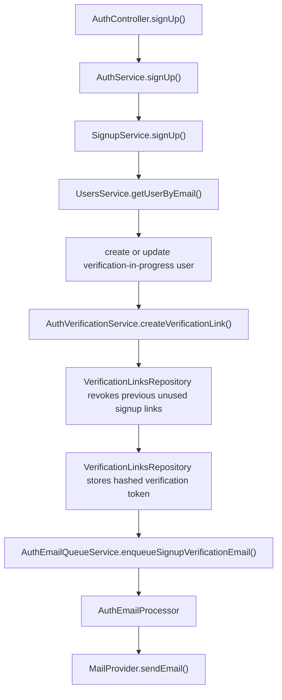
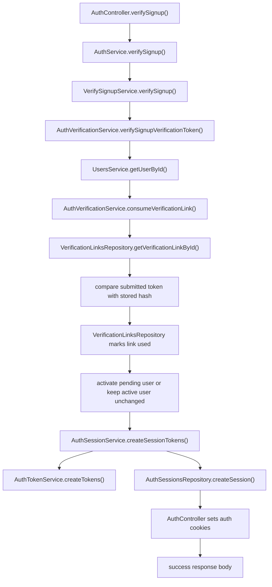
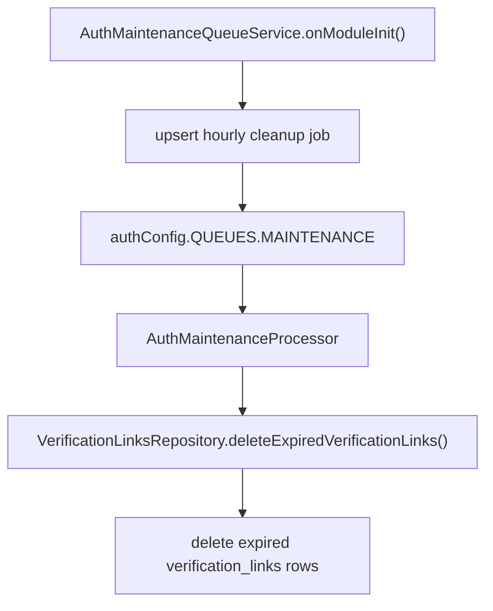

# Auth Email Verification Flows

The auth module owns email verification for sign-in and sign-up.

## Route

```txt
POST /auth/sign-in
POST /auth/verify-signin
POST /auth/sign-up
POST /auth/verify-signup
POST /auth/refresh
POST /auth/logout
```

Sign-in request body:

```ts
{
  email: string;
  password: string;
}
```

Sign-in success response:

```ts
{
  message: string;
  email: string;
}
```

Verify sign-in request body:

```ts
{
  token: string;
}
```

Verify sign-in success response:

```ts
{
  message: string;
}
```

Sign-up request body:

```ts
{
  email: string;
  password: string;
  name: string;
  role: UserRole;
}
```

Sign-up success response:

```ts
{
  message: string;
  email: string;
}
```

Verify sign-up request body:

```ts
{
  token: string;
}
```

Verify sign-up success response:

```ts
{
  message: string;
}
```

`POST /auth/verify-signin` and `POST /auth/verify-signup` set `accessToken` and `refreshToken` cookies. Tokens and user data are not returned in the response body.

`POST /auth/refresh` rotates the refresh session and sets fresh `accessToken` and `refreshToken` cookies. The response body is empty.

`POST /auth/logout` is unguarded and best-effort. It tries to revoke user sessions from valid auth cookies, then clears auth cookies. The response body is empty.

## Sign-In Flow



### Sign-In Behavior

1. `AuthController.signIn()` receives and validates `SignInDto`, which trims and lowercases `email` like `SignUpDto`.

2. `AuthService` delegates the request to `SigninService`.

3. `SigninService` loads auth verification data by email, including `passwordHash`.

4. Sign-in accepts only local active users with a stored password hash and matching password.

5. Missing users, non-local users, inactive users, missing password hashes, and password mismatches all fail with `INVALID_CREDENTIALS`.

6. `AuthVerificationService` creates a JWT sign-in verification token and builds a frontend verification URL:

```txt
{FRONTEND_URL}/verify-signin?token={token}
```

7. The verification token contains a `jti`. `AuthVerificationService` hashes the full token, revokes previous unused sign-in links for the user, and stores the new link in `verification_links`.

8. `AuthEmailQueueService` enqueues a sign-in verification email job on the auth email queue.

9. `AuthEmailProcessor` dispatches the job to `SigninVerificationEmailProcessor`, which renders the sign-in verification email template and sends it through the configured mail provider.

10. The API returns the accepted sign-in response with the user's email.

## Verify Sign-In Flow



### Verify Sign-In Behavior

1. `AuthController.verifySignin()` receives and validates `VerifySigninDto`.

2. `VerifySigninService` verifies the token with `JWT_SIGNUP_VERIFICATION_SECRET` and requires `VERIFY_SIGNIN` purpose.

3. If the token user does not exist or the token email does not match the stored user email, the service throws `INVALID_SIGNIN_VERIFICATION_TOKEN`.

4. If the user is not `active`, verification is rejected with `SIGNIN_VERIFICATION_NOT_ALLOWED`. Sign-in verification does not activate users.

5. `AuthVerificationService.consumeVerificationLink()` loads the `verification_links` row by token `jti`, checks user id, email, purpose, expiry, used state, revoked state, and compares the submitted token against the stored hash.

6. If the link row is missing, expired, used, revoked, mismatched, or the token hash comparison fails, the service throws `INVALID_SIGNIN_VERIFICATION_TOKEN`.

7. A valid sign-in link is marked used before session creation. Reusing the same link later is rejected.

8. `AuthSessionService` creates a session id and asks `AuthTokenService` to create access and refresh JWTs. The refresh JWT contains `sessionId`.

9. `AuthSessionService` hashes the refresh token and `AuthSessionsRepository` stores the session with the refresh expiration.

10. `AuthController` sets `httpOnly` cookies:

```txt
accessToken
refreshToken
```

Cookies use `sameSite: lax`; `secure` is enabled only when `NODE_ENV=production`.

## Sign-Up Flow



### Sign-Up Behavior

1. `AuthController.signUp()` receives and validates `SignUpDto`. The DTO trims and lowercases `email` (`normalizeEmail()`) before validation, so `John@x.com` and `john@x.com` are the same account.

2. `AuthService` delegates the request to `SignupService`.

3. `SignupService` checks whether a user already exists by email.

4. If the existing user is active, the service throws `ConflictException` with `USER_WITH_EMAIL_ALREADY_EXISTS`.

5. If the existing user has `VerificationInProgress` status, the service updates the user's name, role, and password hash.

6. If no user exists, the service creates a local user with `VerificationInProgress` status.

   If the email belongs to an `invited` or `managed` user, the insert hits the unique email constraint and the request fails with a generic `409 DATABASE_UNIQUE_CONSTRAINT`.

7. `AuthVerificationService` creates a JWT signup verification token and builds a frontend verification URL:

```txt
{FRONTEND_URL}/verify-email?token={token}
```

8. The verification token contains a `jti`. `AuthVerificationService` hashes the full token, revokes previous unused sign-up links for the user, and stores the new link in `verification_links`.

9. `AuthEmailQueueService` enqueues a signup verification email job on the auth email queue.

10. `AuthEmailProcessor` renders the signup verification email template and sends it through the configured mail provider.

11. The API returns the accepted signup response with the user's email.

## Verify Sign-Up Flow



### Verify Sign-Up Behavior

1. `AuthController.verifySignup()` receives and validates `VerifySignupDto`.

2. `VerifySignupService` verifies the token with `JWT_SIGNUP_VERIFICATION_SECRET` and requires `VERIFY_SIGNUP` purpose.

3. If the token user does not exist or the token email does not match the stored user email, the service throws `INVALID_SIGNUP_VERIFICATION_TOKEN`.

4. If the user is `invited` or `managed`, verification is rejected with `SIGNUP_VERIFICATION_NOT_ALLOWED`.

5. `AuthVerificationService.consumeVerificationLink()` loads the `verification_links` row by token `jti`, checks user id, email, purpose, expiry, used state, revoked state, and compares the submitted token against the stored hash.

6. If the link row is missing, expired, used, revoked, mismatched, or the token hash comparison fails, the service throws `INVALID_SIGNUP_VERIFICATION_TOKEN`.

7. A valid sign-up link is marked used before account activation and session creation. Reusing the same link later is rejected.

8. If the user is `verification_in_progress`, `UsersService.activateUserById()` sets the status to `active`. For a teacher it also creates the `teachers` row in the same transaction.

9. If the user is already `active`, sign-up verification can succeed only with a currently unused valid link, then creates a fresh session.

10. `AuthSessionService` creates a session id and asks `AuthTokenService` to create access and refresh JWTs. The refresh JWT contains `sessionId`.

11. `AuthSessionService` hashes the refresh token and `AuthSessionsRepository` stores the session with the refresh expiration.

12. `AuthController` sets `httpOnly` cookies:

```txt
accessToken
refreshToken
```

Cookies use `sameSite: lax`; `secure` is enabled only when `NODE_ENV=production`.

## Verification Link Cleanup Flow

