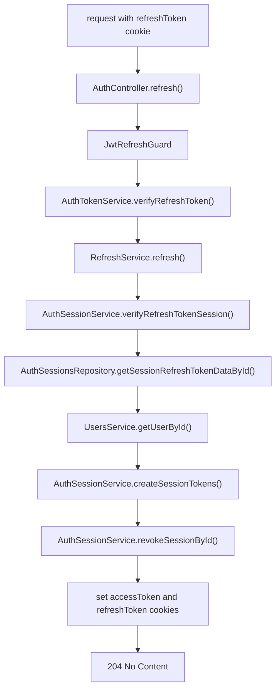
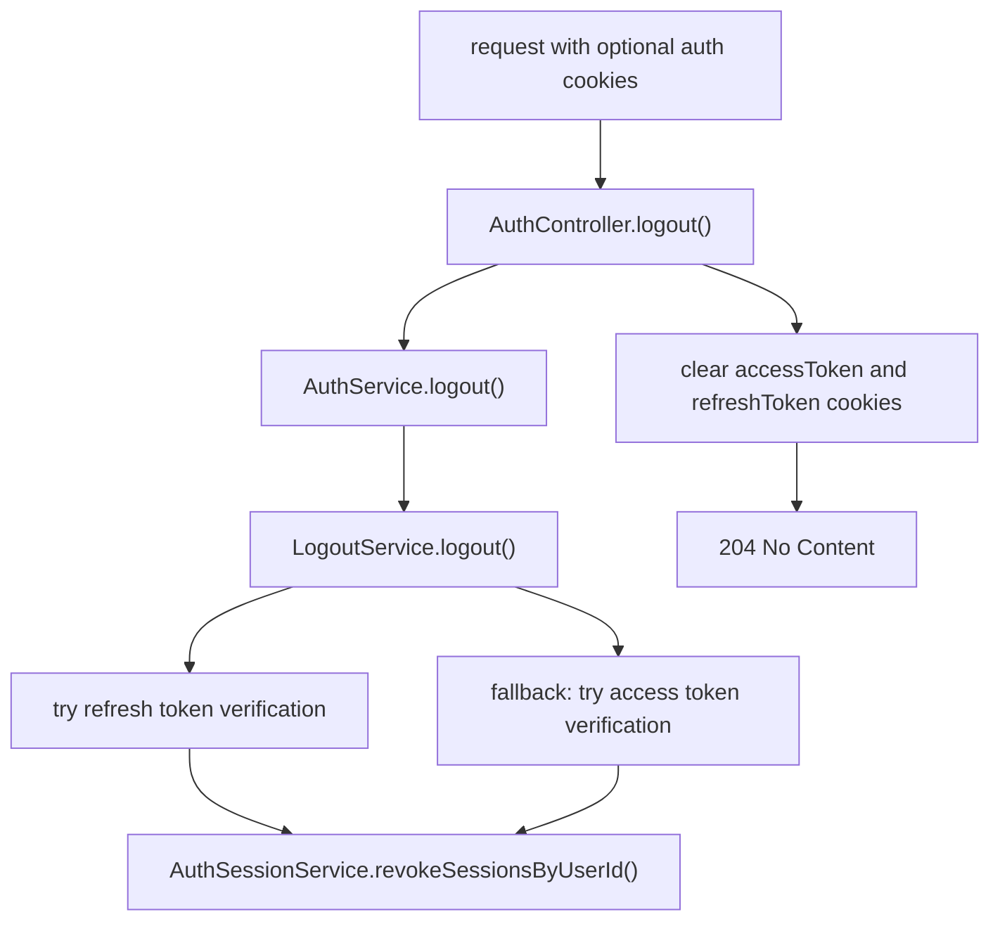

# Auth Session Endpoints

The auth module owns refresh-token sessions and auth cookie lifecycle.

## Routes

```txt
POST /auth/refresh
POST /auth/logout
```

Both endpoints return `204 No Content`.

## Refresh



Important behavior:

- Requires a valid `refreshToken` cookie.
- Validates the refresh JWT and matching stored refresh-token hash.
- Rejects expired, revoked, mismatched, or missing sessions with `INVALID_REFRESH_TOKEN`.
- Requires the user to exist and have `active` status.
- Creates a new session/token pair and revokes the previous session with `replacedBy`.
- Treats reuse of an already revoked refresh session as replay and revokes the user's active sessions.
- Rate-limited per IP to 5 requests per 60 seconds (`authConfig.RATE_LIMIT.SENSITIVE`).

## Logout



Important behavior:

- Unguarded and best-effort.
- Always clears `accessToken` and `refreshToken` cookies.
- Attempts to revoke sessions only when a user can be identified from a valid refresh or access token.
- Does not throw auth errors for missing or invalid cookies.

## Implementation Files

- `src/modules/auth/controllers/auth.controller.ts`
- `src/modules/auth/guards/jwt-refresh.guard.ts`
- `src/modules/auth/services/refresh.service.ts`
- `src/modules/auth/services/logout.service.ts`
- `src/modules/auth/services/auth-session.service.ts`
- `src/modules/auth/services/auth-token.service.ts`
- `src/modules/auth/repositories/auth-sessions.repository.ts`
