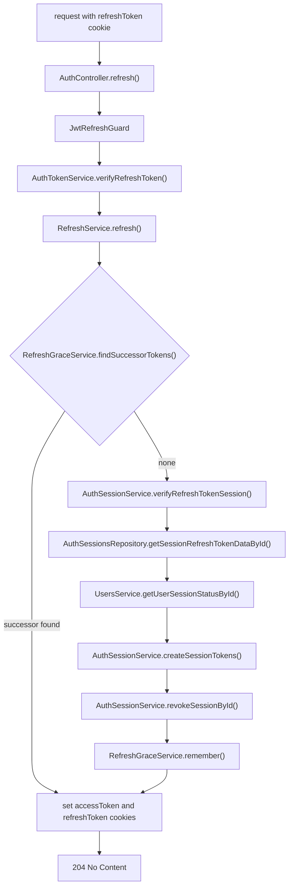
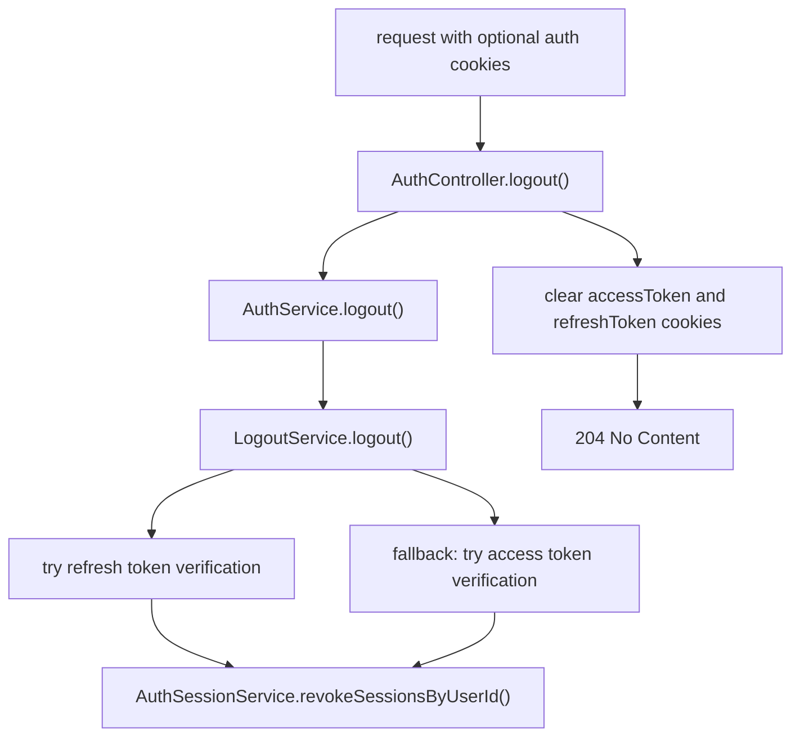

# Auth Session Endpoints

The auth module owns refresh-token sessions and auth cookie lifecycle.

## Routes

```txt
POST /auth/refresh
POST /auth/logout
```

Both endpoints return `204 No Content`.

## Refresh



Important behavior:

- Requires a valid `refreshToken` cookie.
- Validates the refresh JWT and matching stored refresh-token hash.
- Rejects expired, revoked, mismatched, or missing sessions with `INVALID_REFRESH_TOKEN`.
- Requires the user to exist, have an email and have `active` or `onboarding` status (`isSessionAllowedStatus()`); otherwise revokes all of the user's sessions and fails with `INVALID_REFRESH_TOKEN`.
- Creates a new session/token pair and revokes the previous session with `replacedBy`.
- Treats reuse of an already revoked refresh session as replay and revokes the user's active sessions — except inside the refresh grace window below.
- Rate-limited per IP to 5 requests per 60 seconds (`authConfig.RATE_LIMIT.SENSITIVE`).

### Refresh grace window

The frontend refreshes in its Next.js proxy, so parallel requests (tabs, prefetches, server instances) can send the same refresh token at once. After a rotation, `RefreshGraceService` keeps the successor tokens in Redis for `authConfig.REFRESH_GRACE.TTL_MS` (10 s), keyed by the rotated session id. A reused token gets those same tokens back — never a new session — only when:

- the token's hash matches the rotated session (it is the exact token that was rotated);
- the `User-Agent` hash matches the client that did the rotation (the frontend forwards the browser's);
- the successor session is still active (logout or theft detection revoking it ends the grace).

Outside the window, or if any check fails, reuse is treated as replay as before.

## Logout



Important behavior:

- Unguarded and best-effort.
- Always clears `accessToken` and `refreshToken` cookies.
- Attempts to revoke sessions only when a user can be identified from a valid refresh or access token.
- Does not throw auth errors for missing or invalid cookies.

Self-check questions: [session-quiz.md](session-quiz.md).
