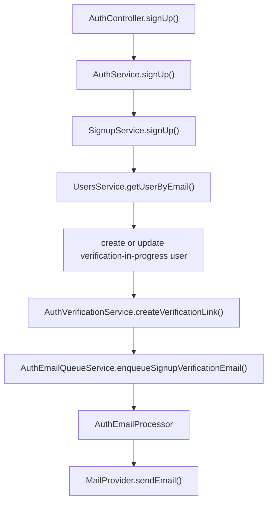
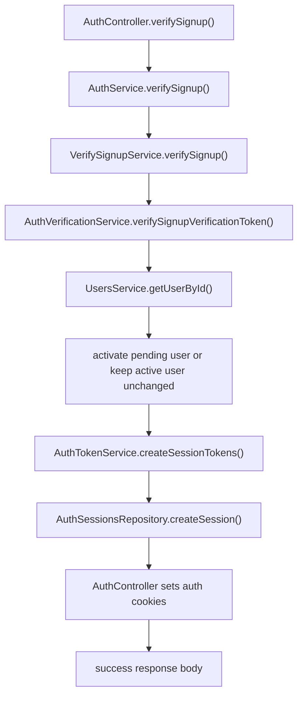

# Auth Signup Flow

The auth module owns the `POST /auth/sign-up` and `POST /auth/verify-signup` flows.

## Route

```txt
POST /auth/sign-up
POST /auth/verify-signup
```

Sign-up request body:

```ts
{
  email: string;
  password: string;
  name: string;
  role: UserRole;
}
```

Sign-up success response:

```ts
{
  message: string;
  email: string;
}
```

Verify sign-up request body:

```ts
{
  token: string;
}
```

Verify sign-up success response:

```ts
{
  message: string;
}
```

`POST /auth/verify-signup` sets `accessToken` and `refreshToken` cookies. Tokens and user data are not returned in the response body.

## Module Structure

Main files:

- `src/modules/auth/auth.module.ts`
- `src/modules/auth/controllers/auth.controller.ts`
- `src/modules/auth/services/auth.service.ts`
- `src/modules/auth/services/signup.service.ts`
- `src/modules/auth/services/verify-signup.service.ts`
- `src/modules/auth/services/auth-token.service.ts`
- `src/modules/auth/services/helpers/auth-verification.service.ts`
- `src/modules/auth/services/helpers/auth-email-queue.service.ts`
- `src/modules/auth/repositories/auth-sessions.repository.ts`
- `src/modules/auth/schemas/schema.ts`
- `src/modules/auth/processors/auth-email.processor.ts`
- `src/modules/auth/templates/signup-verification-email.template.ts`
- `src/modules/auth/types/signup.type.ts`
- `src/modules/auth/types/auth-token.type.ts`
- `src/modules/auth/types/auth-session.type.ts`

Sign-up-specific types are grouped in `src/modules/auth/types/signup.type.ts`.

## Sign-Up Flow



## Verify Sign-Up Flow



## Behavior

1. `AuthController` receives and validates `SignUpDto`.

2. `AuthService` delegates the request to `SignupService`.

3. `SignupService` checks whether a user already exists by email.

4. If the existing user is active, the service throws `ConflictException` with `USER_WITH_EMAIL_ALREADY_EXISTS`.

5. If the existing user has `VerificationInProgress` status, the service updates the user's name, role, and password hash.

6. If no user exists, the service creates a local user with `VerificationInProgress` status.

7. `AuthVerificationService` creates a JWT signup verification token and builds a frontend verification URL:

```txt
{FRONTEND_URL}/verify-email?token={token}
```

8. `AuthEmailQueueService` enqueues a signup verification email job on the auth email queue.

9. `AuthEmailProcessor` renders the signup verification email template and sends it through the configured mail provider.

10. The API returns the accepted signup response with the user's email.

11. `AuthController.verifySignup()` receives and validates `VerifySignupDto`.

12. `VerifySignupService` verifies the token with `JWT_SIGNUP_VERIFICATION_SECRET` and requires `VERIFY_SIGNUP` purpose.

13. If the token user does not exist or the token email does not match the stored user email, the service throws `INVALID_SIGNUP_VERIFICATION_TOKEN`.

14. If the user is `verification_in_progress`, the service updates the user status to `active`.

15. If the user is already `active`, verification succeeds idempotently and creates a fresh session.

16. If the user is `invited`, verification is rejected with `SIGNUP_VERIFICATION_NOT_ALLOWED`.

17. `AuthTokenService` creates access and refresh JWTs. The refresh JWT contains `sessionId`.

18. `AuthSessionsRepository` stores the session with a hashed refresh token and refresh expiration.

19. `AuthController` sets `httpOnly` cookies:

```txt
accessToken
refreshToken
```

Cookies use `sameSite: lax`; `secure` is enabled only when `NODE_ENV=production`.

## Queue

The auth module registers `QUEUE_NAMES.AUTH_EMAIL`.

Signup verification email jobs use:

```ts
AUTH_EMAIL_JOB_NAMES.SEND_SIGNUP_VERIFICATION
```

Job data shape:

```ts
export interface SignupVerificationEmailJobData {
  email: string;
  name: string;
  verificationLink: string;
}
```

Jobs are retried up to 3 times with exponential backoff and are removed after successful completion.

## Token

Signup verification tokens use:

```ts
export interface SignupVerificationTokenPayload {
  sub: string;
  email: string;
  purpose: SignupVerificationTokenPurpose;
}
```

The token is signed with `JWT_SIGNUP_VERIFICATION_SECRET` and expires after `JWT_SIGNUP_VERIFICATION_EXPIRES_IN` seconds.

Access tokens use:

```env
JWT_ACCESS_SECRET
JWT_ACCESS_EXPIRES_IN
```

Refresh tokens use:

```env
JWT_REFRESH_SECRET
JWT_REFRESH_EXPIRES_IN
```

Refresh token sessions are looked up by the `sessionId` stored in the refresh JWT. The stored bcrypt hash is used only for comparison after the session row is loaded.

## Errors

Validation errors are produced by the global `ValidationPipe`.

Known signup conflict:

```ts
{
  errorCode: ERROR_CODE.USER_WITH_EMAIL_ALREADY_EXISTS
}
```

Known verification errors:

```ts
{
  errorCode: ERROR_CODE.INVALID_SIGNUP_VERIFICATION_TOKEN
}
```

```ts
{
  errorCode: ERROR_CODE.SIGNUP_VERIFICATION_NOT_ALLOWED
}
```

All HTTP errors are formatted by `GlobalExceptionFilter`.
