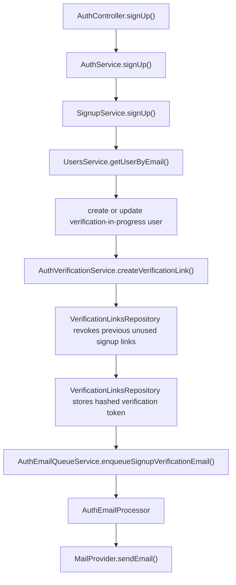
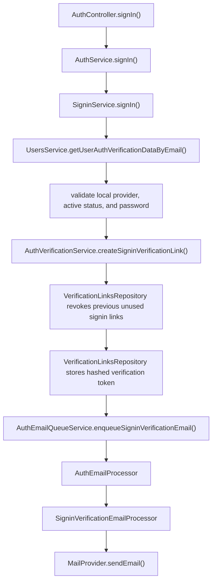
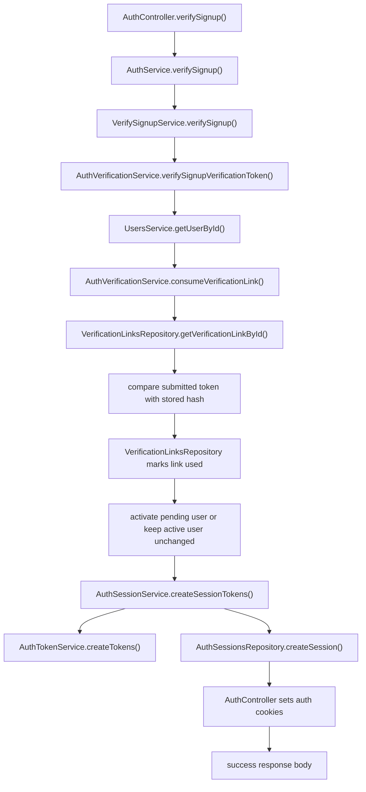
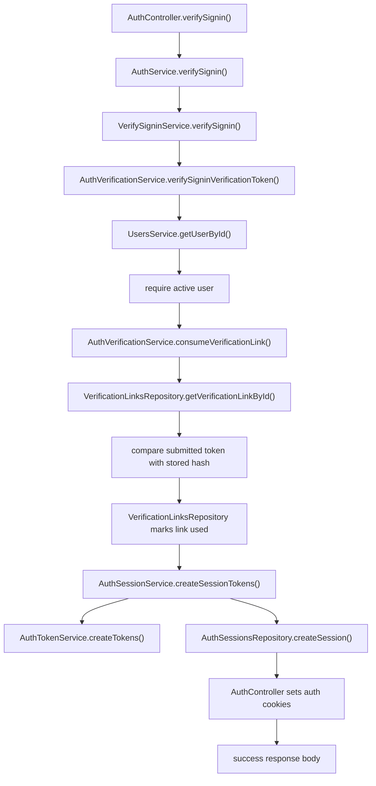
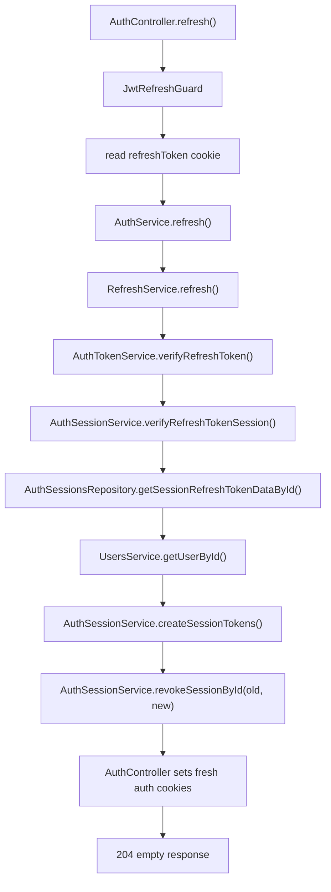
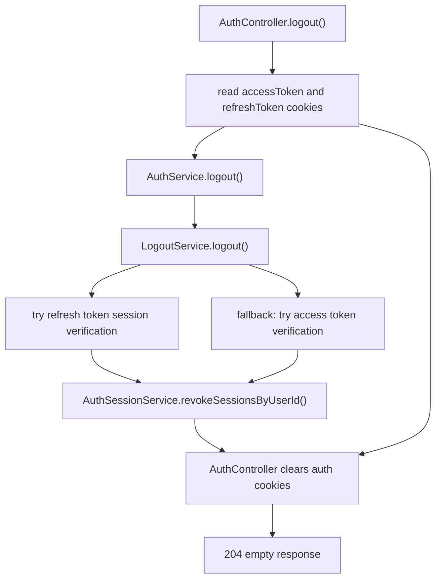
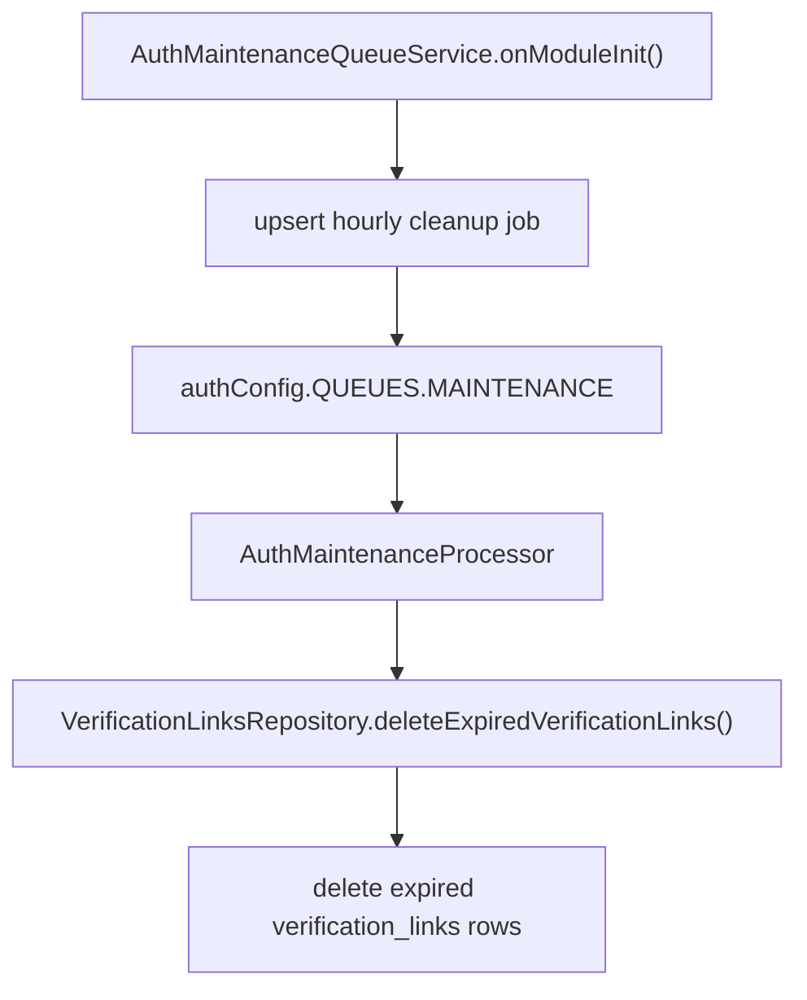

# Auth Email Verification Flows

The auth module owns email verification for sign-up and sign-in.

## Route

```txt
POST /auth/sign-up
POST /auth/sign-in
POST /auth/verify-signup
POST /auth/verify-signin
POST /auth/refresh
POST /auth/logout
```

Sign-up request body:

```ts
{
  email: string;
  password: string;
  name: string;
  role: UserRole;
}
```
Sign-up success response:

```ts
{
  message: string;
  email: string;
}
```

Sign-in request body:

```ts
{
  email: string;
  password: string;
}
```

Sign-in success response:

```ts
{
  message: string;
  email: string;
}
```

Verify sign-up request body:

```ts
{
  token: string;
}
```

Verify sign-in request body:

```ts
{
  token: string;
}
```

Verify sign-up success response:

```ts
{
  message: string;
}
```

Verify sign-in success response:

```ts
{
  message: string;
}
```

`POST /auth/verify-signup` and `POST /auth/verify-signin` set `accessToken` and `refreshToken` cookies. Tokens and user data are not returned in the response body.

`POST /auth/refresh` rotates the refresh session and sets fresh `accessToken` and `refreshToken` cookies. The response body is empty.

`POST /auth/logout` is unguarded and best-effort. It tries to revoke user sessions from valid auth cookies, then clears auth cookies. The response body is empty.

## Module Structure

Main files:

- `src/modules/auth/auth.module.ts`
- `src/modules/auth/config.ts`
- `src/modules/auth/controllers/auth.controller.ts`
- `src/modules/auth/services/auth.service.ts`
- `src/modules/auth/services/signin.service.ts`
- `src/modules/auth/services/signup.service.ts`
- `src/modules/auth/services/verify-signin.service.ts`
- `src/modules/auth/services/verify-signup.service.ts`
- `src/modules/auth/services/refresh.service.ts`
- `src/modules/auth/services/logout.service.ts`
- `src/modules/auth/services/auth-session.service.ts`
- `src/modules/auth/services/auth-token.service.ts`
- `src/modules/auth/services/helpers/auth-verification.service.ts`
- `src/modules/auth/services/helpers/auth-email-queue.service.ts`
- `src/modules/auth/services/helpers/auth-maintenance-queue.service.ts`
- `src/modules/auth/repositories/auth-sessions.repository.ts`
- `src/modules/auth/repositories/verification-links.repository.ts`
- `src/modules/auth/schemas/schema.ts`
- `src/modules/auth/processors/auth-email.processor.ts`
- `src/modules/auth/processors/auth-maintenance.processor.ts`
- `src/modules/auth/processors/signin-verification-email.processor.ts`
- `src/modules/auth/processors/signup-verification-email.processor.ts`
- `src/modules/auth/templates/signin-verification-email.template.ts`
- `src/modules/auth/templates/signup-verification-email.template.ts`
- `src/modules/auth/types/signin.type.ts`
- `src/modules/auth/types/signup.type.ts`
- `src/modules/auth/types/auth-token.type.ts`
- `src/modules/auth/types/auth-session.type.ts`

Sign-in-specific types are grouped in `src/modules/auth/types/signin.type.ts`.
Sign-up-specific types are grouped in `src/modules/auth/types/signup.type.ts`.

## Sign-Up Flow



## Sign-In Flow



## Verify Sign-Up Flow



## Verify Sign-In Flow



## Refresh Flow



## Logout Flow



## Verification Link Cleanup Flow



## Behavior

1. `AuthController` receives and validates `SignUpDto`.

2. `AuthService` delegates the request to `SignupService`.

3. `SignupService` checks whether a user already exists by email.

4. If the existing user is active, the service throws `ConflictException` with `USER_WITH_EMAIL_ALREADY_EXISTS`.

5. If the existing user has `VerificationInProgress` status, the service updates the user's name, role, and password hash.

6. If no user exists, the service creates a local user with `VerificationInProgress` status.

7. `AuthVerificationService` creates a JWT signup verification token and builds a frontend verification URL:

```txt
{FRONTEND_URL}/verify-email?token={token}
```

8. The verification token contains a `jti`. `AuthVerificationService` hashes the full token, revokes previous unused sign-up links for the user, and stores the new link in `verification_links`.

9. `AuthEmailQueueService` enqueues a signup verification email job on the auth email queue.

10. `AuthEmailProcessor` renders the signup verification email template and sends it through the configured mail provider.

11. The API returns the accepted signup response with the user's email.

12. `AuthController.signIn()` receives and validates `SignInDto`.

13. `SigninService` loads auth verification data by email, including `passwordHash`.

14. Sign-in accepts only local active users with a stored password hash and matching password.

15. Missing users, non-local users, inactive users, missing password hashes, and password mismatches all fail with `INVALID_CREDENTIALS`.

16. `AuthVerificationService` creates a JWT sign-in verification token and builds a frontend verification URL:

```txt
{FRONTEND_URL}/verify-signin?token={token}
```

17. The verification token contains a `jti`. `AuthVerificationService` hashes the full token, revokes previous unused sign-in links for the user, and stores the new link in `verification_links`.

18. `AuthEmailQueueService` enqueues a sign-in verification email job on the auth email queue.

19. `AuthEmailProcessor` dispatches the job to `SigninVerificationEmailProcessor`, which renders the sign-in verification email template and sends it through the configured mail provider.

20. The API returns the accepted sign-in response with the user's email.

21. `AuthController.verifySignup()` receives and validates `VerifySignupDto`.

22. `VerifySignupService` verifies the token with `JWT_SIGNUP_VERIFICATION_SECRET` and requires `VERIFY_SIGNUP` purpose.

23. If the token user does not exist or the token email does not match the stored user email, the service throws `INVALID_SIGNUP_VERIFICATION_TOKEN`.

24. If the user is `invited`, verification is rejected with `SIGNUP_VERIFICATION_NOT_ALLOWED`.

25. `AuthVerificationService.consumeVerificationLink()` loads the `verification_links` row by token `jti`, checks user id, email, purpose, expiry, used state, revoked state, and compares the submitted token against the stored hash.

26. If the link row is missing, expired, used, revoked, mismatched, or the token hash comparison fails, the service throws `INVALID_SIGNUP_VERIFICATION_TOKEN`.

27. A valid sign-up link is marked used before account activation and session creation. Reusing the same link later is rejected.

28. If the user is `verification_in_progress`, the service updates the user status to `active`.

29. If the user is already `active`, sign-up verification can succeed only with a currently unused valid link, then creates a fresh session.

30. `AuthController.verifySignin()` receives and validates `VerifySigninDto`.

31. `VerifySigninService` verifies the token with `JWT_SIGNUP_VERIFICATION_SECRET` and requires `VERIFY_SIGNIN` purpose.

32. If the token user does not exist or the token email does not match the stored user email, the service throws `INVALID_SIGNIN_VERIFICATION_TOKEN`.

33. If the user is not `active`, verification is rejected with `SIGNIN_VERIFICATION_NOT_ALLOWED`. Sign-in verification does not activate users.

34. `AuthVerificationService.consumeVerificationLink()` loads the `verification_links` row by token `jti`, checks user id, email, purpose, expiry, used state, revoked state, and compares the submitted token against the stored hash.

35. If the link row is missing, expired, used, revoked, mismatched, or the token hash comparison fails, the service throws `INVALID_SIGNIN_VERIFICATION_TOKEN`.

36. A valid sign-in link is marked used before session creation. Reusing the same link later is rejected.

37. `AuthSessionService` creates a session id and asks `AuthTokenService` to create access and refresh JWTs. The refresh JWT contains `sessionId`.

38. `AuthSessionService` hashes the refresh token and `AuthSessionsRepository` stores the session with the refresh expiration.

39. `AuthController` sets `httpOnly` cookies:

```txt
accessToken
refreshToken
```

Cookies use `sameSite: lax`; `secure` is enabled only when `NODE_ENV=production`.

40. `AuthController.refresh()` requires a `refreshToken` cookie.

41. `JwtRefreshGuard` verifies the refresh JWT signature and attaches the raw refresh token to the request.

42. `RefreshService` verifies the refresh JWT payload, validates the session row and hashed refresh token, requires an active user, creates a new session/token pair, revokes the old session with `replacedBy`, and sets fresh cookies.

43. If a revoked refresh session is reused, `AuthSessionService` revokes the user's remaining active sessions and rejects the request with `INVALID_REFRESH_TOKEN`.

44. `AuthController.logout()` is unguarded. It reads auth cookies directly, asks `LogoutService` to best-effort identify the user from refresh token first and access token second, revokes all active sessions for that user when possible, and always clears auth cookies.

45. `AuthMaintenanceQueueService` registers an hourly cleanup job on module init. `AuthMaintenanceProcessor` deletes expired `verification_links` rows.

## Queue

The auth module registers `authConfig.QUEUES.EMAIL` and `authConfig.QUEUES.MAINTENANCE`.

Signup verification email jobs use:

```ts
authConfig.JOBS.SEND_SIGNUP_VERIFICATION;
```

Sign-in verification email jobs use:

```ts
authConfig.JOBS.SEND_SIGNIN_VERIFICATION;
```

Verification-link cleanup jobs use:

```ts
authConfig.JOBS.CLEANUP_EXPIRED_VERIFICATION_LINKS;
```

Job data shape:

```ts
export interface SignupVerificationEmailJobData {
  email: string;
  name: string;
  verificationLink: string;
}
```

```ts
export interface SigninVerificationEmailJobData {
  email: string;
  name: string;
  verificationLink: string;
}
```

Email jobs are retried up to 3 times with exponential backoff and are removed after successful completion.

The verification-link cleanup job is scheduled hourly with `AuthMaintenanceQueueService` and removes expired verification-link rows.

## Token

Signup verification tokens use:

```ts
export interface SignupVerificationTokenPayload {
  sub: string;
  jti: string;
  email: string;
  purpose: SignupVerificationTokenPurpose;
}
```

The token is signed with `JWT_SIGNUP_VERIFICATION_SECRET` and expires after `JWT_SIGNUP_VERIFICATION_EXPIRES_IN` seconds. The full token is stored only as a hash in `verification_links.hashed_token`.

Sign-in verification tokens use the same payload shape with `VERIFY_SIGNIN` purpose. They are signed with `JWT_SIGNUP_VERIFICATION_SECRET` and expire after `JWT_SIGNIN_VERIFICATION_EXPIRES_IN` seconds.

Verification links are single-use. The `jti` identifies the database row, while the submitted token must still match the stored hash. Used, revoked, expired, missing, or mismatched links are rejected with the endpoint's existing invalid verification token error.

Access tokens use:

```env
JWT_ACCESS_SECRET
JWT_ACCESS_EXPIRES_IN
```

Refresh tokens use:

```env
JWT_REFRESH_SECRET
JWT_REFRESH_EXPIRES_IN
```

Refresh token sessions are looked up by the `sessionId` stored in the refresh JWT. The stored bcrypt hash is used only for comparison after the session row is loaded.

`AuthTokenService` owns JWT signing and verification. `AuthSessionService` owns session id generation, refresh-token hashing, session validation, and session revocation.

## Errors

Validation errors are produced by the global `ValidationPipe`.

Known signup conflict:

```ts
{
  errorCode: ERROR_CODE.USER_WITH_EMAIL_ALREADY_EXISTS;
}
```

Known sign-in error:

```ts
{
  errorCode: ERROR_CODE.INVALID_CREDENTIALS;
}
```

Known verification errors:

```ts
{
  errorCode: ERROR_CODE.INVALID_SIGNUP_VERIFICATION_TOKEN;
}
```

```ts
{
  errorCode: ERROR_CODE.SIGNUP_VERIFICATION_NOT_ALLOWED;
}
```

```ts
{
  errorCode: ERROR_CODE.INVALID_SIGNIN_VERIFICATION_TOKEN;
}
```

```ts
{
  errorCode: ERROR_CODE.SIGNIN_VERIFICATION_NOT_ALLOWED;
}
```

Known refresh error:

```ts
{
  errorCode: ERROR_CODE.INVALID_REFRESH_TOKEN;
}
```

Known access-token error:

```ts
{
  errorCode: ERROR_CODE.INVALID_ACCESS_TOKEN;
}
```

All HTTP errors are formatted by `GlobalExceptionFilter`.
