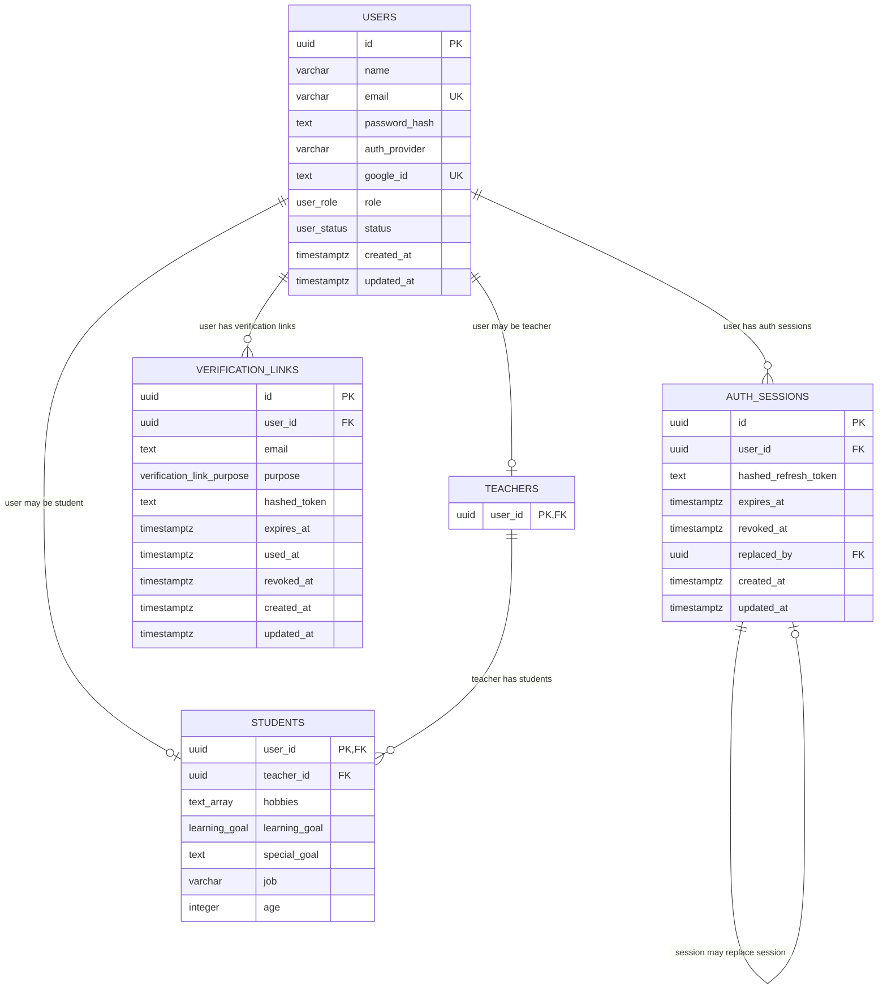

# Entities

## Current Tables

## Indexes

- `users.id`: primary key index.
- `users.email`: unique index.
- `users.google_id`: unique index.
- `auth_sessions.id`: primary key index.
- `auth_sessions.user_id`: indexed foreign key to `users.id`.
- `auth_sessions.replaced_by`: foreign key to `auth_sessions.id`.
- `verification_links.id`: primary key index.
- `verification_links.user_id, verification_links.purpose`: composite index for revoking previous unused links.
- `verification_links.expires_at`: indexed for cleanup.
- `teachers.user_id`: primary key index and foreign key to `users.id`.
- `students.user_id`: primary key index and foreign key to `users.id`.
- `students.teacher_id`: indexed foreign key to `teachers.user_id`.

## Notes

- `students.teacher_id` uses `onDelete: set null`.
- `auth_sessions.user_id` uses `onDelete: cascade`.
- `verification_links.user_id` uses `onDelete: cascade`.
- Refresh tokens are stored only as hashes in `auth_sessions.hashed_refresh_token`.
- Verification tokens are stored only as hashes in `verification_links.hashed_token`.
- Student creation is still service-guarded: `StudentsService.createStudent()` checks that the teacher exists before insert.
