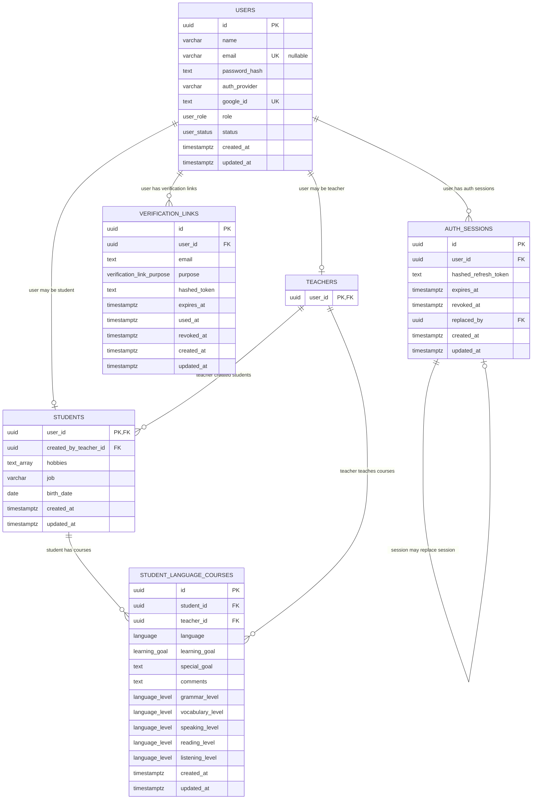

# Entities

## Current Tables

## Indexes

- `users.id`: primary key index.
- `users.email`: unique index; nullable (managed students may have no email), PostgreSQL allows many NULLs.
- `users.google_id`: unique index.
- `auth_sessions.id`: primary key index.
- `auth_sessions.user_id`: indexed foreign key to `users.id`.
- `auth_sessions.replaced_by`: foreign key to `auth_sessions.id`.
- `verification_links.id`: primary key index.
- `verification_links.user_id, verification_links.purpose`: composite index for revoking previous unused links.
- `verification_links.expires_at`: indexed for cleanup.
- `teachers.user_id`: primary key index and foreign key to `users.id`.
- `students.user_id`: primary key index and foreign key to `users.id`.
- `students.created_by_teacher_id`: indexed foreign key to `teachers.user_id`.
- `student_language_courses.id`: primary key index.
- `student_language_courses.student_id, teacher_id, language`: unique constraint (one course per language per teacher); also covers `student_id` lookups.
- `student_language_courses.teacher_id`: indexed foreign key to `teachers.user_id`.

## Notes

- `students.user_id` and `student_language_courses.student_id` use `onDelete: cascade`.
- `students.created_by_teacher_id` and `student_language_courses.teacher_id` use `onDelete: set null`.
- `auth_sessions.user_id` uses `onDelete: cascade`.
- `verification_links.user_id` uses `onDelete: cascade`.
- Refresh tokens are stored only as hashes in `auth_sessions.hashed_refresh_token`.
- Verification tokens are stored only as hashes in `verification_links.hashed_token`.
- A `teachers` row is created in the same transaction whenever a teacher user becomes active (verify sign-up, Google sign-up, Google link or sign-in); see `UsersRepository.ensureRoleProfile()`. Migration `20261004100647_backfill_teachers` created rows for teachers that existed before.

## Enums

- `user_status`: `verification_in_progress`, `invited`, `active`, `managed` (teacher-created student that cannot sign in).
- `language`: `english`, `german`, `french`, `spanish`, `italian`, `polish`, `ukrainian`, `chinese`.
- `language_level`: `a0`, `a1`, `a1_plus`, `a2`, `a2_plus`, `b1`, `b1_plus`, `b2`, `b2_plus`, `c1`, `c1_plus`, `c2`.
- `learning_goal`: see `src/modules/students/enums/learning-goal.enum.ts`.
