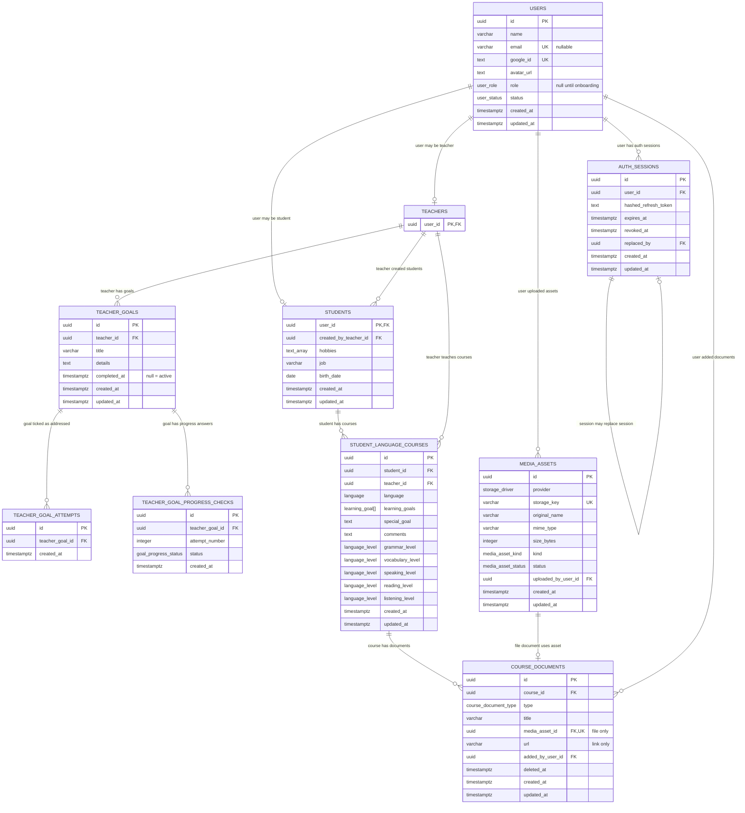

# Entities

## Current Tables

## Indexes

- `users.id`: primary key index.
- `users.email`: unique index; nullable (managed students have no email), PostgreSQL allows many NULLs. Stored lowercased and trimmed (`normalizeEmail()` on the Google profile).
- `users_email_lower_unique`: unique index on `lower(email)`, so a case-variant duplicate (`John@x.com` next to `john@x.com`) is rejected even if a write path skips normalization.
- `users.google_id`: unique index.
- `auth_sessions.id`: primary key index.
- `auth_sessions.user_id`: indexed foreign key to `users.id`.
- `auth_sessions.replaced_by`: foreign key to `auth_sessions.id`.
- `teachers.user_id`: primary key index and foreign key to `users.id`.
- `teacher_goals.teacher_id`: indexed foreign key to `teachers.user_id`.
- `teacher_goal_attempts.teacher_goal_id, created_at`: composite index for counting attempts and grouping them by date; also covers `teacher_goal_id` lookups.
- `teacher_goal_progress_checks.teacher_goal_id, attempt_number`: unique constraint (one answer per check); also covers `teacher_goal_id` lookups.
- `teacher_goal_progress_checks`: check `teacher_goal_progress_checks_attempt_number_check`: `attempt_number` is positive and a multiple of `teachersConfig.GOALS.PROGRESS_CHECK_INTERVAL` (5). Changing the interval needs a new migration.
- `students.user_id`: primary key index and foreign key to `users.id`.
- `students.created_by_teacher_id`: indexed foreign key to `teachers.user_id`.
- `student_language_courses.id`: primary key index.
- `student_language_courses.student_id, teacher_id, language`: unique constraint (one course per language per teacher); also covers `student_id` lookups.
- `student_language_courses.teacher_id`: indexed foreign key to `teachers.user_id`.
- `student_language_courses.learning_goals`: check `student_language_courses_learning_goals_not_empty` (`cardinality >= 1`), plus `NOT NULL`. Not indexed: courses are never searched by goal.
- `media_assets.storage_key`: unique index.
- `media_assets.uploaded_by_user_id`: indexed foreign key to `users.id`.
- `media_assets.status, created_at`: composite index for the stale-upload cleanup.
- `course_documents.course_id, deleted_at`: composite index for listing a course's active documents; also covers `course_id` lookups.
- `course_documents.media_asset_id`: unique (one document per asset); also the foreign key index.
- `course_documents.added_by_user_id`: indexed foreign key to `users.id`.
- `course_documents`: check `course_documents_type_payload`: a `file` row has `media_asset_id` and no `url`, a `link` row has `url` and no `media_asset_id`.

## Notes

- `students.user_id` and `student_language_courses.student_id` use `onDelete: cascade`.
- `students.created_by_teacher_id` and `student_language_courses.teacher_id` use `onDelete: set null`.
- `course_documents.course_id` and `course_documents.media_asset_id` use `onDelete: cascade` (deleting an asset deletes its document row).
- `teacher_goals.teacher_id`, `teacher_goal_attempts.teacher_goal_id` and `teacher_goal_progress_checks.teacher_goal_id` use `onDelete: cascade`.
- Teacher goals: each tick is a `teacher_goal_attempts` row (append-only, no undo), so the attempt count is `COUNT(*)` and the frequency graph groups rows by `created_at`; there is no stored counter. Every `PROGRESS_CHECK_INTERVAL` attempts the teacher must answer `success`, `same` or `worse`, stored with the triggering `attempt_number`. A goal is complete when `completed_at` is set.
- `media_assets.uploaded_by_user_id` and `course_documents.added_by_user_id` use `onDelete: set null`.
- `media_assets` stores the storage key, never a URL. `course_documents.deleted_at` marks a soft delete until the purge job removes the row (see [course-document-endpoints.md](../students/course-document-endpoints.md#delete-a-document)).
- `auth_sessions.user_id` uses `onDelete: cascade`.
- Refresh tokens are stored only as hashes in `auth_sessions.hashed_refresh_token`.
- Sign-in is Google-only: there are no passwords and no verification links (both were dropped in `20261016100027_google_only_auth_onboarding`). A first Google sign-in creates a user with `status = onboarding` and `role = null`.
- The role profile row is created when onboarding sets the role, in the same transaction (`OnboardingRepository`): a `teachers` row for a teacher, a `students` row for a student. Google sign-in and linking also run `UsersRepository.ensureRoleProfile()` (`ON CONFLICT DO NOTHING`), so an active teacher always has the row. Migration `20261004100647_backfill_teachers` created rows for teachers that existed before.

## Enums

- `user_role`: `teacher`, `student`.
- `user_status`: `onboarding` (signed in with Google, role not chosen yet), `active`, `managed` (teacher-created student that cannot sign in). `verification_in_progress` and `invited` are still in the enum but no code sets them.
- `language`: `english`, `german`, `french`, `spanish`, `italian`, `polish`, `ukrainian`, `chinese`.
- `language_level`: `a0`, `a1`, `a1_plus`, `a2`, `a2_plus`, `b1`, `b1_plus`, `b2`, `b2_plus`, `c1`, `c1_plus`, `c2`.
- `storage_driver`: `s3`.
- `media_asset_kind`: `document`, `image`, `audio`.
- `media_asset_status`: `pending` (upload URL issued), `uploaded` (verified and attached).
- `course_document_type`: `file`, `link`.
- `goal_progress_status`: `success`, `same`, `worse`.
- `learning_goal`: see `src/modules/students/enums/learning-goal.enum.ts`. Used as an array (`student_language_courses.learning_goals`): a course has one or more goals, kept in the order the teacher sent them.
