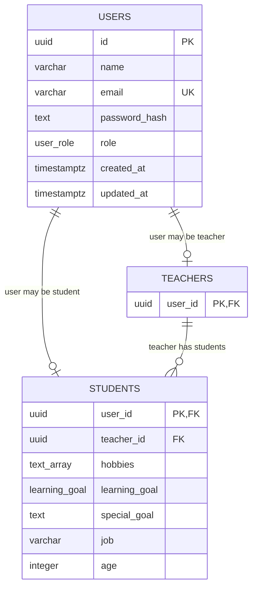

# Entities

## Current Tables

## Indexes

- `users.id`: primary key index.
- `users.email`: unique index.
- `teachers.user_id`: primary key index and foreign key to `users.id`.
- `students.user_id`: primary key index and foreign key to `users.id`.
- `students.teacher_id`: indexed foreign key to `teachers.user_id`.

## Notes

- `students.teacher_id` uses `onDelete: set null`.
- Student creation is still service-guarded: `StudentsService.createStudent()` checks that the teacher exists before insert.
