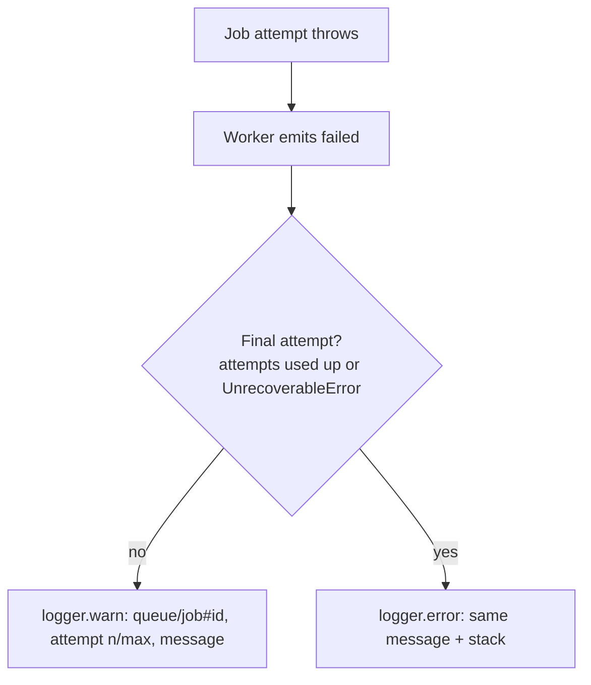

# Queue Architecture

The application uses `@nestjs/bullmq` with a global Redis connection and feature-level queues.

## Current Queues

| Queue | Job | Trigger | Processor |
|---|---|---|---|
| `mail` | `send-email` | none today: email auth was removed, `MailQueueService` is kept for future features | `MailProcessor` |
| `course-documents` | `purge-course-document` | deleting a course document | `CourseDocumentsProcessor` ([details](../students/course-document-endpoints.md#delete-a-document)) |
| `media-assets` | `cleanup-stale-assets` | job scheduler, daily at 03:00 | `MediaAssetsProcessor` ([details](../media-assets/media-assets.md#stale-upload-cleanup)) |

Recurring jobs use `queue.upsertJobScheduler()` from a service's `onModuleInit()` (see `MediaAssetsCleanupSchedulerService`); upserting keeps one schedule across restarts.

## Failure Logging

Every processor extends `LoggedWorkerHost` (`src/queue/logged-worker-host.ts`), which logs each failed attempt through the worker `failed` event.



- The logger is named after the processor class, e.g. `[CourseDocumentsProcessor]`.
- Job data is not logged, because mail jobs carry recipients and message content.
- Queue services log enqueue failures (e.g. Redis unavailable) with the queue/job name, then rethrow so the caller and `GlobalExceptionFilter` still handle the error.
- Worker-level `error` events (connection problems) are not logged here.

## Adding a New Queue

1. Add the queue name to the owning module config object in `src/modules/<module-name>/config.ts`.

2. In the owning feature module, register the queue:

```ts
BullModule.registerQueue({ name: yourModuleConfig.QUEUES.YOUR_QUEUE })
```

3. Add feature-level job names to the same module config object, for example:

```ts
export const yourModuleConfig = {
  QUEUES: {
    YOUR_QUEUE: 'your-queue',
  },
  JOBS: {
    DO_WORK: 'do-work',
  },
} as const;
```

4. Add a feature queue service that injects the queue with `@InjectQueue(yourModuleConfig.QUEUES.YOUR_QUEUE)` and exposes enqueue methods. Log and rethrow enqueue failures (see [Failure Logging](#failure-logging)).

5. Add a feature processor with `@Processor(yourModuleConfig.QUEUES.YOUR_QUEUE)` and extend `LoggedWorkerHost`.

6. Export only the feature queue service from the feature module unless another module needs lower-level queue internals.

Use the existing mail queue implementation as the reference pattern:

- `src/modules/mail/mail.module.ts`
- `src/modules/mail/config.ts`
- `src/modules/mail/services/mail-queue.service.ts`
- `src/modules/mail/processors/mail.processor.ts`
- `src/modules/mail/types/mail-job.ts`
