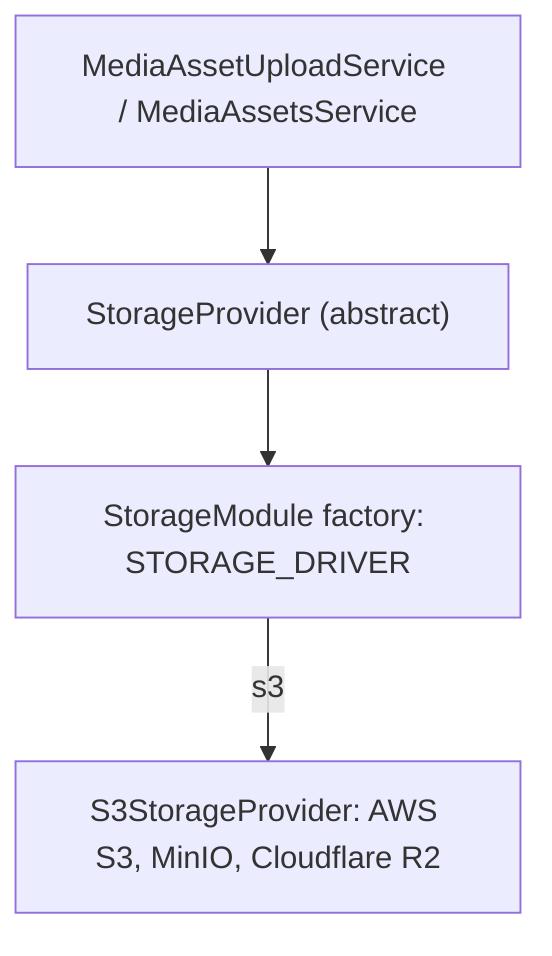

# Object Storage

Files live in a private S3-compatible bucket. Clients never get bucket credentials: they upload and open files through short-lived presigned URLs created by the backend.

## Strategy

`StorageProvider` (`src/common/storage/storage-provider.ts`) is an abstract class used as the DI token. Code injects it and never knows which storage is behind it.



| Method | Purpose |
|---|---|
| `createUploadUrl({ key, mimeType, sizeBytes, expiresInSeconds })` | presigned PUT bound to the content type and exact size |
| `createDownloadUrl({ key, fileName, expiresInSeconds })` | presigned GET served inline under `fileName` |
| `getObjectInfo(key)` | size and type of a stored object, or `null` |
| `deleteObject(key)` | delete; a missing key counts as deleted |

Each provider exposes its `driver`, which is stored in `media_assets.provider`.

### Adding a Provider

1. Add a value to `StorageDriver` (`src/common/storage/enums/storage-driver.enum.ts`) and generate a migration for the `storage_driver` enum.
2. Implement `StorageProvider` in `src/common/storage/providers/`.
3. Add a `case` to the factory in `storage.module.ts` and its env config.

Existing assets keep their `provider` value. Reading old assets after switching providers would need the provider resolved per asset; the current code always uses the configured one.

## S3 Provider Details

- **Signed upload headers:** `content-type` and `content-length` are signed (`storageConfig.S3.SIGNED_UPLOAD_HEADERS`). An upload with a different type or size gets `403` from storage.
- **Checksums:** `requestChecksumCalculation` and `responseChecksumValidation` are `WHEN_REQUIRED`. With the SDK default, a checksum of the not-yet-known body would be baked into presigned URLs and break browser uploads.
- **Path style:** `S3_FORCE_PATH_STYLE=true` builds `endpoint/bucket/key` URLs, required by MinIO on localhost. Keep it `false` for AWS.
- **File URLs:** the GET URL sets `response-content-disposition` to `inline; filename*=UTF-8''<encoded name>` (RFC 5987). Browsers display PDFs, images, audio and text and download other types; non-ASCII and special-character names survive. Uploads cannot be HTML or SVG, so nothing served inline can run scripts.

## Local Storage (MinIO)

`docker-compose.yml` runs MinIO as `local_minio`:

```bash
docker compose up -d minio
```

- Image `bitnamilegacy/minio:2025.4.22`: MinIO no longer publishes free images; this frozen Bitnami build is used for local development only.
- API on `http://localhost:9000`, console on `http://localhost:9001` (login = `S3_ACCESS_KEY_ID` / `S3_SECRET_ACCESS_KEY`).
- The private bucket `S3_BUCKET` is created on startup (`MINIO_DEFAULT_BUCKETS`).
- CORS allows `FRONTEND_URL`, so the browser can upload directly (`MINIO_API_CORS_ALLOW_ORIGIN`).
- Data persists in the `miniodata` volume.

For a real bucket (AWS S3, Cloudflare R2): keep it private, allow `PUT` from `FRONTEND_URL` in its CORS rules, and set the variables in [env.md](../setup/env.md#storage-variables).

## Files

- `src/common/storage/storage-provider.ts`
- `src/common/storage/storage.module.ts`
- `src/common/storage/providers/s3-storage.provider.ts`
- `src/common/storage/config.ts`
- `src/common/configs/env-config.ts` (`getStorageEnvConfig`, `getS3EnvConfig`)
- `docker-compose.yml` (`minio` service)
