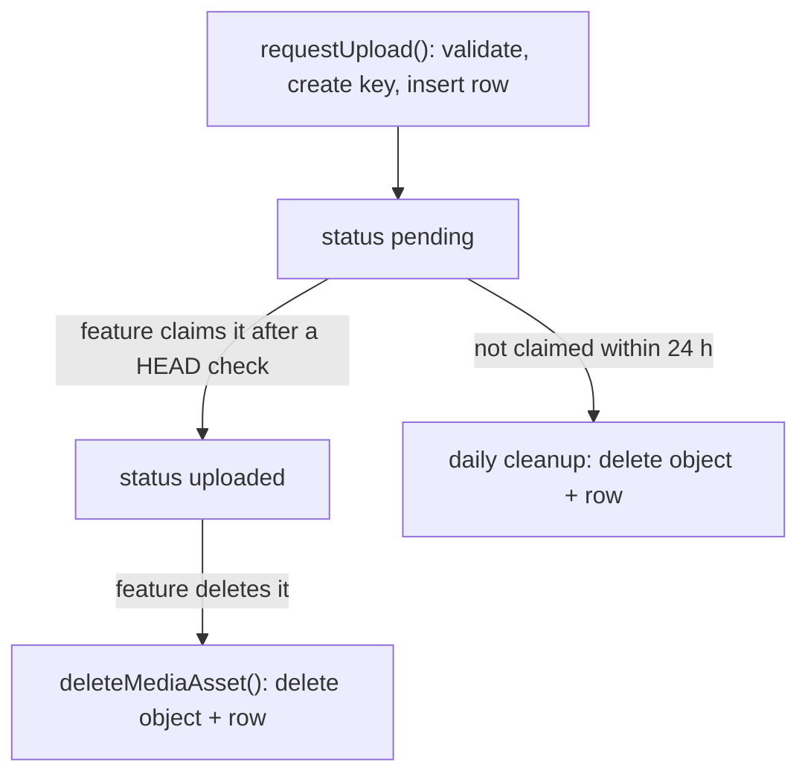
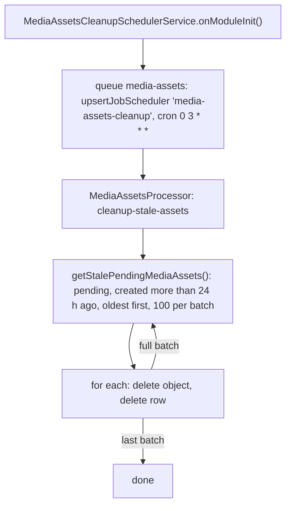

# Media Assets

`MediaAssetsModule` owns files kept in object storage: the `media_assets` table, direct-to-storage uploads, download URLs, deletion, and the cleanup of uploads that were never used. Features attach assets to their own rows (today: [course documents](../students/course-document-endpoints.md)). Storage itself is behind `StorageProvider`, see [storage.md](../storage.md).

The module exports `MediaAssetUploadService` and `MediaAssetsService`.

## Asset Lifecycle

- **`pending`**: an upload URL was issued; the object may or may not exist yet.
- **`uploaded`**: the object was checked in storage and a feature row references the asset.
- A row stores `provider` and `storageKey`, never a URL. URLs are short-lived and created on demand.

## Upload

`MediaAssetUploadService` handles both ends of a direct upload:

- `requestUpload({ uploaderId, fileName, mimeType, sizeBytes })` builds the key `uploads/{uploaderId}/{uuid}` (chosen by the server, never by the client), inserts a `pending` row with the kind derived from the MIME type, and returns `{ mediaAssetId, uploadUrl }`.
- `getVerifiedPendingAsset({ mediaAssetId, uploaderId })` returns the asset only if it is `pending`, was requested by this uploader, and its object exists in storage with the declared size and type. Otherwise `404 MEDIA_ASSET_NOT_FOUND` or `400 MEDIA_ASSET_UPLOAD_INVALID`.

Claiming (`pending` → `uploaded`) happens in the owning feature's transaction, so the asset and the feature row change together.

Request validation lives in `CreateMediaAssetUploadUrlDto`:

| Kind | MIME types | Max size |
|---|---|---|
| `document` | pdf, doc/docx, xls/xlsx, ppt/pptx, odt/ods, txt, csv | 20 MB |
| `image` | jpeg, png, webp | 10 MB |
| `audio` | mpeg, mp4/x-m4a, wav/x-wav, ogg | 50 MB |

The map and limits are `ALLOWED_MIME_TYPES` and `MAX_SIZE_BYTES` in `src/modules/media-assets/config.ts`. SVG, HTML and video are not accepted.

## Open and Delete

- `MediaAssetsService.createDownloadUrl({ storageKey, originalName })`: presigned GET, valid 5 minutes, served `inline` under the original name (browsers show what they can and download the rest).
- `MediaAssetsService.deleteMediaAsset(id)`: deletes the storage object, then the row. Feature rows that reference the asset with `onDelete: cascade` go with it. Safe to retry.

## Stale Upload Cleanup

`upsertJobScheduler` keeps a single schedule however many times the app restarts. The cron runs in the server's time zone.

Not cleaned up: `uploaded` assets whose feature row was removed by a cascade (e.g. a deleted course). No endpoint deletes courses or students today.

## Files

- `src/modules/media-assets/media-assets.module.ts`
- `src/modules/media-assets/config.ts`
- `src/modules/media-assets/schemas/schema.ts`
- `src/modules/media-assets/dto/create-media-asset-upload-url.dto.ts`
- `src/modules/media-assets/services/media-asset-upload.service.ts`
- `src/modules/media-assets/services/media-assets.service.ts`
- `src/modules/media-assets/services/media-assets-cleanup-scheduler.service.ts`
- `src/modules/media-assets/processors/media-assets.processor.ts`
- `src/modules/media-assets/repositories/media-assets.repository.ts`
