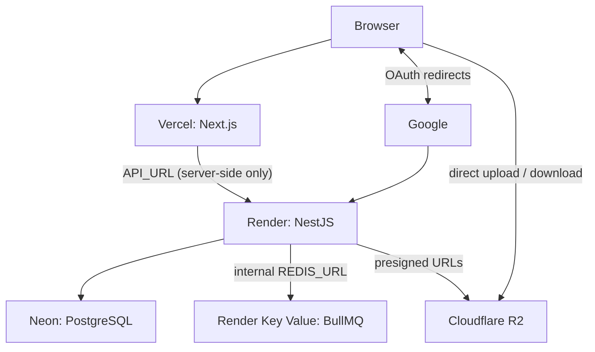

# Backend Deployment

Production runs on Render (API + Redis), Neon (PostgreSQL) and Cloudflare R2 (files). The frontend is on Vercel, see [front deployment](../../../front/src/docs/architecture/deployment.md).

| Part | Where | URL |
|---|---|---|
| Backend API | Render web service, Node runtime, free plan | `https://practice-app-dsmb.onrender.com` |
| Redis | Render Key Value, same Render project | internal URL only |
| PostgreSQL | Neon | — |
| Files | Cloudflare R2 private bucket `lms`, Eastern Europe (EEUR) | `https://ccb336985a39c0d035a05eea41fba5ca.r2.cloudflarestorage.com` |
| Frontend | Vercel | `https://practice-app-lime.vercel.app` |



## Render Service

| Setting | Value |
|---|---|
| Build command | `npm install --include=dev && npm run build && npm run db:migrate` |
| Start command | `npm run start:prod` |

- `--include=dev`: the Nest CLI and other build tools are dev dependencies, and Render skips dev dependencies by default.
- Migrations run in the build step, so each deploy applies new `drizzle/` migrations to Neon before the new version starts. A failed migration fails the deploy and the old version keeps running.
- Free plan: the service sleeps after about 15 minutes without traffic, so the first request after that takes up to a minute.

## Environment Variables

Set in Render → service → Environment. Names and meanings are in [env.md](env.md); production-specific values:

| Variable | Production value |
|---|---|
| `NODE_ENV` | `production` (Resend mail, secure cookies, safe error messages) |
| `DATABASE_URL` | Neon connection string; `sslmode=verify-full` avoids the `pg` SSL-mode warning at boot |
| `REDIS_URL` | Render Key Value **internal** URL; it only works from services inside Render |
| `FRONTEND_URL` | Vercel URL, `https://`, no trailing `/` (CORS and redirect after Google sign-in) |
| `GOOGLE_OAUTH_REDIRECT_URI` | `https://practice-app-dsmb.onrender.com/auth/google/callback` |
| `RESEND_API_KEY`, `RESEND_FROM` | Resend API key and `App <onboarding@resend.dev>` (see [Email Limitation](#email-limitation)) |
| `S3_BUCKET` | `lms`, the bucket name only |
| `S3_ENDPOINT` | `https://ccb336985a39c0d035a05eea41fba5ca.r2.cloudflarestorage.com`, without the bucket name, trailing `/` or trailing `.` |
| `S3_REGION` | `auto` (R2 also accepts `us-east-1`) |
| `S3_FORCE_PATH_STYLE` | `true` or `false`, R2 supports both |
| `S3_ACCESS_KEY_ID`, `S3_SECRET_ACCESS_KEY` | R2 API token with Object Read & Write on `lms` |
| `JWT_*`, `GOOGLE_OAUTH_STATE_SECRET` | new random values, at least 32 characters, not the local ones |

Never commit real values.

## Email Limitation

Production has no own domain, so Resend sends from its test address `onboarding@resend.dev`.

- Resend delivers test emails **only to the email of the Resend account owner**.
- Any other recipient is rejected (`You can only send testing emails to your own email address`), so other users never get signup or sign-in verification emails and cannot finish email sign-up or sign-in. Google sign-in does not send emails and works for everyone.
- A sender on a domain that is not verified in Resend (e.g. `no-reply@demo-lms.com`) is rejected with `Domain not verified`.
- Rejected sends fail only inside the mail queue job (3 attempts); the HTTP request still succeeds and nothing is logged. Check Resend → Logs to see them.
- To lift the limit: verify an owned domain in Resend (DNS records), then set `RESEND_FROM` to an address on it.

## External Settings

- **Google Cloud → Credentials → OAuth client:** authorized redirect URI must equal `GOOGLE_OAUTH_REDIRECT_URI`; authorized JavaScript origin is the Vercel URL. While the consent screen is in Testing mode, only listed test users can sign in.
- **Render Key Value → Settings → Maxmemory Policy:** `noeviction`. BullMQ warns about any other policy at boot, because evicting keys can silently drop queued jobs.
- **Cloudflare R2 bucket `lms`:** private (no r2.dev subdomain, no custom domain). Browsers upload directly with presigned URLs (see [storage.md](../infrastructure/storage.md)), so the bucket needs this CORS policy (R2 → bucket → Settings → CORS Policy):

```json
[
  {
    "AllowedOrigins": ["https://practice-app-lime.vercel.app", "http://localhost:3000"],
    "AllowedMethods": ["GET", "PUT"],
    "AllowedHeaders": ["content-type"],
    "MaxAgeSeconds": 3600
  }
]
```

Only browser origins belong in `AllowedOrigins`: CORS is checked by browsers, and the backend never sends file bytes to R2, it only signs URLs.

## Deploying

- Render auto-deploys on every push to `master`; Render → Manual Deploy redeploys without a commit.
- Changing an environment variable on Render triggers a redeploy.
- The Neon database starts empty: the first user must sign up in production, local accounts do not exist there (`GOOGLE_ACCOUNT_NOT_FOUND` on Google sign-in).

## Troubleshooting

| Symptom | Cause |
|---|---|
| Google "Error 400: invalid_request" / policy error | `GOOGLE_OAUTH_REDIRECT_URI` is `localhost` or `http://`, or not registered in Google Cloud |
| `GOOGLE_ACCOUNT_NOT_FOUND` JSON after Google sign-in | no user for this Google account in Neon; sign up first |
| CORS errors, or Google sign-in does not return to the site | `FRONTEND_URL` does not exactly match the Vercel URL |
| App crashes at boot with `Invalid environment configuration` | a required variable is missing on Render |
| First request very slow | free-plan service waking up |
| Upload `OPTIONS` to R2 → `403 CORS not configured for this bucket` | the bucket in the upload URL has no CORS policy; usually `S3_BUCKET` names another bucket than the one with the policy |
| Upload `OPTIONS` to R2 → `500` | `S3_ENDPOINT` has a stray character, e.g. a trailing `.` (`…cloudflarestorage.com./lms/…`) |
| `SignatureDoesNotMatch` after opening an upload URL in a tab | expected: the URL is signed for `PUT` with the file's type and size, a tab sends `GET`; inspect the app's own request in DevTools → Network instead |
| `Eviction policy is allkeys-lru. It should be "noeviction"` | Key Value maxmemory policy not set to `noeviction` |
| Verification email never arrives | recipient is not the Resend account owner, or `RESEND_FROM` uses an unverified domain; see Resend → Logs |
