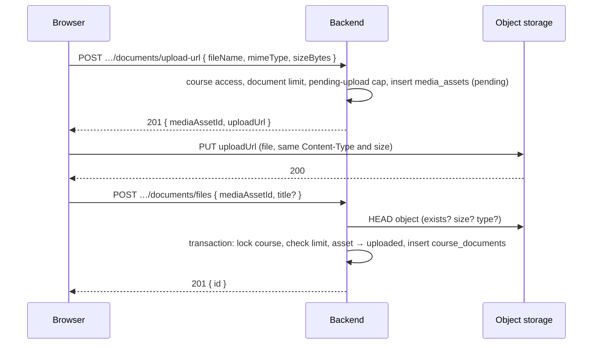
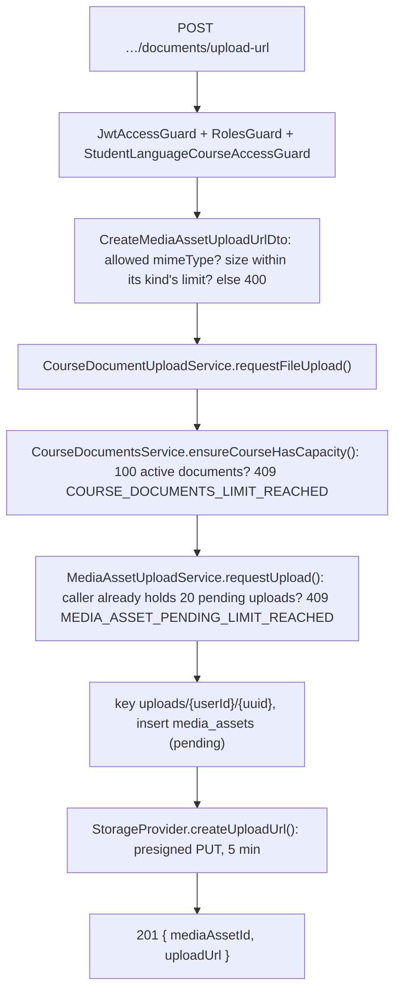
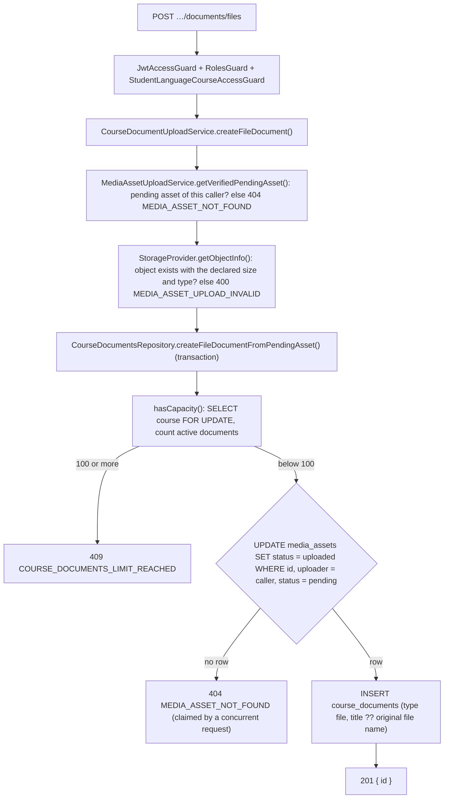
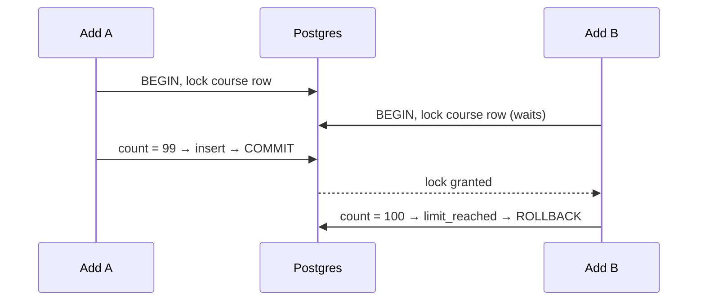
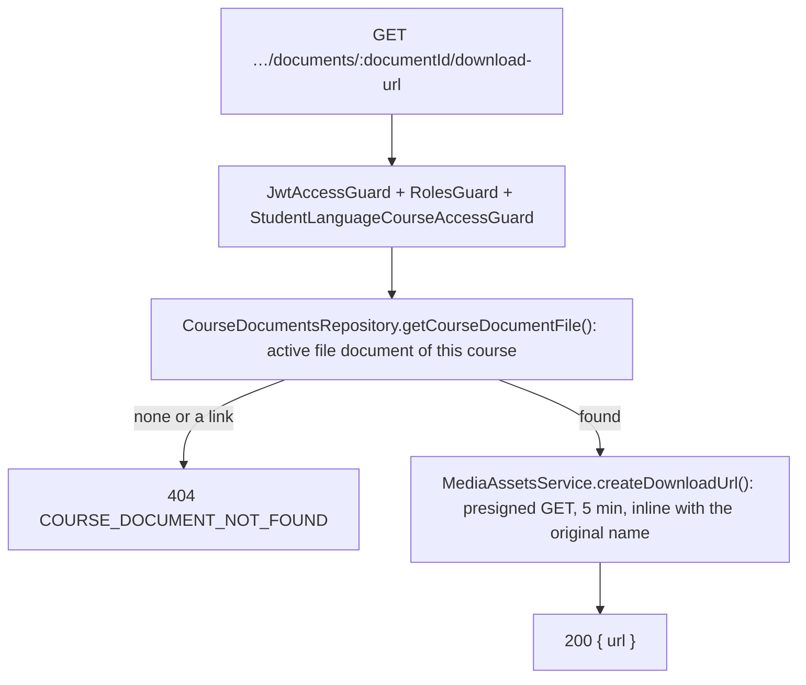
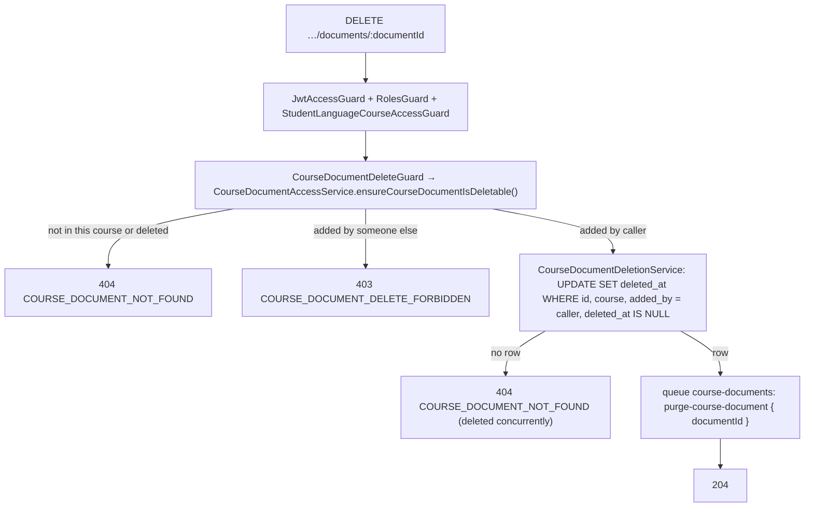
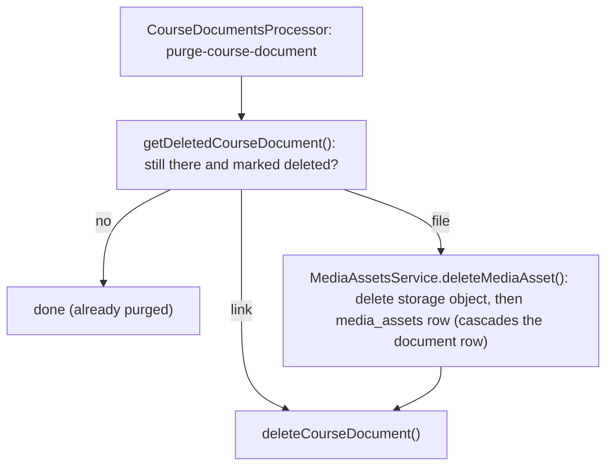

# Course Document Endpoints

A course document is a **file** (uploaded to object storage) or a **link** (an external https URL, e.g. a Google Sheet) attached to one language course. The course's student and the teacher who runs it can add, list, open and delete; only the user who added a document can delete it.

How files are stored, the `media_assets` table and the stale-upload cleanup are described in [media-assets.md](../media-assets/media-assets.md) and [storage.md](../storage.md).

## Routes

All routes live in `CourseDocumentsController`, under `/students/:studentId/courses/:courseId/documents`.

| Method | Route | Result | Extra guard |
|---|---|---|---|
| `POST` | `…/documents/upload-url` | `201 { mediaAssetId, uploadUrl }` | |
| `POST` | `…/documents/files` | `201 { id }` | |
| `POST` | `…/documents/links` | `201 { id }` | |
| `GET` | `…/documents/:documentId/download-url` | `200 { url }` | |
| `DELETE` | `…/documents/:documentId` | `204` | `CourseDocumentDeleteGuard` |

The list has no route of its own: it is part of `GET /students/:studentId/courses/:courseId` (see [Course Details](language-course-endpoints.md#course-details)).

## Access

Every route runs `JwtAccessGuard`, `RolesGuard` (teacher or student) and `StudentLanguageCourseAccessGuard`, which calls `StudentLanguageCourseAccessService.ensureCourseIsAccessible()`:

- the student themselves: the course must belong to them;
- a teacher: they must run this course (`student_language_courses.teacher_id`).

Anything else is `404 STUDENT_LANGUAGE_COURSE_NOT_FOUND`. `StudentAccessGuard` is not used here: the course check is stricter and implies it.

## Upload a File

A file takes three requests. The browser sends the bytes straight to storage; the backend only signs URLs and checks the result.



### Step 1: upload URL



- The size limit depends on the type (documents 20 MB, images 10 MB, audio 50 MB) and is checked in the DTO by `IsWithinMediaAssetSizeLimitConstraint`, so it returns a standard validation `400`.
- The upload URL is signed with `content-type` and `content-length`: storage rejects a different type or size with `403`.
- The capacity check here is an early exit, so a full course does not get files uploaded in vain. It is not the guarantee: step 2 checks the limit again under a lock.
- Pending uploads count against no course until attached, so each user may hold at most 20 (`mediaAssetsConfig.UPLOAD.MAX_PENDING_PER_UPLOADER`). This is a per-user cap rather than `@Throttle`, because every request reaches the backend from the Next server's IP. It is a soft cap: parallel requests can pass the count together.

### Step 2: attach the file



- The client sends `mediaAssetId`, never a storage key, so it can only attach an upload the backend issued to it.
- The conditional update plus the unique `course_documents.media_asset_id` make one upload attachable once.
- A rejected upload stays `pending` and is removed by the daily cleanup.
- The repository returns an outcome (`CourseDocumentCreateOutcome`: `created`, `limit_reached`, `asset_unavailable`), and `CourseDocumentsService.toCreatedDocument()` turns it into the response or the `409`/`404`.

### Document limit under concurrency

Counting first and inserting afterwards would let two parallel adds both see 99 documents and end at 101. So the count runs inside the insert transaction, after a pessimistic row lock on the course (`SELECT … FOR UPDATE` on `student_language_courses`):



Only adds to the same course wait for each other. Links and files use the same `hasCapacity()` helper.

## Add a Link

```txt
POST …/documents/links  { url, title }  ->  201 { id }
```

- `url`: `https` only, at most 2048 characters (`@IsUrl({ protocols: ['https'], require_protocol: true })`). It is stored as-is and never fetched by the server.
- `title`: required, 1–255 characters.
- Same document limit as files, checked the same way inside the insert transaction (`CourseDocumentsRepository.createLinkDocument()`): `409 COURSE_DOCUMENTS_LIMIT_REACHED`.

## Course Details List

`StudentLanguageCoursesService.getStudentLanguageCourse()` adds `documents` to both the teacher's and the student's view through `CourseDocumentsService.getCourseDocuments()`:

```json
{ "id": "…", "type": "file", "title": "Homework week 3", "url": null,
  "file": { "sizeBytes": 2048000, "kind": "document" },
  "addedBy": { "name": "Max Student", "role": "student" }, "canDelete": false }
```

- Active documents only (`deleted_at IS NULL`), newest first; one query with left joins on `users` and `media_assets`.
- `file` is set for files, `url` for links. `addedBy` is `null` once the adding user is deleted. `canDelete` is `addedByUserId === caller`; the id itself is not returned.

## Open a File



The URL makes storage answer with `Content-Disposition: inline; filename*=UTF-8''…`: the browser displays PDFs, images, audio and text, downloads other types (Office files), and keeps the original name for saving. The frontend opens it in a new tab.

## Delete a Document



The document disappears from the list at once. The purge job then removes it for good:



- The file goes first, so a failed attempt is retried (5 attempts, exponential backoff from 5 s) without losing track of it.
- Every step is safe to repeat: a missing object, asset or row counts as already deleted.

## Errors

| Status | Error code | When |
|---|---|---|
| 400 | validation (no specific code) | invalid UUID, body, type, size, URL or title |
| 400 | `MEDIA_ASSET_UPLOAD_INVALID` | uploaded object missing or not matching the declared size or type |
| 403 | `COURSE_DOCUMENT_DELETE_FORBIDDEN` | deleting a document someone else added |
| 404 | `STUDENT_LANGUAGE_COURSE_NOT_FOUND` | no access to the course |
| 404 | `MEDIA_ASSET_NOT_FOUND` | upload unknown, already attached, or requested by another user |
| 404 | `COURSE_DOCUMENT_NOT_FOUND` | document not in this course, deleted, or a link (open) |
| 409 | `COURSE_DOCUMENTS_LIMIT_REACHED` | course already has 100 active documents |
| 409 | `MEDIA_ASSET_PENDING_LIMIT_REACHED` | upload URL requested while the caller already holds 20 unattached uploads |

## Files

- `src/modules/students/controllers/course-documents.controller.ts`
- `src/modules/students/guards/student-language-course-access.guard.ts`
- `src/modules/students/guards/course-document-delete.guard.ts`
- `src/modules/students/services/student-language-course-access.service.ts`
- `src/modules/students/services/course-documents.service.ts`
- `src/modules/students/services/course-document-upload.service.ts`
- `src/modules/students/services/course-document-access.service.ts`
- `src/modules/students/services/course-document-deletion.service.ts`
- `src/modules/students/services/course-documents-queue.service.ts`
- `src/modules/students/processors/course-documents.processor.ts`
- `src/modules/students/repositories/course-documents.repository.ts`
- `src/modules/students/constants/repository/course-document-select-fields.constant.ts`
- `src/modules/students/dto/create-course-file-document.dto.ts`
- `src/modules/students/dto/create-course-link-document.dto.ts`
- `src/modules/students/config.ts` (`COURSE_DOCUMENTS`)
- `src/constant/swagger/students/course-documents.swagger.ts` and the per-endpoint `*-course-*document*.swagger.ts` files

Self-check questions: [course-documents-quiz.md](course-documents-quiz.md).
