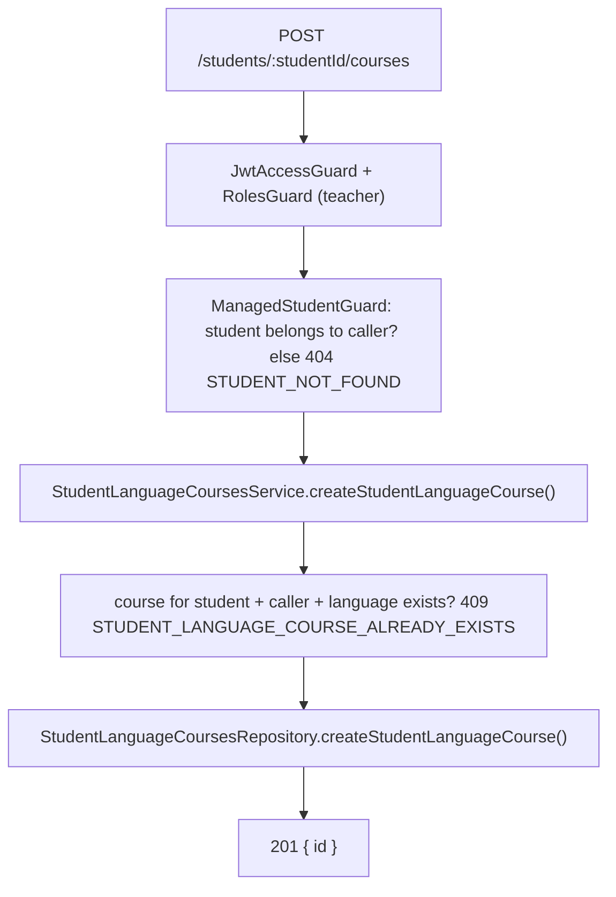
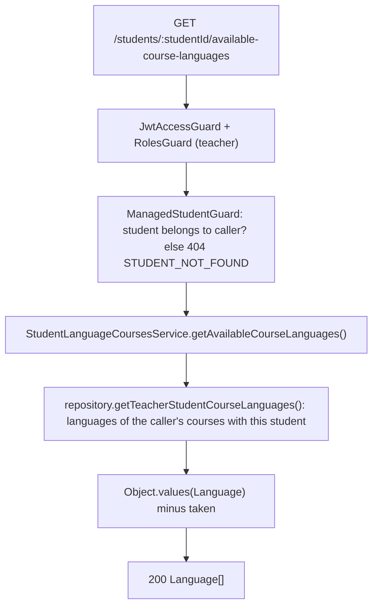
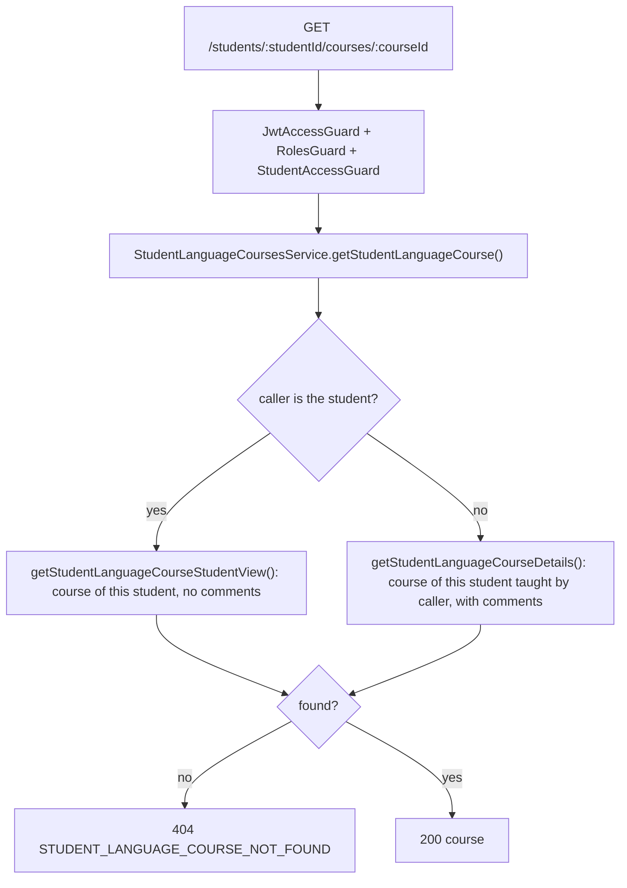
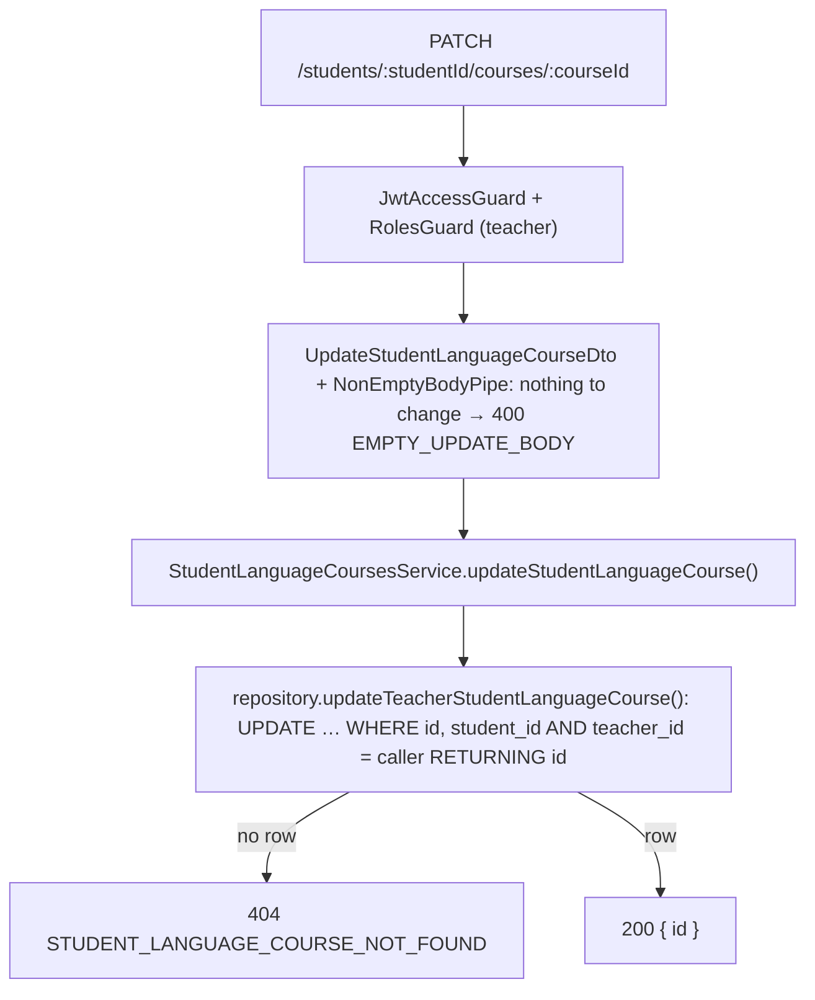

# Language Course Endpoints

A language course links a student, a teacher and one language, and holds one or more learning goals, a free-text special goal, teacher comments and five skill levels. A student can learn several languages with several teachers; a teacher can have one course per language with the same student.

Access rules and guards are described in [student-endpoints.md](student-endpoints.md#access-rules).

## Routes

| Method | Route | Roles | Access guard |
|---|---|---|---|
| `POST` | `/students/:studentId/courses` | teacher | `ManagedStudentGuard` |
| `GET` | `/students/:studentId/available-course-languages` | teacher | `ManagedStudentGuard` |
| `GET` | `/students/:studentId/courses` | teacher, student | `StudentAccessGuard` |
| `GET` | `/students/:studentId/courses/:courseId` | teacher, student | `StudentAccessGuard` |
| `PATCH` | `/students/:studentId/courses/:courseId` | teacher | none: the update query is scoped to the caller |

All course routes live in `StudentLanguageCoursesController`.

## Create Course

```txt
POST /students/:studentId/courses
{ language, learningGoals, specialGoal?, comments?, grammarLevel?, vocabularyLevel?,
  speakingLevel?, readingLevel?, listeningLevel? }  ->  201 { id }
```



- `teacherId` always comes from the caller, never from the body.
- `language` and `learningGoals` are required. `learningGoals` is a non-empty array of `LearningGoal` values without duplicates (`@IsArray`, `@ArrayNotEmpty`, `@ArrayUnique`, `@IsEnum(each)`), stored in the order sent; the database check `cardinality(learning_goals) >= 1` backs it up. `specialGoal` is optional free text, independent of the goals. Levels use the `LanguageLevel` enum (`a0` … `c2`, e.g. `b1_plus`).
- The unique constraint `(student_id, teacher_id, language)` backs up the duplicate check.

## Available Languages

```txt
GET /students/:studentId/available-course-languages  ->  200 ["german", "french", ...]
```

Languages in which the caller can still create a course for this student; `[]` when every language is taken. The frontend uses it to fill the create form's language select.



The repository returns only the taken languages (`language` column only); deciding what is available is the service's job.

## List Courses

```txt
GET /students/:studentId/courses?language=english  ->  200 [{ id, language, learningGoals }]
```

| Caller | Courses returned | Repository method |
|---|---|---|
| the student themselves | all their courses, from every teacher | `getStudentLanguageCourseCards({ studentId, language })` |
| a teacher | only the courses they teach to this student | `getTeacherStudentLanguageCourseCards({ studentId, teacherId, language })` |

Newest first, no pagination. `language` is optional (`GetStudentLanguageCoursesQueryDto`, validated with `@IsEnum(Language)`, `400` otherwise). The controller passes `null` when it is missing, and the repository's `languageFilter()` adds `language = $1` to the `where` only when it is set.

## Course Details

```txt
GET /students/:studentId/courses/:courseId  ->  200 { id, language, learningGoals, specialGoal, …levels, comments? }
```



`comments` are the teacher's private notes: the student's query never selects them.

## Update Course

```txt
PATCH /students/:studentId/courses/:courseId
{ learningGoals?, specialGoal?, comments?, grammarLevel?, vocabularyLevel?,
  speakingLevel?, readingLevel?, listeningLevel? }  ->  200 { id }
```



- An omitted field is kept and `null` clears it, except `learningGoals`: it replaces the whole set and may not be `null` or `[]` (`@ValidateIf(value !== undefined)` instead of `@IsOptional()`, so `null` still fails `@IsArray()` with `400`).
- `language` is not in the DTO, so sending it fails with `400` (`forbidNonWhitelisted`); a course's language never changes.
- No access guard: one `UPDATE` scoped by course, student and teacher both checks access and writes. A course of another teacher, of another student, or a missing one all return the same `404`.

## Files

- `src/modules/students/controllers/student-language-courses.controller.ts`
- `src/modules/students/services/student-language-courses.service.ts`
- `src/modules/students/repositories/student-language-courses.repository.ts`
- `src/modules/students/dto/create-student-language-course.dto.ts`
- `src/modules/students/dto/get-student-language-courses-query.dto.ts`
- `src/modules/students/dto/update-student-language-course.dto.ts`
- `src/constant/swagger/students/update-student-language-course.swagger.ts`
- `src/modules/students/constants/repository/student-language-course-select-fields.constant.ts`
- `src/modules/students/constants/repository/student-language-course-language-select-fields.constant.ts`
- `src/constant/swagger/students/get-available-course-languages.swagger.ts`
