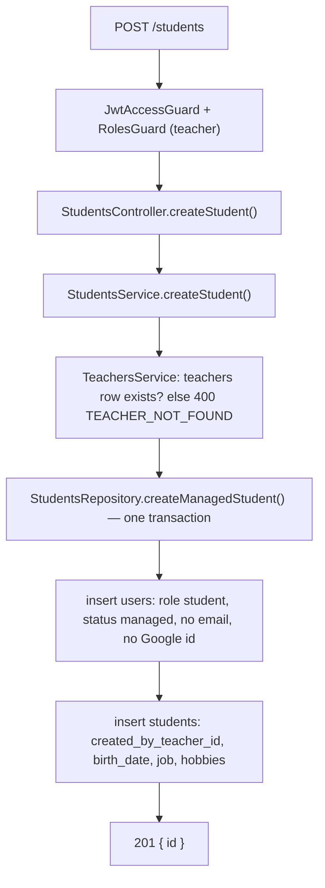
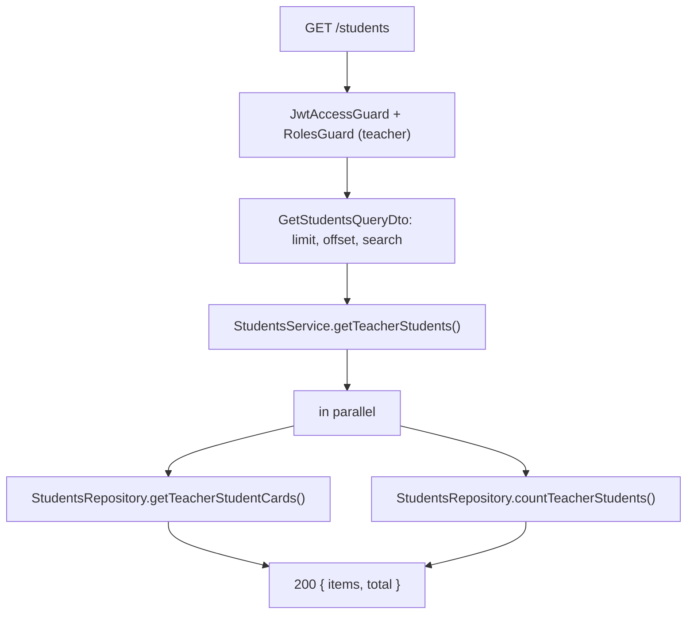
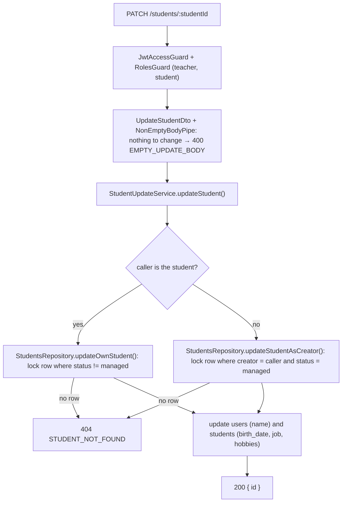

# Student Endpoints

Teachers create and manage students. A created student is a `users` row with `role = student` and `status = managed` plus a `students` profile row. Managed users cannot sign in; they exist so the teacher can keep student data.

Language courses are documented in [language-course-endpoints.md](language-course-endpoints.md). Self-check questions: [quiz.md](quiz.md).

## Routes

| Method | Route | Roles |
|---|---|---|
| `POST` | `/students` | teacher |
| `GET` | `/students` | teacher |
| `GET` | `/students/:studentId` | teacher, student |
| `PATCH` | `/students/:studentId` | teacher, student |

Every route runs `JwtAccessGuard` and `RolesGuard`; that is the only guarding. All routes need the `accessToken` cookie. A wrong role returns `403 FORBIDDEN`.

## Access Rules

A student **belongs to** a teacher when the teacher created them (`students.created_by_teacher_id`) **or** has a course with them (`student_language_courses.teacher_id`). The condition lives once in `StudentsRepository.belongsToTeacher()`.


| Route | Where access is enforced | Who passes |
|---|---|---|
| `GET /students/:studentId` | `getStudentDetailsWithEditAccess()`: `user_id = studentId AND (user_id = caller OR belongsToTeacher(caller))` | the student themselves, or a teacher the student belongs to |
| `PATCH /students/:studentId` | `updateOwnStudent()` (`status != managed`) or `updateStudentAsCreator()` (`created_by_teacher_id = caller AND status = managed`) | the student once they have their own account, or the **creating** teacher while the student is `managed` |

Every denial is `404 STUDENT_NOT_FOUND`, never `403`, so callers cannot probe which student ids exist; that includes the creating teacher of a student who has since activated their account. A teacher who only teaches the student a course can read but not edit them. `StudentAccessService.isStudentEditable()` repeats the edit rule in code to fill `isEditable` in the details response; keep it in step with the two update queries.

Course and course document access is described in [language-course-endpoints.md](language-course-endpoints.md) and [course-document-endpoints.md](course-document-endpoints.md#access).

## Create Student

```txt
POST /students
{ name, birthDate?, job?, hobbies? }  ->  201 { id }
```



- `name` is required (1–255). `birthDate` (ISO date), `job` (≤ 255) and `hobbies` (≤ 20 items, ≤ 100 chars each) are optional.
- There is no `email` field: sending one returns `400` (`forbidNonWhitelisted`). If a teacher could set an email, a managed student would reserve that address, and its real owner could never sign in with Google.
- The student is always linked to the calling teacher through `created_by_teacher_id`.
- No email is sent.

## List My Students

```txt
GET /students?limit=20&offset=0&search=an  ->  200 { items: [{ id, name, job, hobbies }], total }
```



- Only students that belong to the caller. Newest first (`created_at desc`).
- `limit` 1–100 (default 20), `offset` ≥ 0 (default 0).
- `search` (optional, case-insensitive) matches a student whose **name or email starts with it**: `an` matches "Anna …" and `andrew@example.com`. Students without an email (managed students) match by name only.
- `search` is matched literally: `escapeLikePattern()` (`src/common/helpers/string/`) escapes `%`, `_` and `\` before `StudentsRepository.startsWithFilter()` appends the trailing `%`, so typing `_` or `%` does not act as a wildcard.

## Student Details

```txt
GET /students/:studentId  ->  200 { id, name, email, birthDate, job, hobbies, status, isEditable }
```

`StudentsService.getStudentDetails()` loads the student joined with its user in one query (`StudentsRepository.getStudentDetailsWithEditAccess()`), whose `WHERE` also checks access. That query also selects `created_by_teacher_id`, which feeds the edit flag and is left out of the response. `email` is `null` for managed students. `isEditable` tells the client whether `PATCH` would be allowed for this caller. A missing or inaccessible student returns `404 STUDENT_NOT_FOUND`.

## Update Student

```txt
PATCH /students/:studentId
{ name?, birthDate?, job?, hobbies? }  ->  200 { id }
```



- `NonEmptyBodyPipe` (`src/common/pipes/non-empty-body.pipe.ts`) runs after the global `ValidationPipe` and rejects a body without any defined field.
- Nobody can change the email here, so `email` in the body returns `400` (`forbidNonWhitelisted`). An activated student's email belongs to their account (auth); a teacher setting one would reserve someone else's address.
- Both updates go through `updateLockedStudent()`: it selects the student row with the editor's condition `FOR UPDATE` and writes in the same transaction, so a teacher cannot edit a student who activates their account at the same moment. Anyone else, or a wrong student id, matches no row and gets `404`.
- `applyStudentUpdate` skips the `users` or `students` update when it has no defined fields.

## Files

- `src/modules/students/controllers/students.controller.ts`
- `src/modules/students/services/students.service.ts`, `student-access.service.ts`, `student-update.service.ts`
- `src/modules/students/repositories/students.repository.ts`
- `src/modules/students/dto/create-student.dto.ts`, `get-students-query.dto.ts`, `update-student.dto.ts`
- `src/common/pipes/non-empty-body.pipe.ts`
- `src/constant/swagger/students/update-student.swagger.ts`

Self-check questions: [review-fixes-quiz.md](review-fixes-quiz.md).
