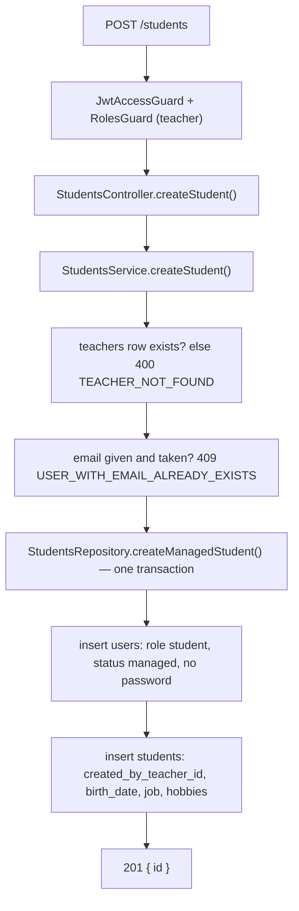
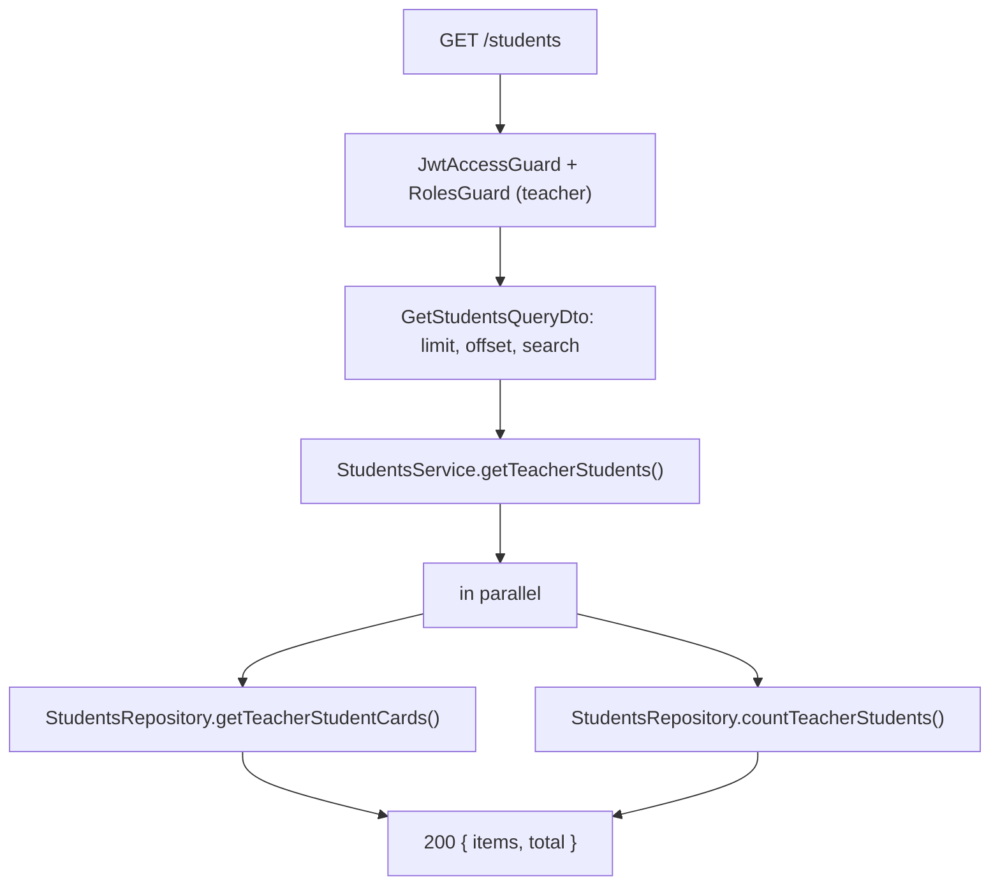
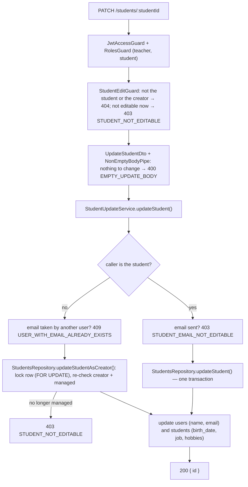

# Student Endpoints

Teachers create and manage students. A created student is a `users` row with `role = student` and `status = managed` plus a `students` profile row. Managed users cannot sign in; they exist so the teacher can keep student data.

Language courses are documented in [language-course-endpoints.md](language-course-endpoints.md). Self-check questions: [quiz.md](quiz.md).

## Routes

| Method | Route | Roles | Guards |
|---|---|---|---|
| `POST` | `/students` | teacher | `JwtAccessGuard`, `RolesGuard` |
| `GET` | `/students` | teacher | `JwtAccessGuard`, `RolesGuard` |
| `GET` | `/students/:studentId` | teacher, student | `JwtAccessGuard`, `RolesGuard`, `StudentAccessGuard` |
| `PATCH` | `/students/:studentId` | teacher, student | `JwtAccessGuard`, `RolesGuard`, `StudentEditGuard` |

All routes need the `accessToken` cookie. A wrong role returns `403 FORBIDDEN`.

## Access Rules

A student **belongs to** a teacher when the teacher created them (`students.created_by_teacher_id`) **or** has a course with them (`student_language_courses.teacher_id`). The condition lives once in `StudentsRepository.belongsToTeacher()`.

| Guard | Allows | Used by |
|---|---|---|
| `ManagedStudentGuard` | a teacher the student belongs to | `POST /students/:studentId/courses` |
| `StudentAccessGuard` | the student themselves (`user.id === studentId`), or a teacher the student belongs to | `GET /students/:studentId`, both course `GET` routes |
| `StudentEditGuard` | the student themselves once they have their own account (`status != managed`), or the **creating** teacher while the student is `managed` | `PATCH /students/:studentId` |

`StudentEditGuard` calls `StudentAccessService.ensureStudentIsEditable()`. A caller who is neither the student nor the creating teacher gets `404 STUDENT_NOT_FOUND`; a candidate who may not edit right now gets `403 STUDENT_NOT_EDITABLE`. A teacher who only teaches the student a course can read but not edit them. The same rule, `isStudentEditable()`, fills `isEditable` in the details response.

Both guards parse `:studentId` as a UUID and delegate to `StudentAccessService`. Denials return `404 STUDENT_NOT_FOUND`, never `403`, so callers cannot probe which student ids exist.

## Create Student

```txt
POST /students
{ name, email?, birthDate?, job?, hobbies? }  ->  201 { id }
```



- `name` is required (1–255). `email` (unique if present), `birthDate` (ISO date), `job` (≤ 255) and `hobbies` (≤ 20 items, ≤ 100 chars each) are optional.
- The student is always linked to the calling teacher through `created_by_teacher_id`.
- No email is sent and no password is set.

## List My Students

```txt
GET /students?limit=20&offset=0&search=an  ->  200 { items: [{ id, name, job, hobbies }], total }
```



- Only students that belong to the caller. Newest first (`created_at desc`).
- `limit` 1–100 (default 20), `offset` ≥ 0 (default 0).
- `search` (optional, case-insensitive) matches a student whose **name or email starts with it**: `an` matches "Anna …" and `andrew@example.com`. Students without an email match by name only.

## Student Details

```txt
GET /students/:studentId  ->  200 { id, name, email, birthDate, job, hobbies, status, isEditable }
```

`StudentAccessGuard` checks access, then `StudentsService.getStudentDetails()` loads, in parallel, the student joined with its user and the edit-access data (`created_by_teacher_id`, `status`). `isEditable` tells the client whether `PATCH` would be allowed for this caller. A missing student returns `404 STUDENT_NOT_FOUND`.

## Update Student

```txt
PATCH /students/:studentId
{ name?, email?, birthDate?, job?, hobbies? }  ->  200 { id }
```



- `NonEmptyBodyPipe` (`src/common/pipes/non-empty-body.pipe.ts`) runs after the global `ValidationPipe` and rejects a body without any defined field.
- Once the student has their own account, the email belongs to auth, so only the creating teacher of a managed student can change it.
- `updateStudentAsCreator` locks the student row and re-checks `created_by_teacher_id` and `status = managed` inside the transaction, so a student activating their account at the same moment cannot have their email changed by the teacher.
- `applyStudentUpdate` skips the `users` or `students` update when it has no defined fields.

## Files

- `src/modules/students/controllers/students.controller.ts`
- `src/modules/students/services/students.service.ts`, `student-access.service.ts`, `student-update.service.ts`
- `src/modules/students/repositories/students.repository.ts`
- `src/modules/students/guards/`
- `src/modules/students/dto/create-student.dto.ts`, `get-students-query.dto.ts`, `update-student.dto.ts`
- `src/common/pipes/non-empty-body.pipe.ts`
- `src/constant/swagger/students/update-student.swagger.ts`
