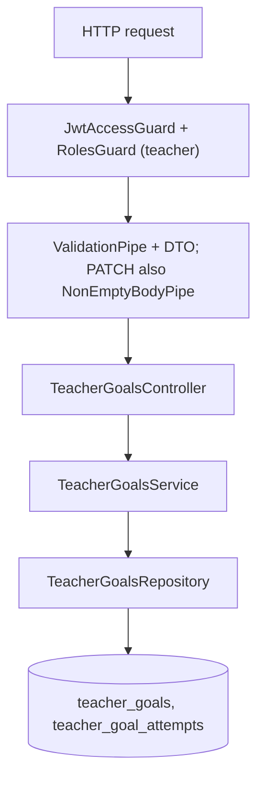
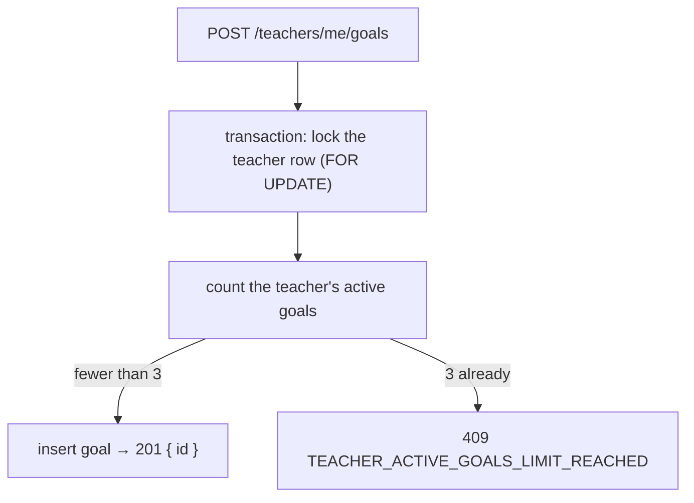
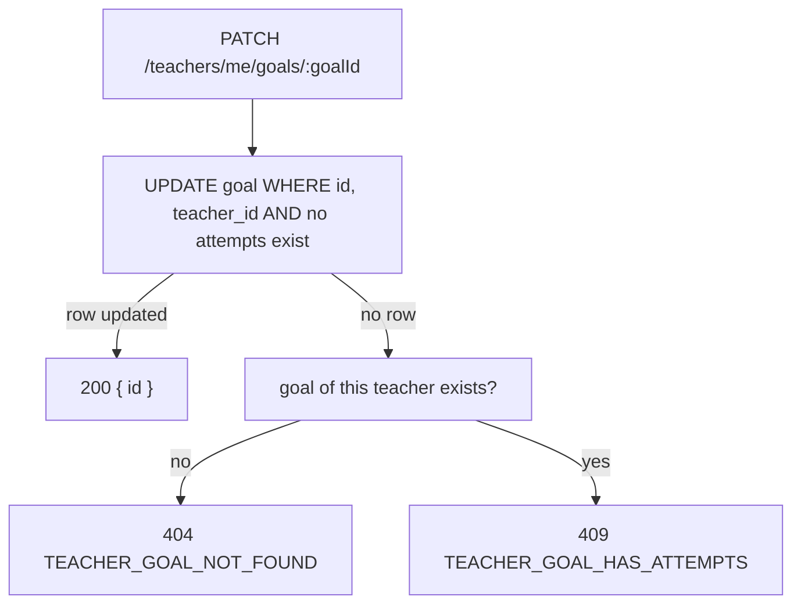

# Teacher Goal Endpoints

A teacher keeps their own improvement goals. Each time they address a goal it is marked: one `teacher_goal_attempts` row is added per mark. The tables are described in [entities.md](../db/entities.md). Marks and progress checks have no endpoints yet.

## Routes

All routes live in `TeacherGoalsController` (`src/modules/teachers/controllers/teacher-goals.controller.ts`), under `/teachers/me/goals`.

| Method | Route | Result |
|---|---|---|
| `POST` | `/teachers/me/goals` | `201 { id }` |
| `GET` | `/teachers/me/goals?status=&limit=&offset=` | `200 { items, total }` |
| `PATCH` | `/teachers/me/goals/:goalId` | `200 { id }` |
| `DELETE` | `/teachers/me/goals/:goalId` | `204` |

## Access

Every route runs `JwtAccessGuard` and `RolesGuard` (teachers only). The teacher id always comes from the access token. Every query filters by it, so another teacher's goal returns `404 TEACHER_GOAL_NOT_FOUND`: the API never reveals that the goal exists.

## Request Flow

## Create

Requires a `title` of at most 255 characters; `details` is optional, at most 2000. The goal starts active (`completedAt` is null).

A teacher can have at most 3 active goals (`teachersConfig.GOALS.MAX_ACTIVE_PER_TEACHER`). Completed goals don't count, so their number is unlimited.

The lock makes two creates sent at the same moment run one after the other, so both can't pass the count.

## List

Returns the teacher's goals newest first, each with `attemptCount` (the number of marks). `status=active` returns goals that are not completed, `status=completed` returns completed ones, and leaving it out returns both. Pagination works as it does for students: `limit` defaults to 20 (max 100) and `offset` to 0. `total` counts every goal that matches the filter.

## Update

A goal can only be edited before its first mark. Once a teacher has worked against a goal, changing its wording would change what those marks mean.

- The "no marks" check is part of the `UPDATE` statement itself, so the read and the write can't drift apart. The lookup only runs on failure, to choose the right error.
- `title` cannot be cleared. `details` can be cleared with `null`. An empty body returns `400 EMPTY_UPDATE_BODY`.

## Delete

Allowed at any time; the frontend asks for confirmation first. It is a hard delete, and the goal's attempts and progress checks go with it (FK `onDelete: cascade`). A missing goal, or another teacher's, returns `404 TEACHER_GOAL_NOT_FOUND`.

## Errors

| Status | Error code | When |
|---|---|---|
| `400` | validation / `EMPTY_UPDATE_BODY` | Invalid body, query or UUID; PATCH with nothing to change |
| `401` | `INVALID_ACCESS_TOKEN` | Missing or invalid access token |
| `403` | `FORBIDDEN` | Caller is not a teacher |
| `404` | `TEACHER_GOAL_NOT_FOUND` | Goal does not exist or belongs to another teacher |
| `409` | `TEACHER_GOAL_HAS_ATTEMPTS` | PATCH on a goal that already has a mark |
| `409` | `TEACHER_ACTIVE_GOALS_LIMIT_REACHED` | POST when the teacher already has 3 active goals |
