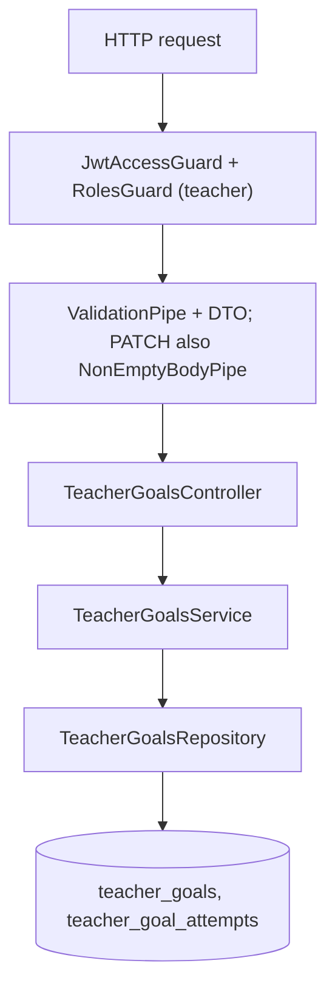
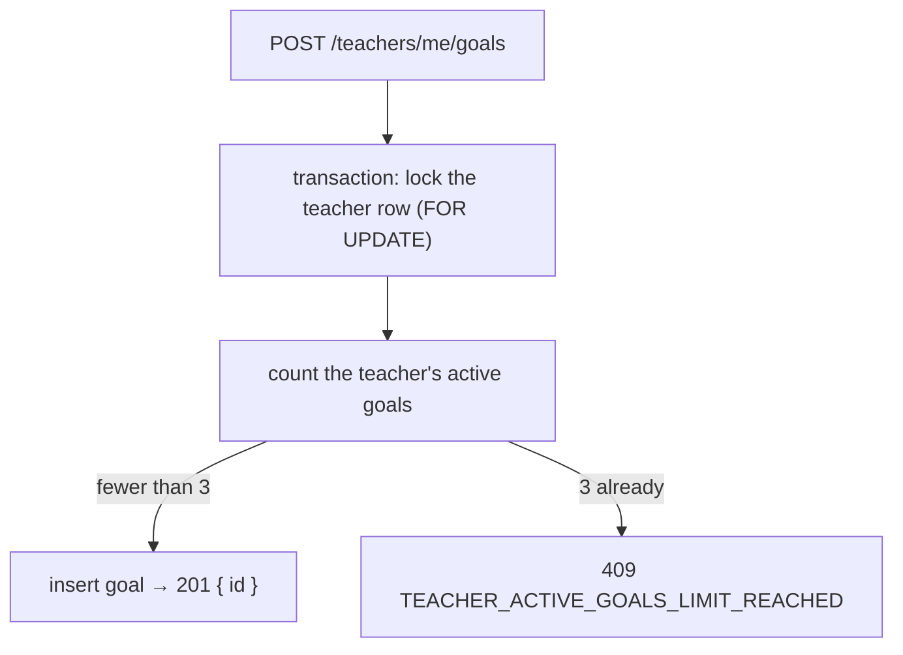
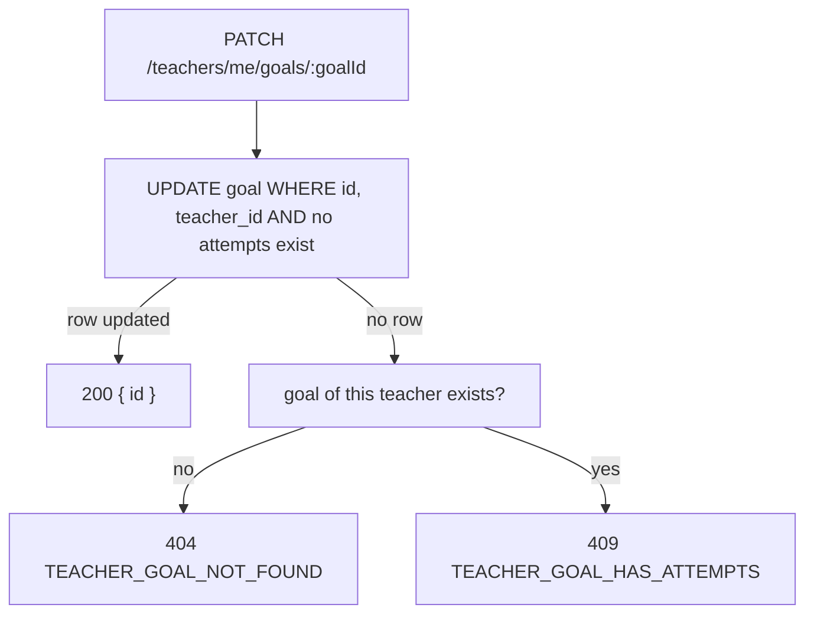
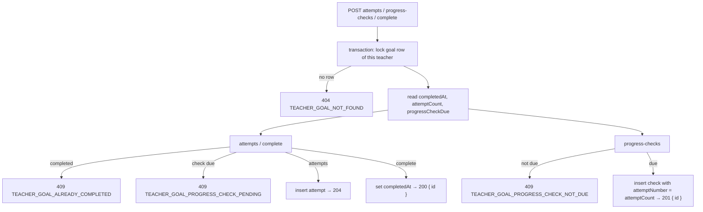

# Teacher Goal Endpoints

A teacher keeps their own improvement goals. Each time they address a goal it is marked: one `teacher_goal_attempts` row is added per mark. Every 5 marks (`teachersConfig.GOALS.PROGRESS_CHECK_INTERVAL`) the teacher must answer a progress check (`success`, `same` or `worse`). The tables are described in [entities.md](../db/entities.md).

## Routes

All routes live in `TeacherGoalsController` (`src/modules/teachers/controllers/teacher-goals.controller.ts`), under `/teachers/me/goals`.

| Method | Route | Result |
|---|---|---|
| `POST` | `/teachers/me/goals` | `201 { id }` |
| `GET` | `/teachers/me/goals?status=&limit=&offset=` | `200 { items, total }` |
| `PATCH` | `/teachers/me/goals/:goalId` | `200 { id }` |
| `DELETE` | `/teachers/me/goals/:goalId` | `204` |
| `POST` | `/teachers/me/goals/:goalId/attempts` | `204` |
| `POST` | `/teachers/me/goals/:goalId/progress-checks` | `201 { id }` |
| `POST` | `/teachers/me/goals/:goalId/complete` | `200 { id }` |

## Access

Every route runs `JwtAccessGuard` and `RolesGuard` (teachers only). The teacher id always comes from the access token. Every query filters by it, so another teacher's goal returns `404 TEACHER_GOAL_NOT_FOUND`: the API never reveals that the goal exists.

## Request Flow

## Create

Requires a `title` of at most 255 characters; `details` is optional, at most 2000. The goal starts active (`completedAt` is null).

A teacher can have at most 3 active goals (`teachersConfig.GOALS.MAX_ACTIVE_PER_TEACHER`). Completed goals don't count, so their number is unlimited.

The lock makes two creates sent at the same moment run one after the other, so both can't pass the count.

## List

Returns the teacher's goals newest first, each with `attemptCount` (the number of marks) and `progressCheckDue` (see [Progress checks](#progress-checks)). `status=active` returns goals that are not completed, `status=completed` returns completed ones, and leaving it out returns both. Pagination works as it does for students: `limit` defaults to 20 (max 100) and `offset` to 0. `total` counts every goal that matches the filter.

## Update

A goal can only be edited before its first mark. Once a teacher has worked against a goal, changing its wording would change what those marks mean.

- The "no marks" check is part of the `UPDATE` statement itself, so the read and the write can't drift apart. The lookup only runs on failure, to choose the right error.
- `title` cannot be cleared. `details` can be cleared with `null`. An empty body returns `400 EMPTY_UPDATE_BODY`.

## Progress checks

`progressCheckDue` is true when `attemptCount` is a positive multiple of 5 and no progress check exists yet for that attempt number. It is computed in SQL, so the frontend only reads the flag: when it is true, it shows the "mark progress" button and hides "add mark" and "complete". The attempt count alone is not enough, because after the check at 5 is answered the count is still 5.

## Mark, progress check, complete

All three writes run in one transaction that first locks the goal row (`SELECT … FOR UPDATE`, filtered by goal id and teacher id) and then reads its state in a new statement. The lock makes double clicks run one after the other, so two marks can't both slip past the 5th-mark check. The state is read after the lock because subqueries inside a `FOR UPDATE` that had to wait still see the data from before the wait.

- **Mark** returns no body: the frontend refreshes the page after every write and reads the new `attemptCount` and `progressCheckDue` from the list.
- **Progress check**: the server sets `attemptNumber` to the current count; the client only sends `status`. A completed goal never has a check due, because completion is blocked while one is due.
- **Complete** frees an active-goal slot. There is no reopen, and answering `success` does not complete the goal.

## Delete

Allowed at any time; the frontend asks for confirmation first. It is a hard delete, and the goal's attempts and progress checks go with it (FK `onDelete: cascade`). A missing goal, or another teacher's, returns `404 TEACHER_GOAL_NOT_FOUND`.

## Errors

| Status | Error code | When |
|---|---|---|
| `400` | validation / `EMPTY_UPDATE_BODY` | Invalid body, query or UUID; PATCH with nothing to change |
| `401` | `INVALID_ACCESS_TOKEN` | Missing or invalid access token |
| `403` | `FORBIDDEN` | Caller is not a teacher |
| `404` | `TEACHER_GOAL_NOT_FOUND` | Goal does not exist or belongs to another teacher |
| `409` | `TEACHER_GOAL_HAS_ATTEMPTS` | PATCH on a goal that already has a mark |
| `409` | `TEACHER_ACTIVE_GOALS_LIMIT_REACHED` | POST when the teacher already has 3 active goals |
| `409` | `TEACHER_GOAL_ALREADY_COMPLETED` | Mark or complete a completed goal |
| `409` | `TEACHER_GOAL_PROGRESS_CHECK_PENDING` | Mark or complete while a progress check is due |
| `409` | `TEACHER_GOAL_PROGRESS_CHECK_NOT_DUE` | Progress check when none is due |

Self-check questions: [teacher-goals-quiz.md](teacher-goals-quiz.md).
