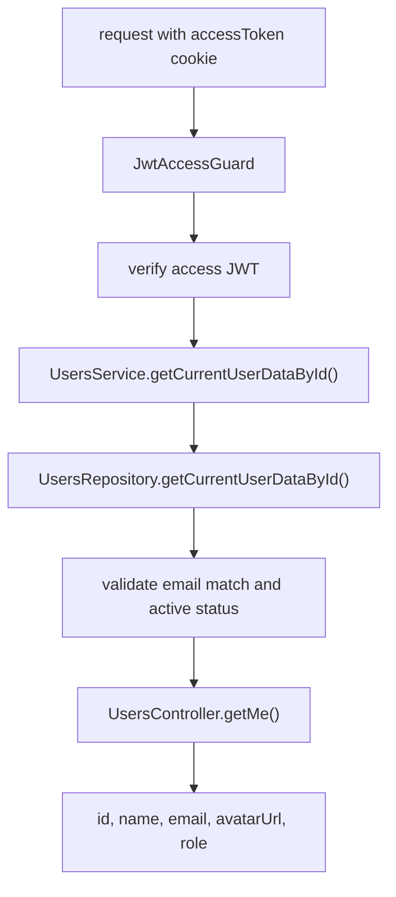

# Current User Endpoint

The users module exposes the current authenticated user's public profile fields.

## Route

```txt
GET /users/me
```

Response body:

```ts
{
  id: string;
  name: string;
  email: string;
  avatarUrl: string | null;
  role: UserRole;
}
```

## Flow



## Behavior

- Requires a valid `accessToken` cookie.
- Loads only `id`, `name`, `email`, `avatarUrl`, `role`, and `status` from the database.
- Uses `status` only for guard validation.
- Returns `id`, `name`, `email`, `avatarUrl`, and `role` (the same object the guard puts on `request.user`; other controllers read the caller id from it).
- Rejects missing, invalid, expired, or inactive-user access tokens with `INVALID_ACCESS_TOKEN`.

## Implementation Files

- `src/modules/users/controllers/users.controller.ts`
- `src/modules/users/services/users.service.ts`
- `src/modules/users/repositories/users.repository.ts`
- `src/common/auth/guards/jwt-access.guard.ts`
