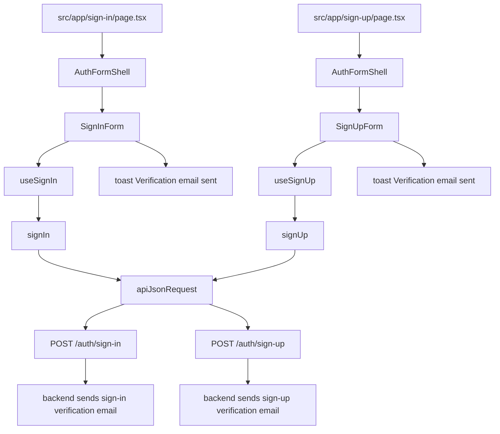
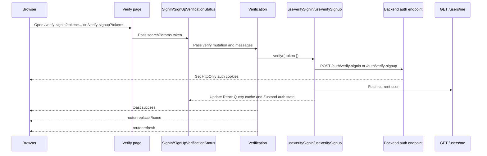
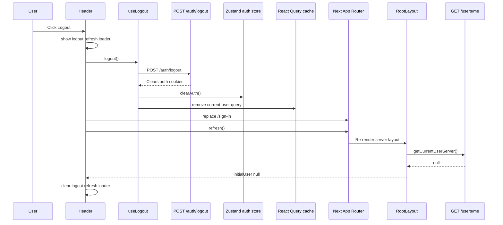
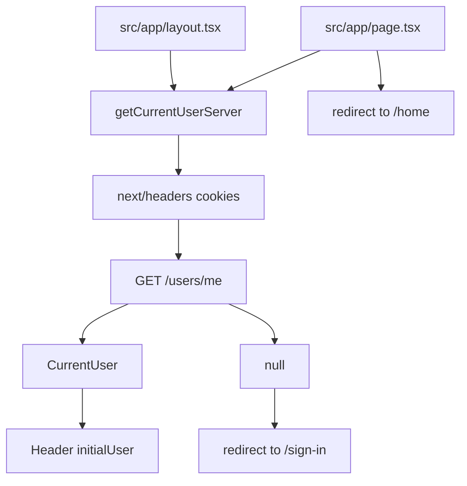
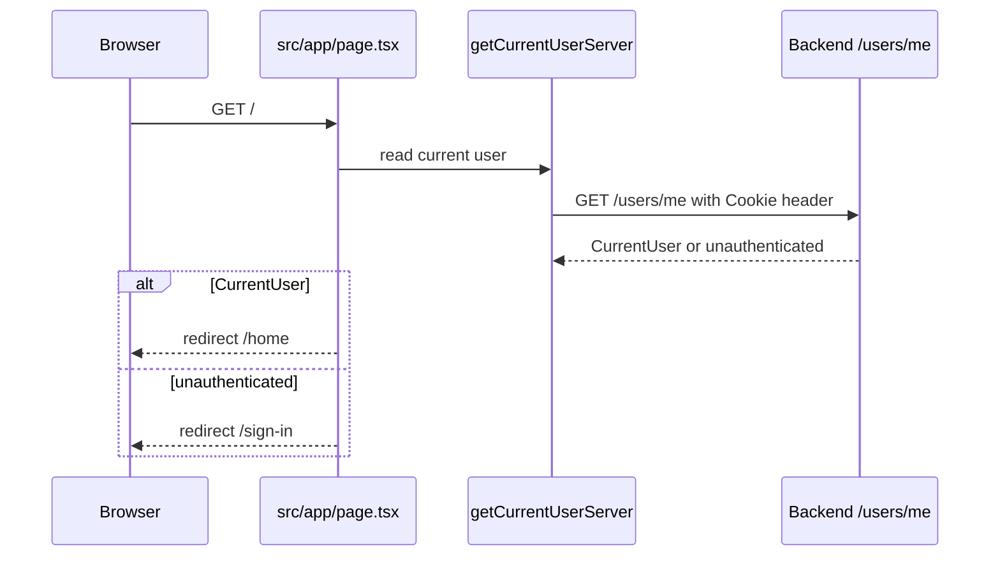
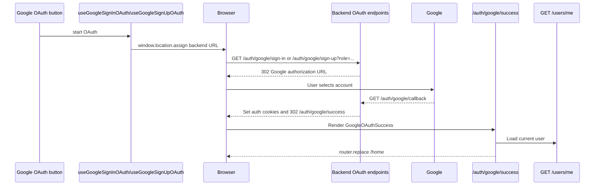

# API Requests

This frontend uses a small `fetch` wrapper, TanStack Query hooks, and in-memory Zustand state for API work.

## Layer Flow

```text
UI component
-> module hook
-> module API function
-> common API client
-> backend endpoint
```

Responsibilities:

- UI components call hooks and render loading, error, success, and empty states.
- Module hooks live in `src/modules/<module-name>/hooks` and own client orchestration, mutation state, query state, query cache updates, and Zustand updates.
- Module API functions live in `src/modules/<module-name>/api` and describe backend endpoints with typed request and response data.
- Shared request behavior lives in `src/modules/common/api`.
- Shared local state lives in `src/modules/common/state` only when it is truly cross-cutting. Auth state is module-owned in `src/modules/auth/state`.

## Auth Request Flow

Credential and verification flows:

```text
useSignUp
-> signUp
-> POST /auth/sign-up
-> backend sends verification email

useSignIn
-> signIn
-> POST /auth/sign-in
-> backend sends verification email

useVerifySignup / useVerifySignin
-> verifySignup / verifySignin
-> POST /auth/verify-signup or POST /auth/verify-signin
-> backend sets HttpOnly auth cookies
-> hook fetches /users/me
-> hook updates React Query cache and Zustand auth state
```

Auth page composition:



Email verification page flow:



The frontend exposes two verification routes:

- `src/app/verify-signin/page.tsx` renders `SignInVerificationStatus`;
- `src/app/verify-signup/page.tsx` renders `SignUpVerificationStatus`.

The backend magic links should target these real frontend pages directly. Each route calls the matching backend verification endpoint, and the backend remains responsible for verifying that the token purpose matches the endpoint.

Session flows:

```text
useCurrentUser
-> getCurrentUser
-> GET /users/me
-> hook updates Zustand auth state on success
-> hook clears Zustand auth state on failure

useLogout
-> logout
-> POST /auth/logout
-> backend clears auth cookies
-> hook clears React Query cache and Zustand auth state
-> Header redirects to /sign-in
-> Header calls router.refresh so RootLayout re-fetches current user

useChangePassword
-> changePassword
-> POST /auth/change-password
-> backend clears auth cookies
-> hook clears React Query cache and Zustand auth state
```

Logout order:



`Header` derives its authenticated structure from the server-provided `initialUser` prop. During logout it keeps auth actions in a loading state across both phases:

```text
logout pending
-> refresh pending while old initialUser is still present
-> router.refresh response arrives with initialUser null
-> loading clears and unauthenticated actions render
```

This prevents authenticated header actions from briefly reappearing after the logout request settles and before the refreshed root layout payload arrives. This is UI state only; protected-route decisions still depend on backend-owned HttpOnly cookies and server session lookup.

Server-rendered session lookup:

```text
RootLayout / RootPage
-> getCurrentUserServer
-> cookies()
-> GET /users/me with forwarded Cookie header
-> backend validates HttpOnly auth cookies
-> returns CurrentUser or unauthenticated
```



`getCurrentUserServer` lives at `src/modules/auth/api/current-user-server.ts`. It is `server-only`, reads request cookies on the server, and forwards the serialized `Cookie` header to the backend. It uses `cache: "no-store"` so the result is request-specific and not shared across users.

When `NEXT_PUBLIC_API_URL` is missing, invalid, or unreachable from the server runtime, server-side auth lookup returns `null`.

The root page at `src/app/page.tsx` performs a server redirect:



Google OAuth flows:

```text
GoogleSignInOAuthButton
-> useGoogleSignInOAuth
-> createGoogleSignInOAuthUrl
-> browser navigates to /auth/google/sign-in
-> backend redirects to Google
-> backend handles /auth/google/callback
-> backend sets HttpOnly auth cookies
-> backend redirects to /auth/google/success
-> GoogleOAuthSuccess
-> useCurrentUser
-> router.replace /home

GoogleSignUpOAuthButton
-> useGoogleSignUpOAuth
-> createGoogleSignUpOAuthUrl
-> browser navigates to /auth/google/sign-up?role=<role>
-> backend redirects to Google
-> backend handles /auth/google/callback
-> backend sets HttpOnly auth cookies
-> backend redirects to /auth/google/success
-> GoogleOAuthSuccess
-> useCurrentUser
-> router.replace /home
```



Implementation entrypoints:

- `src/modules/auth/components/google-oauth-button/google-sign-in-oauth-button.tsx`;
- `src/modules/auth/components/google-oauth-button/google-sign-up-oauth-button.tsx`;
- `src/modules/auth/components/google-oauth-button/google-oauth-button.tsx`;
- `src/modules/auth/hooks/use-google-oauth.ts`;
- `src/modules/auth/api/auth-api.ts`;
- `src/app/auth/google/success/page.tsx`;
- `src/modules/auth/components/google-oauth-success/google-oauth-success.tsx`.

Sign-in does not send `role`; sign-up sends the selected role because the backend may need it to create a new Google-authenticated user. The OAuth start endpoints must be opened with browser navigation, not `fetch`, because Google OAuth depends on top-level redirects.


## Refresh Flow

The common API client handles refresh for ordinary API calls:

```text
apiRequest(path)
-> fetch backend endpoint with credentials: "include"
-> if fetch fails before an HTTP response, throw ApiError with status 0
-> if response is not 401, parse response or throw ApiError
-> if response is 401, call POST /auth/refresh once
-> retry the original request once
-> if refresh fails, throw ApiError to the caller
```

Refresh is guarded by a shared `refreshPromise`, so multiple simultaneous `401` responses reuse one refresh request instead of sending a burst of refresh calls.

Refresh does not run for `/auth/refresh` itself and can be disabled per request with `skipAuthRefresh`.

HTTP error responses and network failures are different:

- HTTP errors such as `400`, `401`, and `500` return a response and are converted to `ApiError` with the backend status code.
- Network/runtime failures such as CORS rejection, offline browser, DNS failure, aborted request, or invalid URL throw before a response exists and are converted to `ApiError` with `status: 0`.

## Cookies And Tokens

The backend owns auth cookies:

- `accessToken`
- `refreshToken`
- `googleOAuthState`

They are `HttpOnly`, so frontend JavaScript cannot and should not read them. The frontend sends them through `fetch` with `credentials: "include"`.

Do not store JWTs in:

- Zustand
- React Query
- `localStorage`
- `sessionStorage`
- component state

Zustand stores only UI-safe auth data:

- `currentUser`
- `isAuthenticated`

React Query owns loading, error, and resolved query state.

## Base URL

`NEXT_PUBLIC_API_URL` controls cross-origin API calls.

```env
NEXT_PUBLIC_API_URL=http://localhost:3001
```

When the variable is set, browser requests and server auth lookup use that backend origin. When it is omitted, browser requests use relative paths such as `/auth/sign-in`, which supports same-origin deployments behind a reverse proxy. Server auth lookup requires an absolute configured backend URL and returns `null` without one.

## Why Server Actions Are Not Used For Auth Requests

Next Server Actions are for server-side mutations initiated through the Next app. They are useful when Next owns the mutation, validation, cache revalidation, or cookie changes.

This auth flow is different:

- The backend already owns auth endpoints and cookie issuing.
- The browser must receive backend `Set-Cookie` headers directly.
- Auth hooks need TanStack Query mutation state and client-side cache updates.
- Google OAuth starts with browser navigation, not a server-side function call.
- Refresh is tied to failed API responses and retry behavior, so it belongs in the API client.

Putting this client orchestration in `src/modules/auth/actions` would require `"use client"`, which violates the project convention that `actions` are reserved for future real `"use server"` functions. Until a BFF layer is intentionally added, auth hooks should call typed API functions directly.

## Why Axios Is Not Used

Native `fetch` is enough for the current needs:

- it is built into the browser and Next runtime;
- it supports `credentials: "include"` for cookie auth;
- the shared API client already centralizes base URL handling, JSON parsing, `ApiError`, refresh-on-401, and one-time retry;
- avoiding Axios keeps the bundle and dependency surface smaller.

Axios can be reconsidered later if the project needs request cancellation conventions, upload/download progress, complex interceptors, or team-standard Axios middleware. The API layer should hide that choice from feature modules either way.

## Proxy Reminder

In Next 16, middleware is called `proxy.ts`.

Do not put refresh rotation in `proxy.ts`. Use Proxy later only for cheap optimistic route redirects when protected pages exist. Keep real session validation and refresh behavior in the API/data layer.
