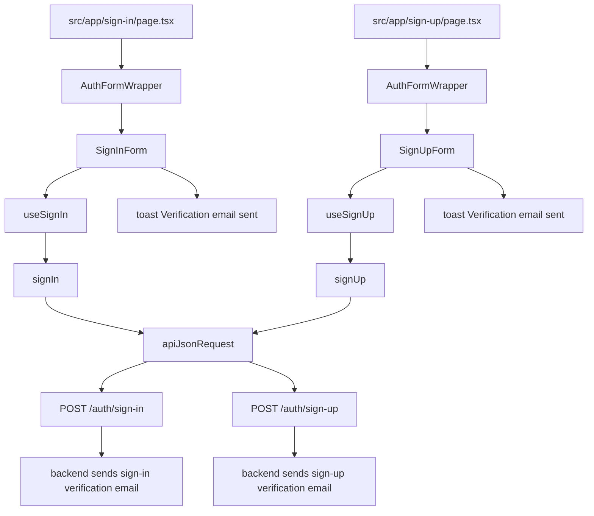
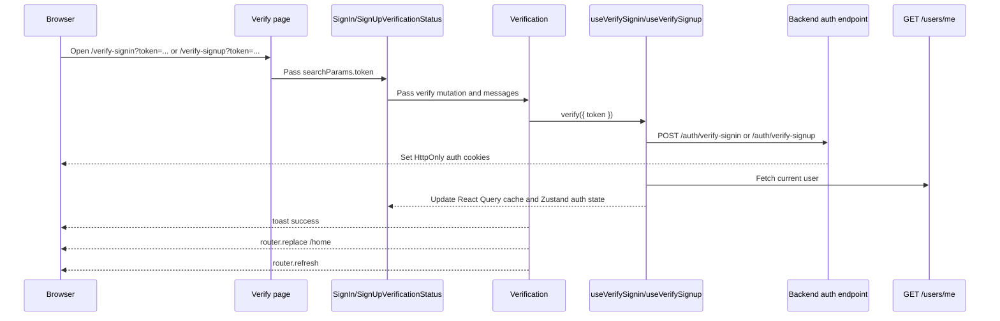
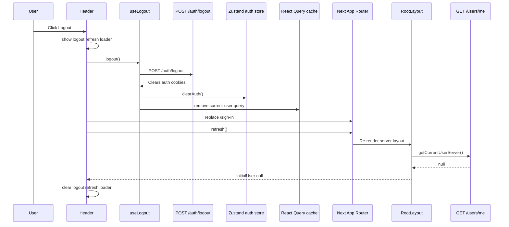
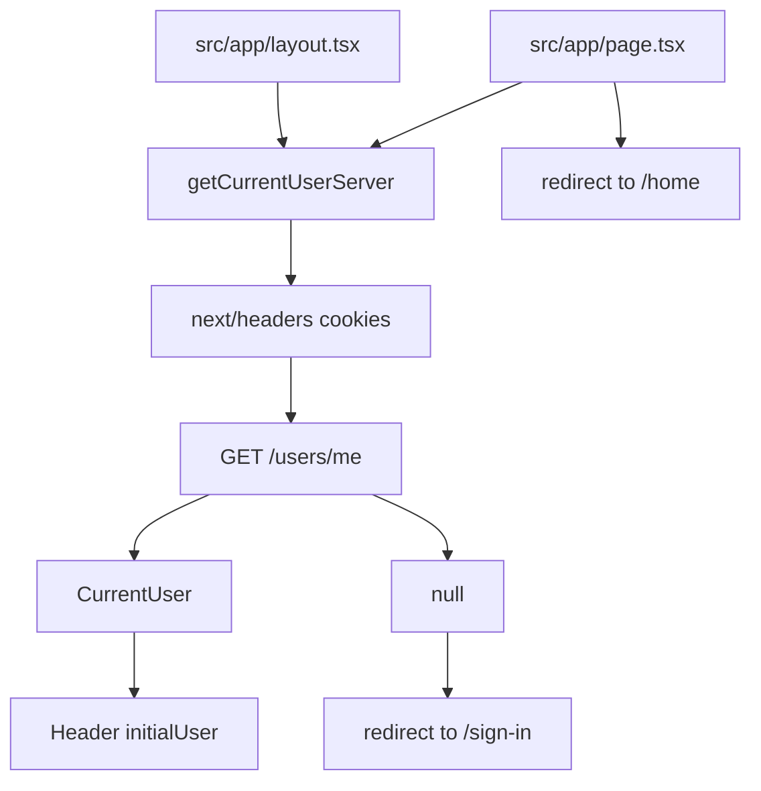
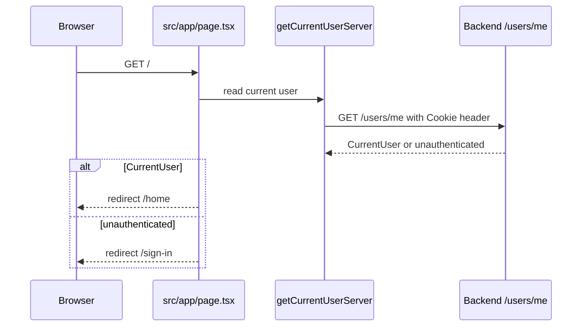
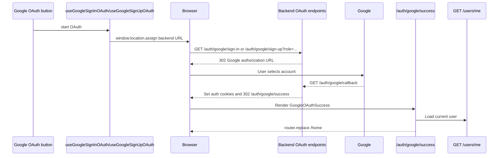

# API Requests

This frontend uses a small `fetch` wrapper, TanStack Query hooks, and in-memory Zustand state for API work.

## Layer Flow

```text
UI component
-> module hook
-> module API function
-> common API client
-> backend endpoint
```

## Auth Request Flow



Email verification page flow:



Logout order:



`Header` derives its authenticated structure from the server-provided `initialUser` prop. During logout it keeps auth actions in a loading state across both phases:

```text
logout pending
-> refresh pending while old initialUser is still present
-> router.refresh response arrives with initialUser null
-> loading clears and unauthenticated actions render
```

This prevents authenticated header actions from briefly reappearing after the logout request settles and before the refreshed root layout payload arrives. This is UI state only; protected-route decisions still depend on backend-owned HttpOnly cookies and server session lookup.





Google OAuth flows:




## Refresh Flow

The common API client handles refresh for ordinary API calls:

```text
apiRequest(path)
-> fetch backend endpoint with credentials: "include"
-> if fetch fails before an HTTP response, throw ApiError with status 0
-> if response is not 401, parse response or throw ApiError
-> if response is 401, call POST /auth/refresh once
-> retry the original request once
-> if refresh fails, throw ApiError to the caller
```

Refresh is guarded by a shared `refreshPromise`, so multiple simultaneous `401` responses reuse one refresh request instead of sending a burst of refresh calls.

Refresh does not run for `/auth/refresh` itself and can be disabled per request with `skipAuthRefresh`.

## Why Server Actions Are Not Used For Auth Requests

Next Server Actions are for server-side mutations initiated through the Next app. They are useful when Next owns the mutation, validation, cache revalidation, or cookie changes.

This auth flow is different:

- The backend already owns auth endpoints and cookie issuing.
- The browser must receive backend `Set-Cookie` headers directly.
- Auth hooks need TanStack Query mutation state and client-side cache updates.
- Google OAuth starts with browser navigation, not a server-side function call.
- Refresh is tied to failed API responses and retry behavior, so it belongs in the API client.