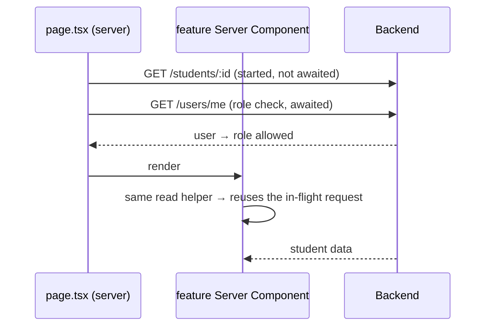
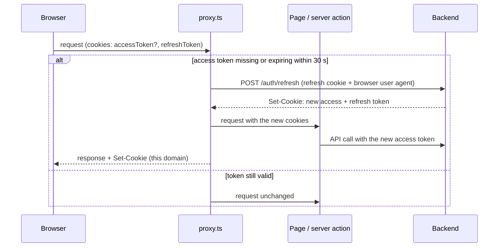
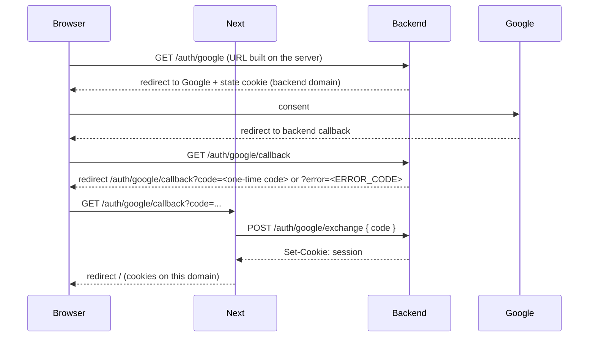

# API Requests

The browser never calls the backend. In production the frontend (Vercel) and the backend (Render) are on different sites, so backend cookies could not reach the Next server and cross-site `fetch` would not send `sameSite: lax` cookies. Every request goes browser → Next → backend ("backend for frontend"), and the session cookies live on this app's domain.

## Layer Flow

```text
Reads:   Server Component -> modules/<name>/api/*-server.ts -> serverApiRequest -> backend
Writes:  Client component -> useServerAction -> "use server" action -> serverApiRequest -> backend
                                                 └─ refresh() on success -> page re-renders with fresh data
```

- `serverApiRequest` (`common/api/server-api-request.ts`, `server-only`) forwards the request cookies, never throws and returns `ServerApiResponse`: `{ ok: true, data }` or `{ ok: false, status, errorCode }`. Backend error text stays on the server; components map `errorCode` to `ERRORS`.
- `useServerAction` (`common/hooks`) runs an action in a transition (`isPending` covers the action and the refresh it triggers) and turns a network failure into a failed result.
- Failed reads render `RefreshButton` (router refresh) for a retry; 404/400 render a not-found message.
- The backend URL is the server-only `API_URL`.

## Reads on Guarded Pages

A page's data request does not wait for the role check (`GET /users/me`) when the page already knows the ids from the URL. The page starts the read, then awaits the guard; both requests are in flight at once, so the page waits about one backend round trip instead of two.



- Read helpers (`students/api/students-server.ts`) and `getCurrentUserServer` are wrapped in React `cache()`, which lasts for one server request. A second call with the same arguments returns the first call's promise, so the early start and the component's own call make one HTTP request.
- `cache()` compares arguments by identity, so the cached functions take strings and numbers; an object argument would miss every time and send a duplicate request.
- Starting before the guard is safe: the backend authorizes every endpoint. If the guard redirects, the response is discarded.
- Pages that need the user's id first (a student's `/courses` pages) still wait for `/users/me`.
- Where the page or guard awaits the data itself (`requireStudentEditorServer`, the new-course page), it uses `Promise.all` with the guard instead.

## Session Refresh (proxy)

`src/proxy.ts` is the only place that refreshes. It runs before every page render and server function call.



- Refresh rejected (401): both cookies are deleted, the page renders signed out.
- Backend unreachable: cookies are kept, the page fails soft.
- Parallel requests can refresh with the same token at once (tabs, prefetches, server instances). The backend's 10-second grace window returns the already-issued successor tokens to the same browser instead of treating the reuse as theft.

## Session Cookies on This Domain

Server functions and route handlers that receive session cookies pass `forwardSetCookies: true`: the backend's `Set-Cookie` values are re-set with this app's attributes (`httpOnly`, `sameSite: lax`, `secure` in production, path `/`). Used by the Google code exchange. Logout deletes both cookies locally whatever the backend answers.

## Google OAuth



Google is the only way to sign in: the first sign-in creates the account, which then goes through onboarding (see `../onboarding/onboarding.md`).

The code is single-use, valid for 60 seconds, and only its hash is stored. When the backend rejects the sign-in it redirects with `?error=<ERROR_CODE>` instead of a code, so the user never lands on a backend JSON page:

| Callback result | Redirect |
| --- | --- |
| code exchanged | `/`, which picks onboarding or the role's landing route |
| `USER_WITH_EMAIL_ALREADY_EXISTS` (a teacher already created this student's account) | `/invite-pending` |
| any other error, or a missing or rejected code | `/sign-in?oauthError=1` (generic error) |

## Direct Storage Uploads

File bytes skip the Next server: an action gets a presigned URL, the browser `PUT`s the file straight to storage with `uploadToPresignedUrl` (`common/api/storage-upload.ts`, no cookies), and a second action creates the document. See `course-documents.md`.

Self-check questions: [api-requests-qa.md](api-requests-qa.md).
