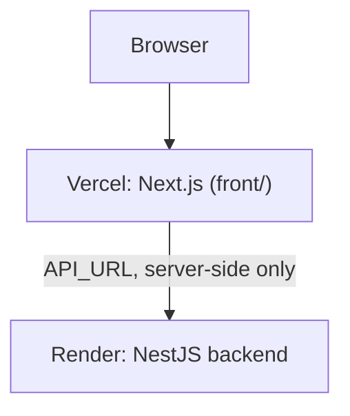

# Frontend Deployment

The app is deployed on Vercel at `https://practice-app-lime.vercel.app`. The backend runs on Render, see [backend deployment](../../../../back/docs/setup/deployment.md).

## Vercel Project

| Setting | Value |
|---|---|
| Git repository | `KaterynaKocheharova/Practice-app` |
| Root Directory | `front` (the repo also holds `back/`) |
| Framework preset | Next.js |
| Build, output, install commands | Vercel defaults, no overrides |
| Function Region (Settings → Functions) | `fra1` (Frankfurt), same region as Render and Neon |

## Environment Variables

| Variable | Value |
|---|---|
| `API_URL` | Render backend URL, `https://`, no trailing `/` |

- `API_URL` is server-only: the browser never calls the backend, every request goes through this app (see [api-requests.md](api-requests.md)).
- Auth cookies therefore belong to the Vercel domain, so frontend and backend on different domains need no cross-site cookie setup.
- Changing a variable takes effect only after a redeploy (Deployments → Redeploy).
- File uploads are the one exception to "browser never calls the backend": the browser `PUT`s straight to Cloudflare R2 with a presigned URL, so the R2 bucket's CORS policy must allow this Vercel URL (see [backend external settings](../../../../back/docs/setup/deployment.md#external-settings)).

## Deploying

- Vercel auto-deploys on every push to `master`.
- Check locally before pushing with `npm run build`.
- When the Vercel URL changes, also update the backend's `FRONTEND_URL` on Render and the authorized JavaScript origin in Google Cloud.
