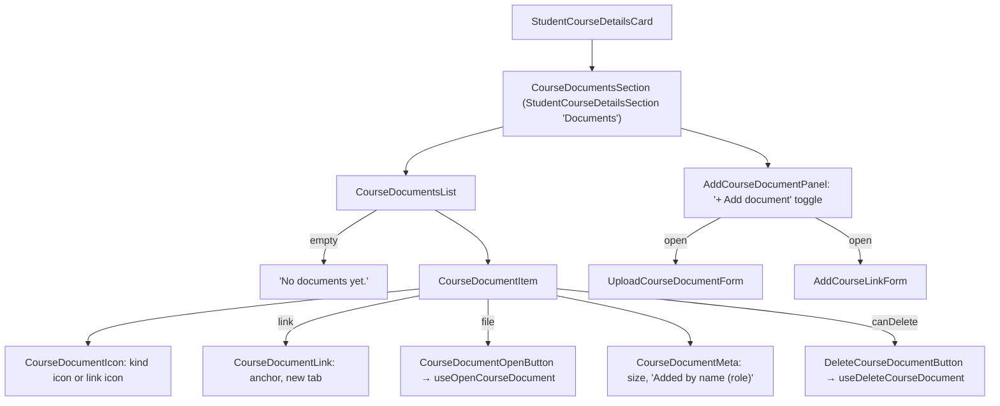
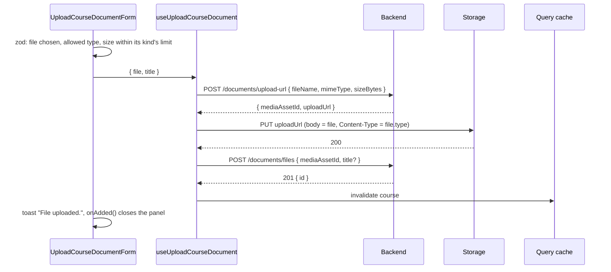
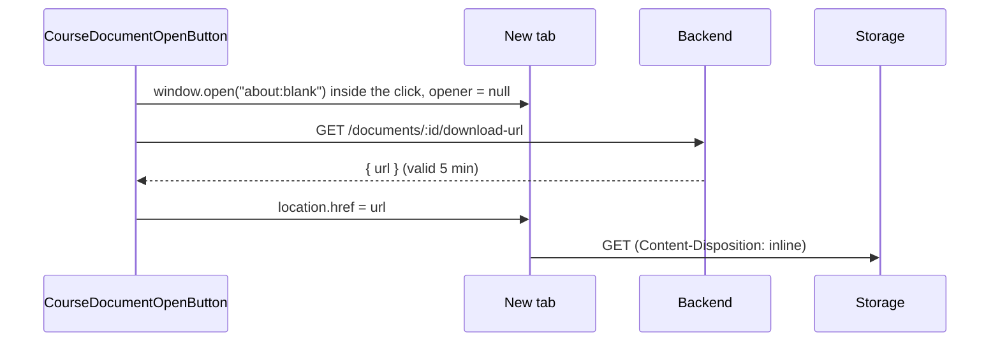

# Course Documents

Files and links attached to a course, shown on the course details page for both the teacher (`/students/[studentId]/courses/[courseId]`) and the student (`/courses/[courseId]`). Feature code lives in `src/modules/students/`. Backend rules are in `back/docs/students/course-document-endpoints.md`.

## Endpoints

| Method | Path (under `/students/:studentId/courses/:courseId`) | Used by |
| --- | --- | --- |
| `GET` | `/` (the course itself) | `useStudentCourse`: the response includes `documents` |
| `POST` | `/documents/upload-url` | `useUploadCourseDocument` (step 1) |
| `PUT` | presigned storage URL (not the backend) | `useUploadCourseDocument` (step 2) |
| `POST` | `/documents/files` | `useUploadCourseDocument` (step 3) |
| `POST` | `/documents/links` | `useAddCourseLink` |
| `GET` | `/documents/:documentId/download-url` | `useOpenCourseDocument` |
| `DELETE` | `/documents/:documentId` | `useDeleteCourseDocument` |

There is no separate list request: documents arrive with the course. Every mutation invalidates `["students", "detail", studentId, "courses", "item", courseId]`, so the list refreshes from the course query. Routes are built by `API_ROUTES.STUDENTS.COURSE_DOCUMENT_*`.

## Data

`CourseDocument` (`types/course-documents.types.ts`) is a union on `type`:

- `file`: `file: { sizeBytes, kind }`, `url: null`
- `link`: `url: string`, `file: null`

Both have `id`, `title`, `addedBy: { name, role } | null` and `canDelete`. Checking `document.type === CourseDocumentType.Link` narrows `url` to a string. `canDelete` comes from the backend (only the user who added a document); the frontend does not compute it.

## Page Composition

The add forms are hidden until the user presses **+ Add document** (a muted ghost button with `aria-expanded` / `aria-controls`). It becomes **Cancel** while open. Both forms call `onAdded` on success, which closes the panel; a failed request keeps it open with the error.

## Upload a File

- The storage `PUT` uses `uploadToPresignedUrl` (`common/api/storage-upload.ts`): plain `fetch`, no cookies and no auth refresh, because the URL's signature is the permission. Storage rejects a different type or size.
- Client validation (`schemas/course-document-form.schema.ts`) mirrors the backend: `STUDENTS_CONFIG.documents.allowedMimeTypes` maps a MIME type to its kind, `maxSizeBytes` holds documents 20 MB, images 10 MB, audio 50 MB. The file input's `accept` lists the extensions.
- An empty title is left out (`toCreateCourseFileDocumentRequest`), so the backend uses the file name.

## Add a Link

`AddCourseLinkForm` validates `url` as `https` only (≤ 2048) and a required `title` (≤ 255), then `useAddCourseLink` posts it. The backend stores the link as-is.

## Open a Document

- **Link:** a normal `<a target="_blank" rel="noopener noreferrer">`.
- **File:** `useOpenCourseDocument().open()`:

The tab is opened before the request, because popup blockers allow `window.open` only during the click. Storage serves the file `inline`: the tab shows PDFs, images, audio and text; Office files are downloaded by the browser instead. If pop-ups are blocked, or the request fails (the blank tab is then closed), a toast shows `ERRORS.COURSE_DOCUMENTS.OPEN_FAILED`.

## Delete

`DeleteCourseDocumentButton` is shown only when `canDelete` is true. It calls `DELETE /documents/:documentId`, toasts "Document deleted." and refreshes the course; the backend removes the stored file later in a background job.

## Errors

Messages come from `ERRORS.COURSE_DOCUMENTS` and `ERRORS.VALIDATION`, never from the backend. `getCourseDocumentErrorMessage` maps `COURSE_DOCUMENTS_LIMIT_REACHED` to `LIMIT_REACHED`; anything else falls back to the action's message (`UPLOAD_FAILED`, `ADD_LINK_FAILED`). Form errors also show under the form via the `root` field.

## Files

- `components/course-documents-section/`, `course-documents-list/`, `course-document-item/`, `course-document-icon/`, `course-document-meta/`, `course-document-link/`, `course-document-open-button/`, `delete-course-document-button/`, `add-course-document-panel/`, `upload-course-document-form/`, `add-course-link-form/`
- `hooks/use-upload-course-document.ts`, `use-add-course-link.ts`, `use-open-course-document.ts`, `use-delete-course-document.ts`
- `api/course-documents-api.ts`, `common/api/storage-upload.ts`
- `schemas/course-document-form.schema.ts`, `types/course-documents.types.ts`
- `utils/format-file-size.ts`, `get-course-document-kind.ts`, `get-course-document-error-message.ts`, `to-course-document-upload-url-request.ts`, `to-create-course-file-document-request.ts`
- `students.config.ts` (`documents`, `forms.courseDocument`), `students.enums.ts` (`CourseDocumentType`, `MediaAssetKind`, `CourseDocumentFormField*`)
