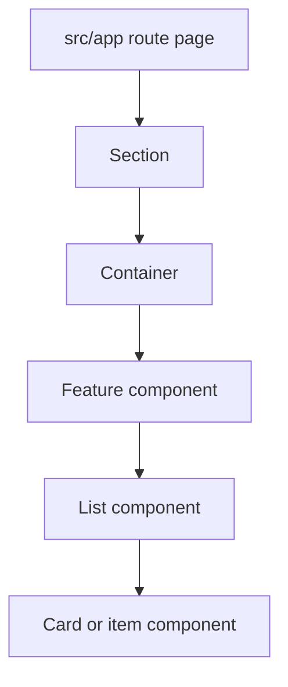

# Design System

This app uses a bento-style design system built on Tailwind CSS v4 and CSS variables.

## Theme Modes

Themes are controlled with classes on the root HTML element:

```tsx
<html className="day">
<html className="night">
```

The default mode is `day`.

## Color Tokens

Use semantic Tailwind tokens instead of raw hex values in components:

```text
bg-background
bg-card
bg-primary
bg-accent
text-foreground
text-muted-foreground
border-border
text-success
text-warning
text-error
text-info
```

Day mode uses a warm coral and plum palette:

```text
background: #fff7f3
card: #fffcfa
primary: #e85d75
accent: #6d3a75
foreground: #2a1725
muted-foreground: #7d6675
border: #f1d6d9
success: #27815f
warning: #b45f16
error: #c9364d
info: #5b668f
```

Night mode uses matching warm dark surfaces with softer coral and plum accents:

```text
background: #1e131b
card: #2a1a26
primary: #ff8fa3
accent: #d8a6e2
foreground: #fff7f3
muted-foreground: #c9aebc
border: #4a2b3f
success: #7dd7ae
warning: #f4b56a
error: #ff8799
info: #b8c0ff
```

## Bento Tokens

Base bento variables live in `src/app/globals.css`:

```text
--bento-radius
--bento-radius-sm
--bento-gap
--bento-shadow
--input-height
--input-radius
--focus-ring
```

Use `rounded-bento`, `rounded-bento-sm`, and `shadow-bento` for shared bento surfaces.

## Shared Components

Reusable primitives live in `src/modules/common/components`.

```text
BackLink
Button
ButtonLink
Card
Container
FormErrorMessage
Header
Input
Label
Loader
PasswordField
Section
Select
SelectField
TextField
Textarea
TextareaField
Wrapper
```

Component roles:

- `Container`: horizontal page width and responsive side padding.
- `Section`: vertical spacing for page sections.
- `Wrapper`: elevated bento subsection surface.
- `Card`: smaller repeated bento item surface.
- `Button`: accessible button variants and sizes.
- `ButtonLink`: a Next `Link` with the same variants and sizes as `Button` (both use `button/style.ts`).
- `TextField`: `Label` + `Input` + optional hint + `FormErrorMessage`, with `aria-invalid` and `aria-describedby` wired up.
- `FormErrorMessage`: alert text for field and form-level validation errors.
- `Header`: global responsive app header with server-provided auth state, desktop nav, and mobile/tablet sidebar controls.
- `Loader`: reusable loading placeholder. The current variant is a skeleton-style block used where stable layout dimensions matter.
- `Input`, `Textarea`, `Label`: form primitives with theme-aware borders, text, disabled states, and focus rings.
- `PasswordField`: password input with a built-in show/hide button. It masks values by default and only switches the input type when the user toggles visibility.
- `Select`: native `<select>` styled like `Input`.
- `SelectField`: `Label` + `Select` + `FormErrorMessage`, like `TextField`. Takes `options` (`SelectOption[]`) and an optional `placeholder` rendered as the empty first option.
- `TextareaField`: `Label` + `Textarea` + `FormErrorMessage`, like `TextField`.
- `BackLink`: ghost `ButtonLink` with a left arrow, for "Back to ..." navigation at the top of a page.

## Common Component Usage

### Container

Use `Container` once per major page region to center content and apply responsive horizontal padding.

```tsx
<Container>
  <FeatureHeader />
</Container>
```

Do not use `Container` for card-level padding or repeated list items.

### Section

Use `Section` for vertical spacing between page-level regions.

```tsx
<Section>
  <Container>
    <FeatureContent />
  </Container>
</Section>
```

When adding a page, start with `Section`, then `Container`, then feature-owned content.

### Wrapper

Use `Wrapper` for a bento subsection surface that groups related content inside a page section.

```tsx
<Wrapper>
  <SettingsForm />
</Wrapper>
```

Do not nest `Wrapper` inside another `Wrapper`.

### Card

Use `Card` for repeated bento items such as course cards, assignment cards, dashboard tiles, or notification items.

```tsx
<Card>
  <CourseSummary />
</Card>
```

Prefer `Wrapper` for a whole subsection and `Card` for items inside that subsection.

### Button

Use `Button` for actions. Pick variants by intent:

- `primary`: main page or form action.
- `secondary`: supportive action or accent action.
- `ghost`: low-emphasis action.
- `danger`: destructive action.

Use the native `disabled` attribute for unavailable actions.

### ButtonLink

Use `ButtonLink` when an action navigates, for example "Add student" → `/students/new`, or "Cancel" in a form. Use `Button` when it runs code instead. It takes the same `variant` and `size` props as `Button`.

```tsx
<ButtonLink href={APP_ROUTES.STUDENTS_NEW}>{TEXTS.STUDENTS.ADD_STUDENT}</ButtonLink>
```

### Header

`Header` is rendered by `src/app/layout.tsx` and receives `initialUser` from `getCurrentUserServer`. Client behavior inside the header is limited to the sidebar open/close hook and logout mutation. Primary nav links are filtered by the user's role (see `role-access.md`), and the brand link points to `/`.

### Loader

Use `Loader` for reusable non-text loading placeholders:

```tsx
<Loader className={authActionsStyles.loading} />
```

### Input, Textarea, And Label

Use `Label` with `Input` or `Textarea` for form fields.

```tsx
<Label htmlFor="email">Email</Label>
<Input id="email" name="email" type="email" />
```

Use `aria-invalid` on invalid fields so error styling is applied consistently.

### TextField

Prefer `TextField` for a standard labelled text input with an error message. It sets `aria-invalid` and `aria-describedby` (hint and error ids) for you, and passes everything else, including `register(...)`, through to `Input`.

```tsx
<TextField
  errorId={fieldIds.EmailError}
  errorMessage={errors.email?.message}
  id={fieldIds.Email}
  label={TEXTS.STUDENTS.EMAIL}
  optionalLabel={TEXTS.STUDENTS.OPTIONAL}
  type={inputTypes.email}
  {...register(fields.Email)}
/>
```

### SelectField

Build options from a value → label map with `toSelectOptions` (`src/modules/common/utils`). `placeholder` adds an empty option, so an optional choice submits `""`.

```tsx
<SelectField
  errorId={fieldIds.LearningGoalError}
  errorMessage={errors.learningGoal?.message}
  id={fieldIds.LearningGoal}
  label={TEXTS.COURSES.LEARNING_GOAL}
  options={toSelectOptions(courseLabels.learningGoals)}
  placeholder={TEXTS.COURSES.NOT_SET}
  {...register(fields.LearningGoal)}
/>
```

## Page Composition

Pages should compose layout primitives before feature content:

```text
page
-> Section
-> Container
-> Wrapper or feature component
-> Card or list component
```



## Component Rules

- Keep components as small as the feature allows.
- Give each component one clear responsibility.
- Prefer composition over boolean-heavy components.
- Keep props focused on what the component needs to render.
- Extract lists into separate components.
- Extract list items into separate components when item markup has behavior, conditional states, or more than a few fields.
- Keep page components focused on data loading and composition, not detailed list markup.