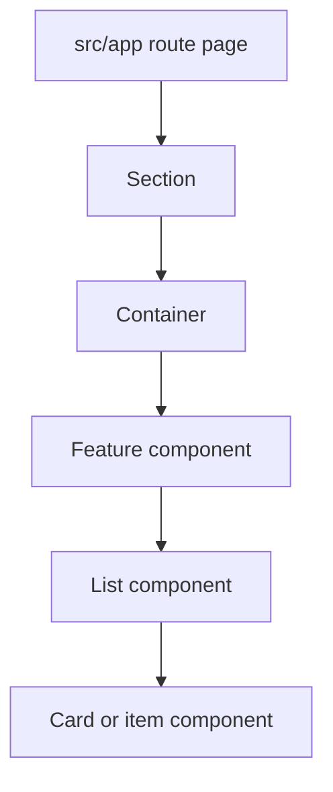
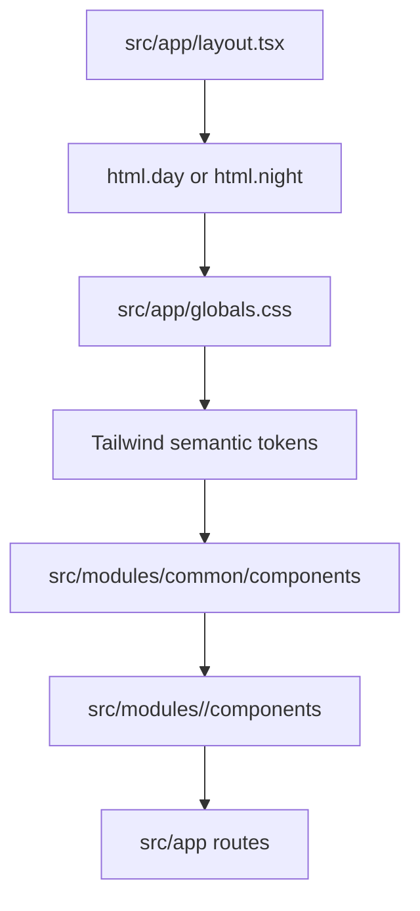

# Design System

This app uses a bento-style design system built on Tailwind CSS v4 and CSS variables.

## Theme Modes

Themes are controlled with classes on the root HTML element:

```tsx
<html className="day">
<html className="night">
```

The default mode is `day`.

## Color Tokens

Use semantic Tailwind tokens instead of raw hex values in components:

```text
bg-background
bg-card
bg-primary
bg-accent
text-foreground
text-muted-foreground
border-border
text-success
text-warning
text-error
text-info
```

Day mode uses:

```text
background: #f8fafc
card: #ffffff
primary: #2563eb
accent: #0d9488
foreground: #0f172a
muted-foreground: #64748b
border: #e2e8f0
success: #16a34a
warning: #d97706
error: #dc2626
info: #0284c7
```

Night mode uses:

```text
background: #0f172a
card: #1e293b
primary: #60a5fa
accent: #2dd4bf
foreground: #f8fafc
muted-foreground: #94a3b8
border: #334155
success: #4ade80
warning: #fbbf24
error: #f87171
info: #38bdf8
```

## Bento Tokens

Base bento variables live in `src/app/globals.css`:

```text
--bento-radius
--bento-radius-sm
--bento-gap
--bento-shadow
--input-height
--input-radius
--focus-ring
```

Use `rounded-bento`, `rounded-bento-sm`, and `shadow-bento` for shared bento surfaces.

## Shared Components

Reusable primitives live in `src/modules/common/components`.

```text
Button
Card
Container
Input
Label
Section
Textarea
Wrapper
```

Component roles:

- `Container`: horizontal page width and responsive side padding.
- `Section`: vertical spacing for page sections.
- `Wrapper`: elevated bento subsection surface.
- `Card`: smaller repeated bento item surface.
- `Button`: accessible button variants and sizes.
- `Input`, `Textarea`, `Label`: form primitives with theme-aware borders, text, disabled states, and focus rings.

## Common Component Usage

### Container

Use `Container` once per major page region to center content and apply responsive horizontal padding.

```tsx
<Container>
  <FeatureHeader />
</Container>
```

Do not use `Container` for card-level padding or repeated list items.

### Section

Use `Section` for vertical spacing between page-level regions.

```tsx
<Section>
  <Container>
    <FeatureContent />
  </Container>
</Section>
```

When adding a page, start with `Section`, then `Container`, then feature-owned content.

### Wrapper

Use `Wrapper` for a bento subsection surface that groups related content inside a page section.

```tsx
<Wrapper>
  <SettingsForm />
</Wrapper>
```

Do not nest `Wrapper` inside another `Wrapper`.

### Card

Use `Card` for repeated bento items such as course cards, assignment cards, dashboard tiles, or notification items.

```tsx
<Card>
  <CourseSummary />
</Card>
```

Prefer `Wrapper` for a whole subsection and `Card` for items inside that subsection.

### Button

Use `Button` for actions. Pick variants by intent:

- `primary`: main page or form action.
- `secondary`: supportive action or accent action.
- `ghost`: low-emphasis action.
- `danger`: destructive action.

Use the native `disabled` attribute for unavailable actions.

### Input, Textarea, And Label

Use `Label` with `Input` or `Textarea` for form fields.

```tsx
<Label htmlFor="email">Email</Label>
<Input id="email" name="email" type="email" />
```

Use `aria-invalid` on invalid fields so error styling is applied consistently.

## Page Composition

Pages should compose layout primitives before feature content:

```text
page
-> Section
-> Container
-> Wrapper or feature component
-> Card or list component
```



## Component Rules

- Keep components as small as the feature allows.
- Give each component one clear responsibility.
- Prefer composition over boolean-heavy components.
- Keep props focused on what the component needs to render.
- Extract lists into separate components.
- Extract list items into separate components when item markup has behavior, conditional states, or more than a few fields.
- Keep page components focused on data loading and composition, not detailed list markup.

## Flow



## Rules

- Prefer semantic tokens over raw colors in components.
- Use `cn` from `src/modules/common/utils` for component class composition so Tailwind class conflicts are merged consistently.
- Keep shared primitives server-safe unless they need browser APIs.
- Add `"use client"` only to components that use hooks, event-only behavior, browser APIs, or client state.
- Use `Wrapper` for subsection surfaces and `Card` for repeated items.
- Do not create feature-specific variants in common components until reuse is clear.
