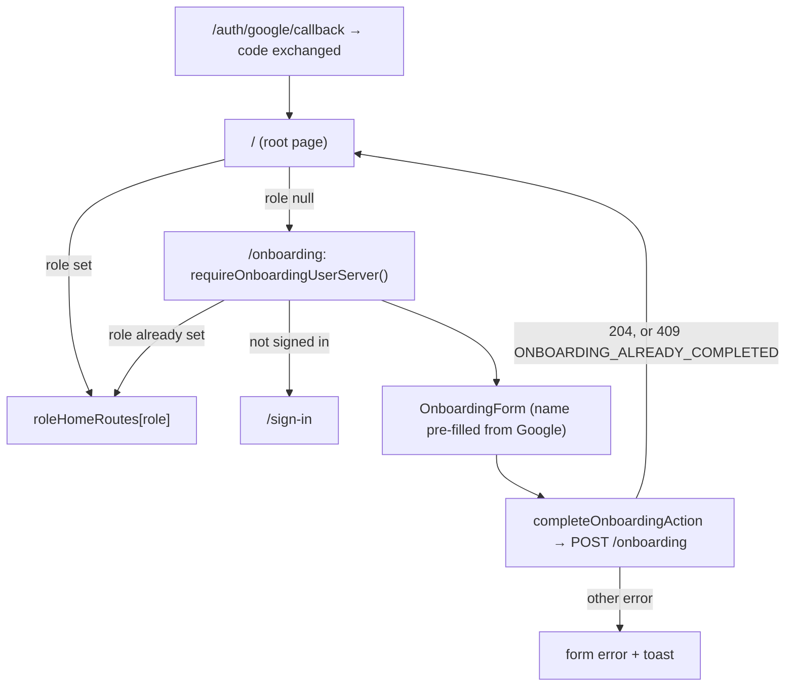

# Onboarding

A user's first Google sign-in creates an account without a role. Onboarding sets the name and role once; until then the backend only allows `/users/me`.

## Flow

## Form

- Name: required, pre-filled from the Google profile.
- Role: teacher or student, picked once; the backend answers `409 ONBOARDING_ALREADY_COMPLETED` to a second attempt, which the form treats as done (e.g. finished in another tab).
- Student details (birth date, job, hobbies): shown only when "Student" is picked, all optional. They reuse `StudentProfileFields` and `studentProfileFormSchema` from the students module, so the rules match the student create/edit forms. They are sent as `student` only for the student role, because the backend rejects them for teachers.

## Managed Students

A student a teacher created by email (`managed`) cannot sign in with Google: the backend redirects to the callback with `USER_WITH_EMAIL_ALREADY_EXISTS`, and the callback route shows `/invite-pending` ("Your teacher has already created an account for you. You will be invited soon.").

## Entry Points

- `src/app/onboarding/page.tsx`
- `src/modules/onboarding/api/require-onboarding-user-server.ts`
- `src/modules/onboarding/components/onboarding-form/onboarding-form.tsx`
- `src/modules/onboarding/actions/onboarding-actions.ts`
- `src/app/invite-pending/page.tsx`
