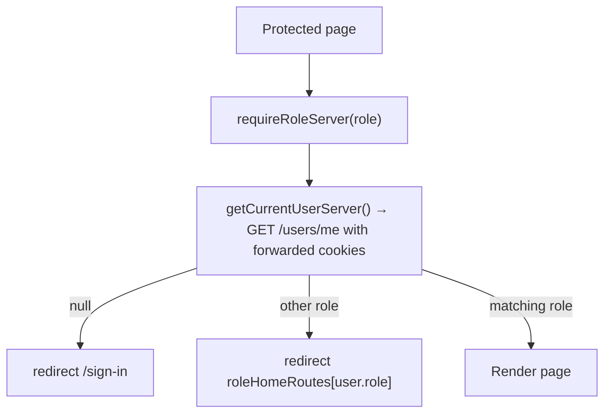

# Role Access

Each signed-in role has its own landing route and its own set of pages. Access is decided on the server, per page.

## Landing Routes

`AUTH_CONFIG.roleHomeRoutes` (`src/modules/auth/auth.config.ts`) maps each role to its landing route:

| Role | Landing route |
| --- | --- |
| `teacher` | `/students` |
| `student` | `/courses` (empty placeholder for now) |

Where the map is used:

- `src/app/page.tsx`: `/` redirects signed-in users to their landing route and everyone else to `/sign-in`.
- `GoogleOAuthSuccess`: redirects to the current user's landing route.
- `Verification` (sign-in/sign-up email links): redirects to `/`, which then picks the landing route.
- The header and sidebar brand link points to `/`.

## Page Guard

`requireRoleServer(role)` (`src/modules/auth/api/require-role-server.ts`, `server-only`) is awaited at the top of each protected page:

| Page | Required role |
| --- | --- |
| `src/app/students/page.tsx` | `teacher` |
| `src/app/students/new/page.tsx` | `teacher` |
| `src/app/courses/page.tsx` | `student` |

The guard only controls page access. The backend enforces the same rules on its endpoints: `GET /students` and `POST /students` are teacher-only.

## Header Navigation

`COMMON_CONFIG.header.primaryNavLinks` gives each link a `roles` list. `Header` filters the list with `getPrimaryNavLinks(role)` (`src/modules/common/components/header/get-primary-nav-links.ts`) and passes the result to `HeaderDesktopNav` and `Sidebar`:

- teacher → "Students"
- student → "Courses"
- signed out, or while logging out → no primary links
