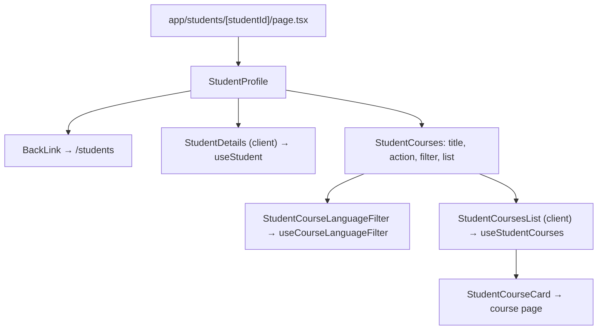
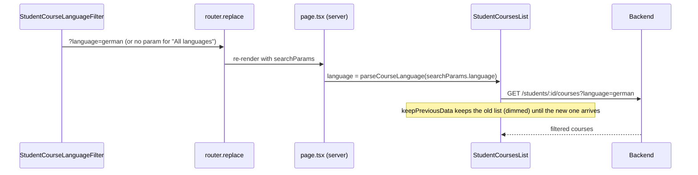
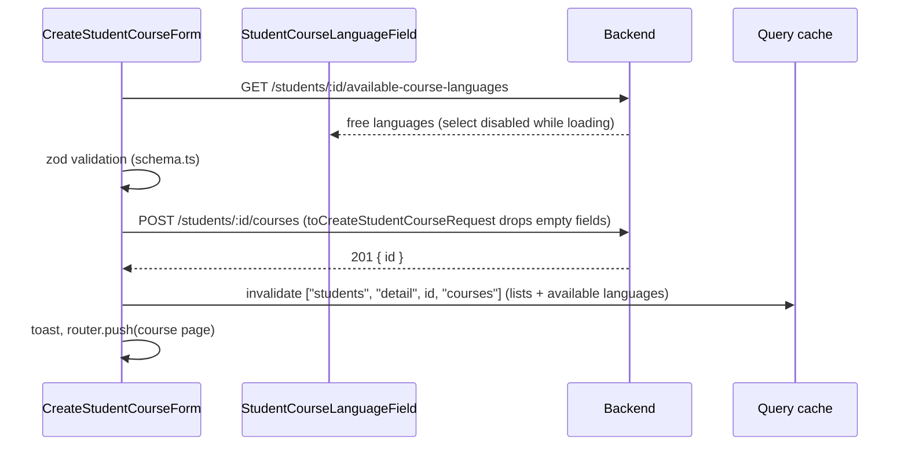
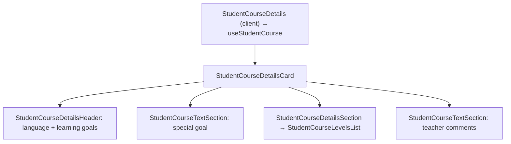

# Student Courses

A course is one language a teacher teaches a student. Teachers see and create courses from a student's page; students see their own courses on `/courses`. Feature code lives in `src/modules/students/`, next to the student code (see `students.md`).

## Routes

| Route | Role | Composes |
| --- | --- | --- |
| `/students/[studentId]` | teacher | `StudentProfile`: `StudentDetails` + `StudentCourses` with a "Create course" link |
| `/students/[studentId]/courses/new` | teacher | `CreateStudentCourseForm` |
| `/students/[studentId]/courses/[courseId]` | teacher | `StudentCourseDetails` with an "Edit course" link |
| `/students/[studentId]/courses/[courseId]/edit` | teacher | `EditStudentCourse` (see `student-editing.md`) |
| `/courses` | student | `StudentCourses` for `currentUser.id`, with an "Edit profile" link |
| `/courses/[courseId]` | student | `StudentCourseDetails` for `currentUser.id` |

Every page awaits `requireRoleServer` (see `role-access.md`). A student's user id is their student id, so student pages pass `currentUser.id`. `getCourseHref` (`utils/get-course-href.ts`) builds card links by viewer role.

## Endpoints

| Method | Path | Role | Response |
| --- | --- | --- | --- |
| `GET` | `/students/:studentId` | teacher, student (self) | `{ id, name, email, birthDate, job, hobbies, status, isEditable }` |
| `GET` | `/students/:studentId/courses?language=` | teacher, student (self) | `{ id, language, learningGoals }[]`, newest first |
| `GET` | `/students/:studentId/courses/:courseId` | teacher, student (self) | goals and levels; `comments` only for the teacher |
| `GET` | `/students/:studentId/available-course-languages` | teacher | `Language[]` the teacher has no course in yet |
| `POST` | `/students/:studentId/courses` | teacher | `201 { id }`; `409` if the language is taken |
| `PATCH` | `/students/:studentId/courses/:courseId` | teacher (the course's teacher) | `200 { id }`; see `student-editing.md` |

A teacher only sees courses they teach. There is no pagination: a teacher has at most one course per language with a student.

## Student Page

`StudentDetails` and `StudentCoursesList` mount together, so `GET /students/:id` and `GET /students/:id/courses` run in parallel.

### Language filter

Filtering happens on the backend. The selected language lives in the URL, so it survives reloads and can be shared.

`parseCourseLanguage` turns an unknown value into `null`, which means all languages. The query key includes the language: `["students", "detail", id, "courses", "list", language]`.

List states: skeleton while pending; `StudentResourceError` when loading fails; "No courses yet." or "No courses in this language." when empty. A hidden `role="status"` line announces how many courses were found.

## Create Course

- The language select lists only what the backend returns. When it returns `[]`, the field shows "already has a course in every language" and submit is disabled. A failed load shows an error with a retry button.
- A `409` (`STUDENT_LANGUAGE_COURSE_ALREADY_EXISTS`) still sets an error on the language field, for a course created in another tab.
- `learningGoals` is a required `CheckboxGroupField` over `LearningGoal`: zod requires at least one (`LEARNING_GOALS_REQUIRED`), and the array is sent as is on create and update. On edit, `toStudentCourseFormValues` pre-ticks the saved goals; an update replaces the whole set. `specialGoal` (≤ 1000) is optional free text, independent of the goals. Levels are five optional selects (`StudentCourseLevelFields`). `comments` ≤ 5000.

## Course Details

The course card and the details header show all goals as one comma-separated line in the stored order (`formatLearningGoals`, `utils/format-learning-goals.ts`).

`StudentCourseTextSection` renders nothing when its text is empty. The backend leaves `comments` out of the student's response, and `getTeacherComments` returns `null` when the field is missing.

## Errors

`StudentResourceError` treats `404` (unknown or not accessible) and `400` (malformed id) as "not found" and shows no retry. Other failures show a load error with a retry button. All messages come from `ERRORS.STUDENTS` / `ERRORS.COURSES`, never from the backend.
