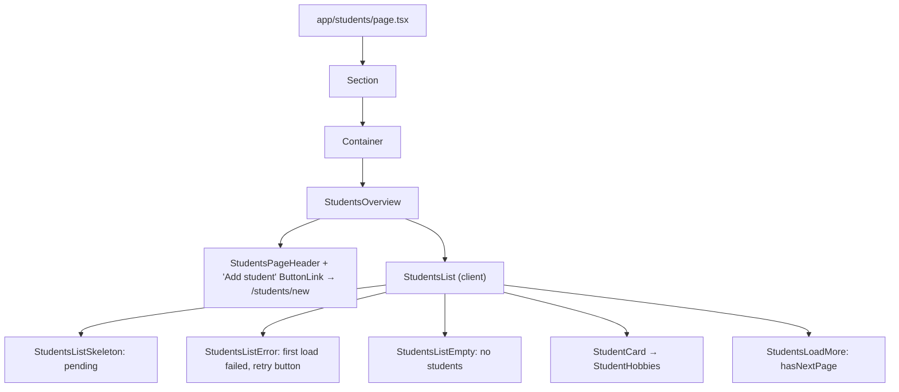
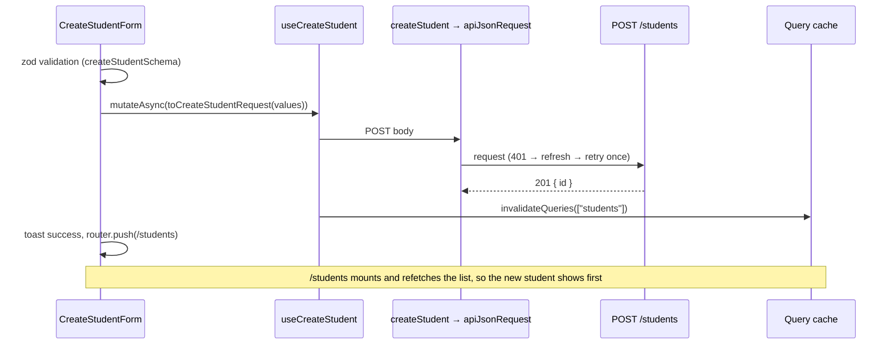

# Students

Teachers see their students on `/students` and add new ones on `/students/new`. Both pages are teacher-only; see `role-access.md`. Each `StudentCard` links to the student's page, `/students/[studentId]`, which is documented with courses in `student-courses.md`. Editing students and courses is documented in `student-editing.md`.

Feature code lives in `src/modules/students/`:

```text
students.config.ts         STUDENTS_CONFIG: form fields/ids, page size, query keys, validation limits, course labels
students.enums.ts          form field names/ids, input types, error codes, query params, Language/LanguageLevel/LearningGoal
api/students-api.ts        getStudents, createStudent, getStudent, updateStudent
api/student-courses-api.ts getStudentCourses, getStudentCourse, getAvailableCourseLanguages,
                           createStudentCourse, updateStudentCourse
api/*-server.ts            getStudentServer, requireStudentEditorServer (server-only)
schemas/                   studentFormSchema, studentCourseFormSchema (shared by create and edit forms)
hooks/                     useStudents, useCreateStudent, useUpdateStudent, useStudent, useStudentCourses,
                           useStudentCourse, useAvailableCourseLanguages, useCreateStudentCourse,
                           useUpdateStudentCourse, useCourseLanguageFilter
types/                     StudentCard, StudentsPage, StudentDetails, StudentCourse*, Create*/Update*Request/Response
utils/                     parseHobbies, to*Request / to*FormValues mappers, parseCourseLanguage, getCourseHref, ...
components/                StudentsOverview, StudentsList, Create*/Edit* forms, StudentFormFields,
                           StudentCourseFormFields, StudentProfile, StudentCourses, ...
```

## Endpoints

| Method | Path | Body / query | Response |
| --- | --- | --- | --- |
| `GET` | `/students` | `limit`, `offset` | `{ items: { id, name, job, hobbies }[], total }`, newest first |
| `POST` | `/students` | `{ name, email?, birthDate?, job?, hobbies? }` | `201 { id }` |
| `PATCH` | `/students/:studentId` | any of the create fields; `null` clears one | `200 { id }` |

`GET` and `POST` are teacher-only on the backend (`403` for other roles). `PATCH` is open to the creating teacher while the student is managed, or to the student themselves once they have their own account; see `student-editing.md`.

## Students Page



Request flow: `StudentsList → useStudents → getStudents → apiRequest → GET /students?limit=10&offset=n`.

Error handling:

- **First load fails:** `StudentsListError` shows a retry button that calls `refetch()`.
- **"Load more" fails:** a toast appears (`ERRORS.STUDENTS.LOAD_FAILED`). The loaded cards stay, and the button stays available to retry.
- **A background refetch fails:** the loaded cards are kept and no message is shown.

## Create Student



### Fields and validation

The schema is `components/create-student-form/schema.ts`. Its limits mirror the backend DTO:

| Field | Rule |
| --- | --- |
| `name` | required, trimmed, 1–255 |
| `email` | optional, valid email, ≤ 255 |
| `birthDate` | optional, ISO date from `<input type="date">` |
| `job` | optional, ≤ 255 |
| `hobbies` | optional, comma-separated text, ≤ 20 items, each ≤ 100 |

Fields render with the common `TextField`. Errors are linked to their inputs through `aria-describedby`.
