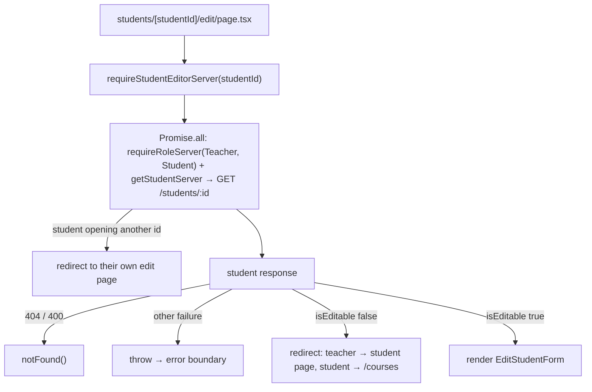
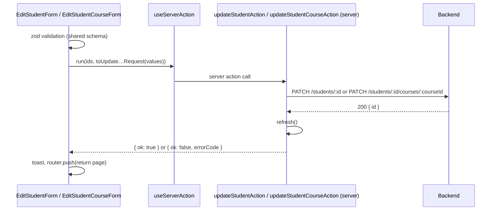

# Student Editing

Teachers and students can edit a student profile; teachers can edit the courses they teach. The backend decides who may edit a student and reports it as `isEditable` on `GET /students/:studentId`. The frontend only shows or hides edit entry points and guards the edit page from that flag.

## Who Can Edit

| What | Editor | Rule |
| --- | --- | --- |
| Student profile | the teacher who created the student | only while the student is **managed** (no own account yet); **not** the email |
| Student profile | the student themselves | only once they have their own account; **not** the email |

| Course | the teacher who teaches it | the language cannot be changed |

## Routes

| Route | Roles | Guard | Composes |
| --- | --- | --- | --- |
| `/students/[studentId]/edit` | teacher, student | `requireStudentEditorServer` | `EditStudentForm` with server-loaded student |
| `/students/[studentId]/courses/[courseId]/edit` | teacher | `requireRoleServer(Teacher)` | `EditStudentCourse` → `EditStudentCourseForm` |

Entry points use `EditStudentLink` (pencil `ButtonLink`):

- `StudentDetails` (teacher's student page) shows "Edit student" only when `student.isEditable`.
- The teacher's course page shows "Edit course".
- `/courses` shows "Edit profile", pointing to the student's own edit page.

## Edit Student Page Guard

The student edit page loads data on the server, so a viewer who may not edit never sees the form.

- The role check and the student read run together; the own-id redirect is still checked before the student response is used.
- `getStudentEditPageContent(role, studentId)` picks the title, back label and return link for both the guard redirect and the page.
- `serverApiRequest` (`src/modules/common/api/server-api-request.ts`, `server-only`) forwards the request cookies and returns `{ ok, data }` or `{ ok: false, status, errorCode }`. `getCurrentUserServer` uses the same helper.
- The course edit page has no server data guard: `EditStudentCourse` (Server Component) loads the course and shows `StudentResourceError` for a missing one. The backend only lets the course's teacher update it.

## Saving

- **Prefill:** `toStudentFormValues` / `toStudentCourseFormValues` turn `null` into `""` for inputs; hobbies are joined with `", "`.
- **Requests send every editable field.** Emptied fields become `null`, which clears them on the backend.
  - `toUpdateStudentRequest` is the same for both editors and has no `email`. `StudentFormFields` has no email input.
  - `toUpdateStudentCourseRequest` never sends `language`.
- **Shared with create:** `StudentFormFields`, `StudentCourseFormFields` and the schemas in `src/modules/students/schemas/` (`studentFormSchema`, `studentCourseFormSchema`) are used by both the create and edit forms. The create course form passes its `StudentCourseLanguageField` through `languageField`; the edit form has none.
- **Fresh data:** there is no client cache. A successful action calls `refresh()`, and the page it navigates to is rendered on the server from current backend data.

## Errors

| Case | Shown |
| --- | --- |
| `403 STUDENT_NOT_EDITABLE` (e.g. the student activated their account meanwhile) | `ERRORS.STUDENTS.NOT_EDITABLE` |
| any other student update failure | `ERRORS.STUDENTS.UPDATE_FAILED` |
| any course update failure | `ERRORS.COURSES.UPDATE_FAILED` |

All messages are frontend-owned (`ERRORS`), never backend text.
