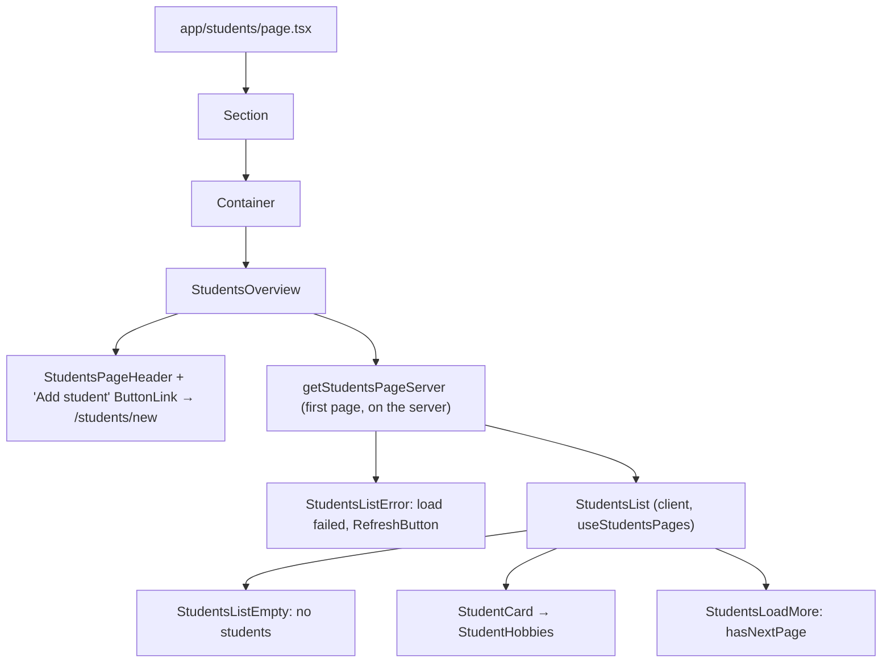
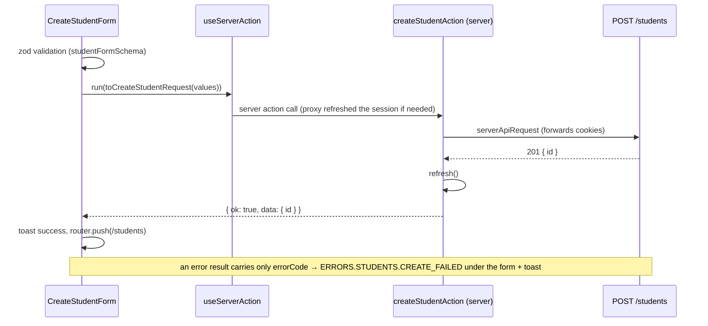

# Students

Teachers see their students on `/students` and add new ones on `/students/new`. Both pages are teacher-only; see `../architecture/role-access.md`. Each `StudentCard` links to the student's page, `/students/[studentId]`, which is documented with courses in `student-courses.md`. Editing students and courses is documented in `student-editing.md`.

Feature code lives in `src/modules/students/`:

```text
students.config.ts         STUDENTS_CONFIG: form fields/ids, page size, validation limits, course labels
students.enums.ts          form field names/ids, input types, error codes, query params, Language/LanguageLevel/LearningGoal
api/students-server.ts     getStudentsPageServer, getStudentServer, getStudentCoursesServer, getStudentCourseServer,
                           getAvailableCourseLanguagesServer (server-only reads)
api/require-student-editor-server.ts  edit-page guard (server-only)
actions/                   "use server": students, student courses, course documents (writes + "load more")
schemas/                   studentFormSchema, studentCourseFormSchema (shared by create and edit forms)
hooks/                     useStudentsPages, useCourseLanguageFilter, useUploadCourseDocument, useOpenCourseDocument
types/                     StudentCard, StudentsPage, StudentDetails, StudentCourse*, Create*/Update*Request/Response
utils/                     parseHobbies, to*Request / to*FormValues mappers, parseCourseLanguage, getCourseHref, ...
components/                StudentsOverview, StudentsList, Create*/Edit* forms, StudentFormFields,
                           StudentCourseFormFields, StudentProfile, StudentCourses, ...
```

## Endpoints

| Method | Path | Body / query | Response |
| --- | --- | --- | --- |
| `GET` | `/students` | `limit`, `offset` | `{ items: { id, name, job, hobbies }[], total }`, newest first |
| `POST` | `/students` | `{ name, birthDate?, job?, hobbies? }` | `201 { id }` |
| `PATCH` | `/students/:studentId` | any of the create fields; `null` clears one | `200 { id }` |

`GET` and `POST` are teacher-only on the backend (`403` for other roles). `PATCH` is open to the creating teacher or the student themselves, depending on `isEditable`; see `student-editing.md`.

## Students Page



Request flow: the first page is rendered by `StudentsOverview` (Server Component) through `getStudentsPageServer → serverApiRequest → GET /students?limit=10&offset=0`. "Load more" calls `loadStudentsPageAction(offset)` from `useStudentsPages`, which appends the page to local state. While the page loads, the root `loading.tsx` is shown.

Pages are fetched by offset, newest first. If a student is added between two loads, the next page shifts by one and repeats an already loaded card. `appendNewStudents` (`utils/append-new-students.ts`) drops cards whose `id` is already loaded, so no card appears twice and React keys stay unique. `hasNextPage` uses the latest `total` and stops when a page comes back empty.

Error handling:

- **First load fails:** `StudentsListError` shows a `RefreshButton` that re-renders the page on the server.
- **"Load more" fails:** a toast appears (`ERRORS.STUDENTS.LOAD_FAILED`). The loaded cards stay, and the button stays available to retry.

## Create Student



### Fields and validation

The schema is `schemas/student-form.schema.ts`, shared with the edit form. Its limits mirror the backend DTO:

| Field | Rule |
| --- | --- |
| `name` | required, trimmed, 1–255 |
| `birthDate` | optional, ISO date from `<input type="date">` |
| `job` | optional, ≤ 255 |
| `hobbies` | optional, comma-separated text, ≤ 20 items, each ≤ 100 |

Fields render with the common `TextField`. Errors are linked to their inputs through `aria-describedby`.

Self-check questions: [review-fixes-qa.md](review-fixes-qa.md).
