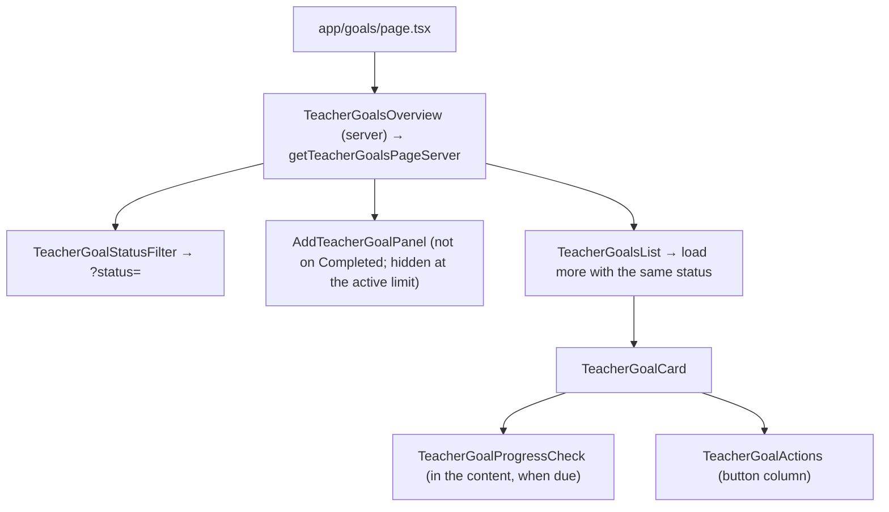
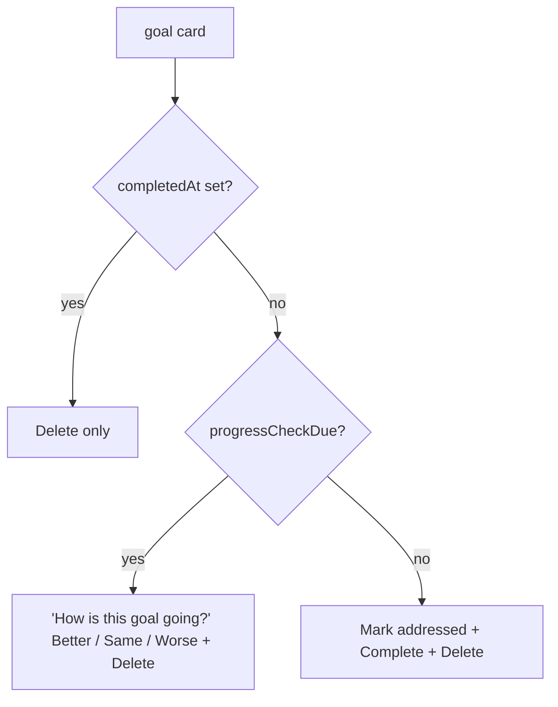
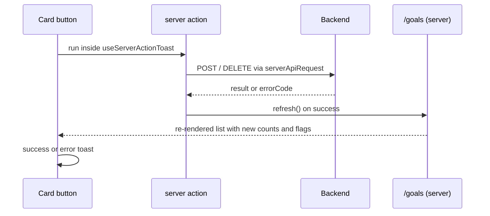

# Teacher Goals

A teacher keeps their own improvement goals on `/goals`. They mark a goal each time they work on it, answer a progress check every few marks, and complete the goal when done. Feature code lives in `src/modules/teachers/`; the backend rules are in `back/docs/teachers/teacher-goal-endpoints.md`.

## Route

| Route | Role | Composes |
| --- | --- | --- |
| `/goals?status=` | teacher | `TeacherGoalsOverview`: status filter, "Add goal" panel, goals list |

`app/goals/page.tsx` reads `status` with `parseTeacherGoalStatus`; a missing or unknown value means `active`. The page starts the first list request before `requireRoleServer`, so it runs alongside `GET /users/me` (see `../architecture/api-requests.md`).

## Endpoints

| Method | Path | Response |
| --- | --- | --- |
| `GET` | `/teachers/me/goals?status=&limit=&offset=` | `{ items, total, activeTotal, maxActive }`; each item has `attemptCount` and `progressCheckDue` |
| `POST` | `/teachers/me/goals` | `201 { id }`; `409` at the active-goal limit |
| `DELETE` | `/teachers/me/goals/:goalId` | `204` |
| `POST` | `/teachers/me/goals/:goalId/attempts` | `204` |
| `POST` | `/teachers/me/goals/:goalId/progress-checks` | `201 { id }`, body `{ status: success \| same \| worse }` |
| `POST` | `/teachers/me/goals/:goalId/complete` | `200 { id }`; cannot be undone |

The backend takes the teacher from the session, so a teacher only ever sees and changes their own goals.

## Page

A failed first load shows an error with a retry button; an empty list shows a message for the selected filter.

## Status filter

The filter works like the course language filter (see `../students/student-courses.md`): it writes `?status=` with `router.replace` inside a transition, the server re-renders the page, and the backend does the filtering. Active is the default and keeps the URL clean. While the new list loads, the old one stays visible and the filter is dimmed.

## Card actions

What a card shows depends only on fields from the backend. The frontend never counts marks itself.

- From `sm` up, the buttons stack in a column on the right of the card; on phones they sit below the text. The progress question is too wide for that column, so it stays in the card's content as its own block.
- Complete and Delete open a `ConfirmDialog` first; Complete warns that a goal cannot be reopened. The dialog closes when the request finishes, whatever the result.
- Better / Same / Worse send `success` / `same` / `worse`. Answering does not complete the goal.

## Writes

- The list keeps loaded pages in client state. It remounts when the page key changes: the key covers the status filter and each goal's id, mark count, check flag and completion. That's how a mark or a check shows up right away.
- Error toasts use frontend messages from `ERRORS.TEACHER_GOALS`, mapped from the backend `errorCode` (not found, already completed, progress check pending / not due, active limit); unknown codes fall back to a generic message per action.
- Double clicks are safe: the backend locks the goal and answers the second request with `409`.

Key files: `actions/teacher-goals-actions.ts`, `api/teacher-goals-server.ts`, `components/teacher-goal-actions/`, `utils/get-goals-page-key.ts`, `common/hooks/use-server-action-toast.ts`.
